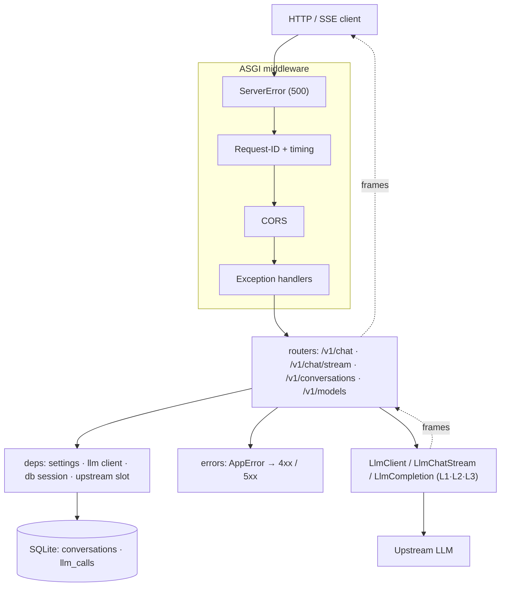

# llm-app-engineering

[](https://github.com/Tanking020/llm-app-engineering/actions/workflows/ci.yml)


> **An async backend for LLM applications, built around three invariants.**
>
> **The upstream is replaceable** — every model call goes through a single adapter; the HTTP
> layer cannot even import `httpx` (enforced by a lint rule, not a convention).
> **Failures are legible** — one response envelope with stable machine-readable codes and request
> IDs, including streaming-aware error frames that distinguish *"the model said nothing"* from
> *"the upstream never answered"*.
> **Spend is reconcilable** — one billing row per call, with a four-state machine that separates
> *"is the amount correct"* from *"is the content empty"*.
>
> 206 tests · 93% branch coverage · CI on every push.

---

## 概览

面向 LLM 应用的异步 API 服务。对外提供 **SSE 流式对话**与会话管理接口，对内把「流式输出、
上游故障、并发与成本、可对账账单」当作一等公民来设计，而不是事后补丁。

技术栈：FastAPI · SQLAlchemy 2.1 async（SQLite，代码保持可切 PostgreSQL）· httpx · pydantic v2 ·
pydantic-settings · uv（锁文件 + 独立解释器）· ruff · mypy `--strict` · pytest。

设计取向有三条硬约束，贯穿整个仓库：

| 约束 | 落地方式 | 怎么证明 |
|---|---|---|
| **上游可替换** | 所有上游调用穿过 `LlmClient` / `LlmChatStream`；路由层零 `httpx` | lint 规则 `TID251` 把「绕过适配器」变成 CI 会红的事 |
| **失败可解释** | 单一错误出口，业务码与 HTTP 码解耦，`X-Request-ID` 恒等于 body 里的 `request_id` | 错误形状被 7 个契约用例钉住 |
| **成本可核算** | 每次调用落一行账单；流式记账两阶段提交 | 并发 6 条流时数据库连接池峰值 **2** |

## 能力一览

| 能力 | 现状 | 关键实现 |
|---|---|---|
| **SSE 流式对话** | ✅ 真调上游 `stream=true` | 自造状态帧 + 逐字正文 + `finish_reason` + token 用量；首个数据帧 **60 ms** |
| **流式失败的完整表意** | ✅ | 状态码层（pre-flight → 502）/ 协议层（坏帧跳过或中止 + WARNING）/ 业务层（`STREAM_NO_CONTENT`、`STREAM_FAILED` 帧） |
| **上游故障三档翻译** | ✅ | L1 连不上 / L2 状态码不对 / L3 结构不可信，全部在适配器内分类 |
| **会话增删改查** | ✅ | 游标分页；账单统计用 `outerjoin + group` 聚合，语句数与条目数无关（📎 N=100 时 2 条，朴素写法 101 条） |
| **多租户鉴权** | ✅ | `X-API-Key` → sha256 → 用户（库里只有 hash）；每次查询带 `owner_id`；越权一律 **404**（不泄露存在性）；静态检查兜住「新增路由忘挂鉴权」 |
| **可对账账单** | ✅ | `completed` / `aborted` / `no_content` / `pending` 四态（`StrEnum`） |
| **并发与成本护栏** | ✅ | 上游信号量（超限 **503 + `Retry-After`**）+ `max_tokens` 上限 + 输入三上限 + 上游**总时长**上限（流式发 `STREAM_TIMEOUT` 帧）+ **每用户令牌桶**（60 次/分 + 突发 20 → **429 `Retry-After`**） |
| **容器镜像** | ✅ 真构建通过 | 多阶段构建（builder 不落地）、非 root（uid 10001）、exec 形式 CMD（SIGTERM 直达应用）；📎 真 `docker build` 通过：镜像 **283 MB**、`whoami=app`、`alembic upgrade head` exit 0、`/health` 200、无 key 401、`docker stop` 窗口内 **ExitCode=0**（13a-1，2026-11-18） |
| **优雅停机** | ✅ | `timeout_graceful_shutdown`（默认 30 s）：窗口内跑完 / 超窗口明确切断；📎 有**真信号**验收脚本 `scripts/probe_graceful_shutdown.py` |
| **统一错误形状** | ✅ | `{"error": {code, message, request_id}}`，422 附加 `details` |
| **生产环境防护** | ✅ | `prod` + `DEBUG=true` 启动即失败；`/docs`、`/redoc`、`/openapi.json` 一并关闭 |
| **可观测性** | ✅ | 一行一 JSON 的访问日志（含客户端 IP / request_id）；5 个进程内指标 + `/metrics`（nginx 侧 `return 404` 硬阻断）+ 3 条告警规则（📎 `promtool check rules` 验过）；⚠️ 无告警接收端（Prometheus/Alertmanager 未部署） |

> 说明：`POST /v1/chat`（非流式）已**真调上游**（决策 53）：一次请求一次响应，落一行账单，与流式共用同一条 pre-flight 顺序和同一个并发闸门。

## 架构



**依赖方向是单向的**：`api/` → 根层模块（`config` · `constants` · `database` · `errors` · `llm_client` ·
`models` · `schemas` · `auth` · `ratelimit` · `metrics` · `logging_setup`），**根层从不反向 import `api/`**；
`schemas.py` 只放契约，`config.py` 只读不写。
上游调用只允许出现在适配器里 —— 这条不是靠 code review 记住的，是 `pyproject.toml` 里的一条规则。
（`services/` 层的拆分已在计划中：路由文件目前同时承担校验编排与帧协议，加检索功能前会按
「HTTP 契约变化」与「业务规则变化」分开，见 [#63](docs/todos.md)。）

中间件栈的真实顺序（由 `app.build_middleware_stack()` 逐层取得）：
`ServerError → (ExceptionTelemetry) → Request-ID → CORS → Exception → AsyncExitStack → Router`。
顺序有语义：`ServerErrorMiddleware` 在最外层，所以 **500 响应不经过 CORS 中间件** —— 由异常处理器
自己补 CORS 头兜住（[#57](docs/todos.md) 已解决，13c-1）。

## 快速开始

前置：[uv](https://docs.astral.sh/uv/)（唯一需要手动准备的工具）。

```bash
git clone https://github.com/Tanking020/llm-app-engineering.git
cd llm-app-engineering

uv sync                        # 按 uv.lock 还原依赖（含 Python 3.12）
cp .env.example .env           # Windows: Copy-Item .env.example .env
#   编辑 .env，填入 LLM_API_KEY

uv run python -m app           # 监听地址 / 端口 / reload 全部读 .env
```

打开 <http://127.0.0.1:8000/docs> 查看交互式 API 文档（仅 `APP_ENV=dev` 时开启）。

> 用 `uv run python -m app` 而不是 `uvicorn app.api.app:app --reload`：前者的 `HOST` / `PORT` /
> `DEBUG` 来自配置；后者会**静默绕过**它们（`.env` 写 `PORT=9001` 也不会生效）。

📋 **所有命令（本地跑 / curl 配方 / 质量门 / 迁移 / 容器 / 日志指标 / 压测 / 上线检查 / 演示动线 / 排错）→ [RUNBOOK.md](RUNBOOK.md)**

### 用容器起整套（生产形态）

前置：Docker Desktop（Linux 容器）。

```bash
docker compose build --build-arg PIP_INDEX_URL=https://pypi.tuna.tsinghua.edu.cn/simple
docker compose up -d            # ① 一次性迁移 → ② app 健康 → ③ nginx 就绪
docker compose ps               # app / proxy 都是 healthy；migrate 是 exited 0
```

入口是 **nginx 的 80**（`http://127.0.0.1/health`）；⚠️ **宿主上的 8000 已不再发布** ——
app 只在 compose 网络内被反代访问（[决策 46](docs/decisions.md)）。空库首启由 `migrate` 服务先跑完迁移，
app 通过 `depends_on: service_completed_successfully` 等它（[决策 45](docs/decisions.md)）。

细节（构建参数、日志打平命令、四处联动的网络/信任名单）见 [docs/dev-environment.md](docs/dev-environment.md) §8.0d。

## 使用

> **鉴权**：除 `/health`、`/health/ready`、`/metrics`、`/v1/models*` 外，所有端点都要 `X-API-Key`。
> 库里只存 sha256，**明文只在签发时显示一次**：
>
> ```bash
> uv run python -m app.keys create --user me --label laptop   # 输出明文，只给一次
> export KEY=<粘贴明文>            # Windows PowerShell: $env:KEY = "<粘贴明文>"
> ```

### 流式对话（SSE）

```bash
curl -N -s http://127.0.0.1:8000/v1/chat/stream \
  -H "X-API-Key: $KEY" \
  -H 'Content-Type: application/json' \
  -d '{"messages":[{"role":"user","content":"列出三种排序算法"}]}'
```

```text
data: {"status": "thinking"}

data: {"delta": "1"}

data: {"delta": "."}

data: {"finish_reason": "stop"}

data: {"usage": {"prompt_tokens": 44, "completion_tokens": 63, "total_tokens": 107}}

data: [DONE]
```

帧契约（7 类，含 2 类错误帧）见 [docs/api.md](docs/api.md)。
两个容易被误读的点：

- **`200` 不代表成功**：响应头一旦发出就改不了状态码，所以流中途失败只能表达成 `error` 帧。
  真正的连接 / 状态码级失败在 **pre-flight** 阶段就被拦成 `502`。
- **收到 `finish_reason` 不代表内容结束**：`usage` 帧与最后一个 `delta` 可能排在它之后，
  正确的封笔信号是 `[DONE]`。

### 会话与账单

```bash
curl -s -X POST http://127.0.0.1:8000/v1/conversations \
  -H "X-API-Key: $KEY" \
  -H 'Content-Type: application/json' -d '{"title": "第一次对话"}'

curl -s http://127.0.0.1:8000/v1/conversations?limit=20 \
  -H "X-API-Key: $KEY"                  # 游标分页 + 账单统计
```

### 错误契约

```json
{
  "error": {
    "code": "LAST_MESSAGE_NOT_USER",
    "message": "最后一条消息必须是 user，当前是 assistant",
    "request_id": "1b085bd5c5b3"
  }
}
```

客户端**只认 `code`**（稳定）；`message` 可以改文案。`X-Request-ID` 响应头与 body 里的
`request_id` 恒等 —— 用户报障时给这一个字符串就能定位到那一条日志。

## 关键设计决策

每条决策都记录了**代价**与**重审条件**（[docs/decisions.md](docs/decisions.md)，54 条 ADR）。以下是影响最大的几条：

| 决策 | 选择 | 为什么 | 代价 / 何时重审 |
|---|---|---|---|
| 流式协议 | **SSE** | 单向推送够用；能走 HTTP/1.1、能过代理、能直接用 `curl` 调试 | 需要双向交互时重议（WebSocket） |
| 上游隔离 | **适配器 + lint 强制** | 换上游只改一个文件；错误分类只有一处 | 多一层间接调用 |
| 流式记账 | **两阶段：先 `commit` 一行 `pending`，拿到 usage 再改状态** | 若在流结束时才写，数据库写事务横跨整条流 → SQLite 单写者 → 并发流完全串行化（实测 4 条并发 **2.60 s → 0.71 s**） | 每请求多一次独立提交；需维护状态机 |
| 列表分页 | **游标**（`id > N`），`total` 为辅 | offset 在「翻页期间删数据」时会**漏掉一条**（实测），用户永远看不到 | 不支持随机跳页 |
| 错误形状 | **统一 envelope + 稳定业务码** | 客户端只写一份解析代码；新增错误码不动客户端 | 500 不经过 CORS 中间件，靠处理器补头（[#57](docs/todos.md) 已解决） |
| 上游 4xx | **按「客户端能否自己修好」分流** | 429 透传 + `Retry-After`，避免把上游限流伪装成网关故障而引发重试风暴（每次重试都真实计费） | 需识别 body 中的超长标记（未对真实上游验证） |
| 并发超限 | **有限等待 → 503 + `Retry-After`** | 纯排队会让被挡用户等 3 s 以上才见到响应头（实测 3.05 s vs 0.50 s） | 单进程信号量；多副本需下沉到 Redis / 网关 |
| 配置错误 | **启动即失败**（`prod` + `DEBUG=true`、越界值） | 配错在启动时暴露，而不是在第一次请求时 | 需要维护跨字段校验 |

## 可靠性与成本控制

| 机制 | 参数 | 行为 |
|---|---|---|
| 上游并发闸门 | `MAX_CONCURRENT_UPSTREAM_CALLS=4` | 超出后等待 `UPSTREAM_QUEUE_TIMEOUT=1.0 s`，仍未拿到槽位 → **503 + `Retry-After`** |
| 输出上限 | `MAX_TOKENS_CEILING=4096` | 超限 → **400**；未指定 → 填上限（**只接受或拒绝，从不改写**） |
| 输入上限 | 单条 20 000 字符 / 100 条 / 合计 60 000 字符 | 分别拦下「巨型单条」「海量短消息」「乘积爆炸」 |
| 客户端断开 | — | `aclose()` 让上游实测 **4 ms 内**停止生成；已产生的用量仍落账单（`aborted`） |
| 账单对账 | 四态 `StrEnum` | `status` 只回答「金额准不准」，不回答「内容空不空」 |
| 入口与部署 | nginx 独占 80，app 只 `expose` | 空库首启由一次性 `migrate` 服务先跑完（决策 45 / 46）；宿主 8000 不再发布 |
| 日志 | 一行一 JSON（`client` / `request_id` / `duration_ms`） | 轮转交给 Docker（`10m × 3`）；nginx 自己的 413/502/504 也回同一 JSON 信封（[决策 52](docs/decisions.md)，[#89](docs/todos.md) 已解决） |
| 生产防护 | `APP_ENV=prod` | 交互式文档全部关闭；`DEBUG=true` 直接拒绝启动 |

单请求最坏成本 ≈ **$0.05**（按 1 M 上下文上限 + 4096 输出上限推算，见 [docs/architecture.md](docs/architecture.md)）。

## 测试与质量门

```bash
uv run ruff format .    # 格式化
uv run ruff check .     # lint（E/F/I/UP/B/TID）
uv run mypy .           # 类型检查（strict + warn_unreachable）
uv run pyright          # 类型检查（与编辑器 Pylance 对齐，只拦 error）
uv run pytest -q        # 206 个用例，约 15 s
```

| | 结果 |
|---|---|
| `ruff check` / `format --check` | 全绿（51 files） |
| `mypy --strict` | 全绿（54 source files，含 `tests/`、`scripts/` 与 `playground/`） |
| `pyright`（`pyrightconfig.json`） | 0 errors（与编辑器同一套判断；📎 变异「改回 `getattr` 写法」→ mypy 仍绿而 pyright **红**） |
| `pytest -q` | **206 passed** |
| 分支覆盖 | **93%**（`llm_client.py` / `models.py` / `errors.py` / `logging_setup.py` / `constants.py` 100%） |
| CI | `.github/workflows/ci.yml`：push / PR 跑上面五条 + `uv sync --locked` |

测试策略有三条判据（细节见 [tests/README.md](tests/README.md)）：

| 判据 | 做法 | 为什么必须这样 |
|---|---|---|
| **不碰真上游** | `dependency_overrides` 注入假对象；假对象**继承真类**，签名漂移由 mypy 抓 | 测试要能离线跑、可重复、不花钱 |
| **不碰开发库** | `conftest.py` 在 `import app` 之前把 `DATABASE_URL` 指到临时库；每个用例清表 | 「测了一下，开发库空了」是可以避免的事故 |
| **必须走 HTTP** | 测试不 import 路由函数，只认 URL | 中间件、异常处理器、依赖注入才会真实经过 |
| **DDL 归迁移独占** | `tests/test_migrations.py`：`alembic check` 无漂移 + 迁移建出的**结构**（列 / 外键 / 索引 / 唯一约束，用 `PRAGMA` 读）与 `create_all` 一致 | 模型改了忘生成迁移时，其余用例全绿；而比「SQL 文本」会在 SQLite 的 batch 重建表后误报（表名带引号、列挪到末尾） |
| **鉴权不靠自觉** | `tests/test_source_rules.py`：`ast` 断言「除白名单外每个路由都声明了 `CurrentUserDep`」+「每个写路由都有 `await db.commit()`」 | 「按路由挂依赖」是显式写法 —— 新增路由忘写就是**任何人可调**，只能靠静态检查兜 |

**「全绿」不等于「断言有牙」。** 每批用例写完抽 3 ~ 5 处做变异测试（故意改坏一行源码，看它红不红）。
📌 **次数与成败不在这里累计**（两处维护必然漂）：逐条证据在 [docs/DEVLOG.md](docs/DEVLOG.md) §二 各条流水的 📎 段。
其中一次失败直接暴露了方法论问题：把枚举值拼成 `"pengding"` 时**四道门全绿** ——
`mypy` 只检查成员名，`ruff` 只看格式。于是补了一条「值必须被断言钉住」的守卫用例。

## 实测结果

以下数字全部来自本仓库的实测记录（环境与方法见 [docs/DEVLOG.md](docs/DEVLOG.md)）：

| 指标 | 改前 | 改后 | 条件 |
|---|---|---|---|
| 首个 SSE 数据帧 | 845.8 ms | **60.0 ms** | 真实上游；加状态帧后不再空等 |
| 4 条并发流总耗时 | 2.60 s | **0.71 s** | 真 uvicorn + 真 TCP + SQLite（修写事务横跨整条流） |
| 数据库连接池峰值（6 条流） | 6 | **2** | 同上 |
| 外键查询（5 万行） | 全表扫 | **快 25 倍** | 加 `index=True` |
| 连接复用（20 次请求） | 20 条 TCP | **1 条 TCP（快 6.28 倍）** | httpx 连接池 |
| 上游停止生成的延迟 | — | **4 ms** | 客户端断开后 `aclose()` |
| 容器空库首启 | 首请求 `no such table` | **migrate 先跑 → app healthy → 201** | 隔离项目 + 全新卷（决策 45） |
| 反代下的流式 | `proxy_buffering on` 一次性到齐（2.07 s） | **逐帧 0.07 / 0.47 / 0.87 …** | `proxy_buffering off`（决策 46） |
| 发版不停在途流 | 依赖者先停会掐断 | **在途流跑到 4.8 s 收到 `[DONE]`** | `stop_signal: SIGQUIT`（决策 46） |

## 项目结构

```text
.
├── src/app/
│   ├── api/app.py          # 应用对象 · lifespan · 路由
│   ├── api/deps.py         # 依赖：settings / llm client / db session / upstream slot
│   ├── llm_client.py       # 上游适配器（唯一 import httpx 的文件）
│   ├── schemas.py          # 对外契约（请求 / 响应 / 分页 / 统计）
│   ├── errors.py           # AppError + 业务码↔状态码 + 4 个处理器（单一出口）
│   ├── models.py           # ORM：Conversation / LlmCall（含四态枚举）
│   ├── database.py         # engine / session factory / 外键 PRAGMA
│   ├── config.py           # 全部可调参数 + 跨字段校验
│   ├── logging_setup.py    # dictConfig 单一出口
│   ├── constants.py        # 跨模块必须一致的常量（如头名 X-Request-ID / X-API-Key）
│   ├── auth.py             # API key 生成 / sha256 哈希 / 查属主（只存 hash，明文只给一次）
│   ├── keys.py             # API key 运维 CLI：python -m app.keys create/list/revoke
│   ├── ratelimit.py        # 令牌桶限流（按 user 分桶、时钟可注入）
│   ├── __main__.py         # 启动入口（让 settings.host/port/debug 生效）
│   └── main.py             # CLI：上游连通性检查
├── alembic/                # 数据库迁移：env.py（连库 + 指向 metadata）+ versions/（每个迁移一个文件）
├── alembic.ini             # 迁移配置（连接串不写在这里，由 settings 注入）
├── tests/                  # 206 个用例，按「测哪一层」分为 21 个文件
├── docs/                   # 决策 · 架构 · 契约 · 开发日志 · 待办 · 上线自检
├── notes/                  # 机制与实测的深度笔记
├── Dockerfile              # 多阶段构建 + 非 root + exec 形式 CMD（13a-1）
├── .dockerignore           # 构建上下文只有 26 个文件 / 471 KB（排掉 .venv 113 MB、.env）
├── docker-compose.yml      # 单机栈：migrate（一次性）→ app（不发布端口）→ proxy（nginx 独占 80）
├── deploy/nginx.conf       # 反代：关缓冲（SSE）、上游重解析、body 上限、健康端点、**反代层 413/502/504 回 JSON 信封**（决策 52）、`/metrics` 404 硬阻断
├── playground/             # 一次性实验脚本（不参与交付）
├── scripts/                # 验收探针（手工跑、不进 CI）：probe_graceful_shutdown.py（决策 39）、fake_upstream.py + loadtest_chat_stream.py（决策 51）
├── pyproject.toml          # 依赖、工具配置、lint 边界的唯一来源
└── .github/workflows/ci.yml
```

## Roadmap

| 状态 | 内容 |
|---|---|
| ✅ **已完成** | HTTP/ASGI 地基 → 参数与契约 → 依赖注入 → 错误处理与 `lifespan` → 中间件与 CORS → 异步正确姿势 → SSE 流式 → 上游适配器封层 → 持久化与账单 → 配置 / 日志 / 安全 → 回归测试 → CI → **容器化（镜像 + 一次性迁移 + nginx 入口）** → **访问日志带客户端 IP** → **日志 JSON 化 + 轮转** → **多租户鉴权** → **指标与告警**（[#66](docs/todos.md)）→ **压测定容量**（[#76](docs/todos.md)，[决策 51](docs/decisions.md)）→ **非流式接真上游**（[决策 53](docs/decisions.md)） |
| 🔜 **上线前剩余（P1 / P2）** | 连接池参数按 13f 数字显式设定（[#59](docs/todos.md)）· 日配额与预算告警（门 4）· 告警接收端 Prometheus / Alertmanager（门 5）· 灰度与回滚预案（门 6，`P2`）· 数据治理：备份演练 / 保留策略 / PII（门 7）|
| 🧾 **Step 13 收口报告** | [docs/step13-closeout.md](docs/step13-closeout.md)：交付清单 / 七道门 / 数字总表 / **未做清单** / 可讲给评审者的三件事（2026-11-21 快照，定级 **L3**） |
| 📋 **规划中** | 消息持久化（`messages` 表）· 检索增强（混合检索 + 重排 + 量化评估）· 工具调用与多步规划 |

完整的 94 条待办（含现状证据与档期）见 [docs/todos.md](docs/todos.md)；阶段状态见 [docs/roadmap.md](docs/roadmap.md)。

## 文档

| 想知道 | 去哪 |
|---|---|
| 为什么这么设计、放弃了什么、何时该重审 | [docs/decisions.md](docs/decisions.md)（54 条 ADR） |
| 系统长什么样（中间件栈 / ER / 帧序 / 状态机） | [docs/architecture.md](docs/architecture.md) |
| 端点契约与真实响应样本 | [docs/api.md](docs/api.md) |
| 什么时候做了什么、踩了什么坑、证据 | [docs/DEVLOG.md](docs/DEVLOG.md) |
| 离「敢上线」还差什么 | [docs/production-readiness.md](docs/production-readiness.md) |
| 测试怎么跑、两个连接池谁占谁 | [tests/README.md](tests/README.md) |
| 机制、协议与实测的深度笔记 | [notes/](notes/) |
| 改代码必须满足什么 | [CONTRIBUTING.md](CONTRIBUTING.md) |

## Contributing

见 [CONTRIBUTING.md](CONTRIBUTING.md)：质量门、提交规范、命名与注释约定、测试要求，以及
「改了什么就要更新哪个文档」的清单。

## License

[MIT](LICENSE)
