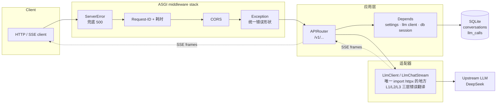

# llm-app-engineering

[](https://github.com/Tanking020/llm-app-engineering/actions/workflows/ci.yml)


> **English** — A production-minded LLM backend service built from an empty directory:
> async FastAPI + SSE streaming + upstream adapter + SQLite accounting + a 93-case
> regression suite (92% branch coverage) gated by CI. Every design choice has a written
> ADR, every test claim is verified by mutation testing, and every "silent failure"
> found during development is logged with its evidence. Roadmap: FastAPI service →
> native LLM API → RAG → Agent, then ship it.

---

一个**从零搭起来的 LLM 应用后端**：工程规范先行，逐阶段长大，最终目标是**对外上线**的
RAG 知识库问答服务。当前处于**阶段 1 · FastAPI 服务**（Step 1 ~ 12 完成，Step 13 部署未开始）。

技术选型的门槛不是「能不能跑」，而是：**如果这个接口明天给 1000 个真实用户用，够不够？**

## 现在有什么

| 能力 | 状态 | 证据 |
|---|---|---|
| 真实 LLM 流式对话（SSE） | ✅ | 真调上游 DeepSeek；状态帧 + 逐字正文 + `finish_reason` + token 用量；📎 首帧 60ms |
| 上游适配器封层 | ✅ | 路由层零 `httpx`、零 `try/except`（由 lint 规则 `TID251` 机械保证） |
| 可对账的账单 | ✅ | `llm_calls` 表四态（`completed` / `aborted` / `no_content` / `pending`），并发 6 条流时连接池峰值 **2** |
| 统一错误形状 | ✅ | 任何错误都是 `{"error":{code,message,request_id}}`；`X-Request-ID` 恒等于 body 里的 `request_id` |
| 并发与成本护栏 | ✅ | 上游并发闸门（超限 **503 + `Retry-After`**）+ `max_tokens` 上限 + 输入侧三个上限 |
| 自动化回归 | ✅ | **93 个用例**（含真 uvicorn 并发测试与穿过适配器的真实 HTTP 路径）；**47 次变异测试、42 次被抓到** |
| 一键质量门 | ✅ | `ruff` / `mypy --strict` / `pytest`，**GitHub Actions 推送即跑** |

> ⚠️ **尚不能上线**：无鉴权 / 无限流 / 无 `Dockerfile` / 无指标，且 `/v1/chat`（非流式）仍是 `echo` 占位。
> 完整缺口与档期见 [docs/production-readiness.md](docs/production-readiness.md)。

## 架构

一次请求穿过的层（细节与真实样本见 [docs/architecture.md](docs/architecture.md)）：



**分层原则**：路由只做「校验 → 查库 → 调适配器 → 返回」，上游错误的分类与重试语义只在适配器里。
这样换上游（DeepSeek → OpenAI → 自建 vLLM）只改一个文件。

## 快速开始

前置：安装 [uv](https://docs.astral.sh/uv/)（唯一需要手动准备的工具）。

```bash
git clone https://github.com/Tanking020/llm-app-engineering.git
cd llm-app-engineering

uv sync                        # 按 uv.lock 还原逐位一致的依赖环境（含 Python 3.12）
cp .env.example .env           # Windows PowerShell: Copy-Item .env.example .env
#   至少在 .env 里填 LLM_API_KEY

uv run python -m app           # 启动 HTTP 服务（读 .env 的 HOST / PORT / DEBUG）
#   打开 http://127.0.0.1:8000/docs  —— 自动生成的交互式 API 文档（仅 dev 环境开启）
```

> ⭐ 用 `uv run python -m app` 而不是 `uvicorn app.api.app:app --reload`：
> 前者的监听地址 / 端口 / 是否 reload 都读 `.env`；后者会**静默绕过**这些配置。
>
> 阶段 0 的 CLI 仍可用：`uv run python -m app.main ping` 验证上游连通性。

## 接口

| 方法 | 路径 | 说明 |
|---|---|---|
| GET | `/health` · `/health/ready` | liveness（不碰外部依赖）· readiness（探库，失败 503） |
| GET | `/v1/models` · `/v1/models/latest` · `/v1/models/{name}` | 模型清单（未知模型 404） |
| GET | `/v1/upstream/models` | **真实调上游**，字段白名单（10 键 → 3 字段） |
| POST | `/v1/chat` | 非流式（⚠️ 仍为 `echo` 占位，[#46](docs/todos.md)） |
| POST | `/v1/chat/stream` | **SSE 流式**，真调上游，每次调用落一行账单 |
| POST/GET | `/v1/conversations` | 新建 · **游标分页**列表（含账单统计） |
| GET/PATCH/DELETE | `/v1/conversations/{id}` | 详情 · 改标题 · 删除（计费记录 `SET NULL` 保留） |

请求/响应真实样本、错误码、SSE 帧契约、逐条 curl 命令 → **[docs/api.md](docs/api.md)**。

## 质量门

```bash
uv run ruff format .          # 1. 格式化
uv run ruff check . --fix     # 2. lint（E/F/I/UP/B/TID）
uv run mypy .                 # 3. 类型检查（strict，含 tests/ 与 playground/）
uv run pytest -q              # 4. 回归（93 个用例，约 12s，不碰真上游、不碰开发库）
```

| 检查 | 当前结果 |
|---|---|
| `ruff check .` | All checks passed |
| `ruff format --check .` | 32 files already formatted |
| `mypy .` | Success: no issues found in 32 source files |
| `pytest -q` | 93 passed |
| `pytest --cov` | 服务代码**分支**覆盖 **92%**（`llm_client.py` 100%）。不设 `--cov-fail-under`：覆盖率用来找缺口，守行为靠断言 |
| GitHub Actions | `.github/workflows/ci.yml`：上面四条**推送即跑** |

**「全绿」不等于「断言有牙」**：每批用例写完要抽 3 ~ 5 处做**变异测试**
（故意改坏一行源码，看测试红不红，再还原）。累计 **47 次、42 次抓到**，
5 次抓不到的全部记了原因 —— 详见 [docs/DEVLOG.md](docs/DEVLOG.md)。

## 项目结构

```text
.
├── README.md                    # 本文件：面向访客
├── CONTRIBUTING.md              # 开发约定：改代码前后必须满足什么
├── pyproject.toml / uv.lock     # 依赖与工具配置的唯一事实来源
├── .env.example                 # 配置模板（真值放 .env，不提交）
├── .github/
│   ├── workflows/ci.yml         # 质量门：push / PR 自动跑
│   └── copilot-instructions.md  # AI 协作指令（新会话自动加载）
├── docs/                        # 项目文档（台账 / 决策 / 架构 / 接口）
├── src/app/                     # 应用代码
│   ├── config.py                # 全部可调参数（类型安全 + 跨字段校验）
│   ├── logging_setup.py         # dictConfig 唯一出口
│   ├── schemas.py               # 对外数据契约
│   ├── errors.py                # AppError + 码↔状态码 + 4 个处理器（单一出口）
│   ├── llm_client.py            # 上游适配器：唯一 import httpx 的文件
│   ├── database.py / models.py  # 引擎 / 会话工厂 / ORM
│   ├── __main__.py              # 启动入口（让 settings.host/port/debug 生效）
│   └── api/app.py + api/deps.py # 应用对象 / lifespan / 路由 / 依赖
├── tests/                       # 93 个用例：按「测哪一层」分家（见 tests/README.md）
├── playground/                  # 实验区：一次性验证代码，不参与交付
└── notes/                       # 学习笔记（换项目也成立的知识，将独立成库）
```

**为什么用 `src` 布局**：扁平布局下 `import app` 能成功只是因为「当前目录恰好在 `sys.path` 里」；
`src` 布局必须先真正安装项目才能导入 —— 打包配置写错会**立刻**报错，而不是等别人 `pip install` 之后。

## 文档地图

| 想知道 | 去哪 |
|---|---|
| 做到哪了、下一步做什么 | [docs/roadmap.md](docs/roadmap.md) |
| 什么时候做了什么、踩了什么坑、证据 | [docs/DEVLOG.md](docs/DEVLOG.md) |
| 还剩哪些事（#1 ~ #77） | [docs/todos.md](docs/todos.md) |
| 为什么这么设计、放弃了什么 | [docs/decisions.md](docs/decisions.md)（30 条 ADR） |
| 七层栈 / ER / 帧序 / 状态机 | [docs/architecture.md](docs/architecture.md) |
| 端点契约与响应样本 | [docs/api.md](docs/api.md) |
| 离上线还差什么 | [docs/production-readiness.md](docs/production-readiness.md) |
| 测试怎么跑、两个连接池谁占谁 | [tests/README.md](tests/README.md) |
| 换成别的项目也成立的知识 | [notes/](notes/) |

## 关键技术决策（各有 ADR）

| 决策 | 结论 | 为什么 |
|---|---|---|
| 流式协议 | **SSE**，不是 WebSocket | 单向推送够用；能用 HTTP/1.1、能过代理、能直接 curl | 
| 上游调用 | **适配器封层**，路由看不见 `httpx` | 换上游只改一个文件；错误分类只有一处 |
| 流式记账 | **两阶段**：开流前 commit `pending`，拿到 usage 改状态 | 写完再记账 = 数据库写锁横跨整条流 → 并发流串行化 |
| 列表分页 | **游标**（`id > N`）为主，`total` 为辅 | 📎 实测 offset 在翻页期间删数据会**漏一条** |
| 错误形状 | 统一 envelope，业务码与 HTTP 码解耦 | 客户端只认 `code`；文案可以改 |
| 上游 4xx | 按「客户端能不能自己修好」分流 | 429 透传而不是 502，避免客户端重试风暴 |

完整 30 条 + 代价 + 重审条件 → [docs/decisions.md](docs/decisions.md)。

## Roadmap

阶段 0 工程基础 ✅ → **阶段 1 FastAPI + 数据库 🟡（Step 1~12 完成，Step 13 部署待做）** →
阶段 2 原生 LLM API → 阶段 3 RAG（重点：检索质量 + 量化评估）→ 阶段 4 Agent + 部署。

下一步的优先级与理由见 [docs/roadmap.md](docs/roadmap.md) §二。

## 说明

- 本仓库把**代码与学习笔记放在一起**（[notes/](notes/)）。笔记的目标是将来迁到独立仓库，
  所以目录边界按「换个项目还对吗」画清楚了 —— 见 [notes/README.md](notes/README.md)。
- 所有实测数字都标了 📎，并写清是在什么环境下测的。没实测的一律写「推断」。
- 提交规范、质量门、目录约定与 PR 要求见 [CONTRIBUTING.md](CONTRIBUTING.md)。
