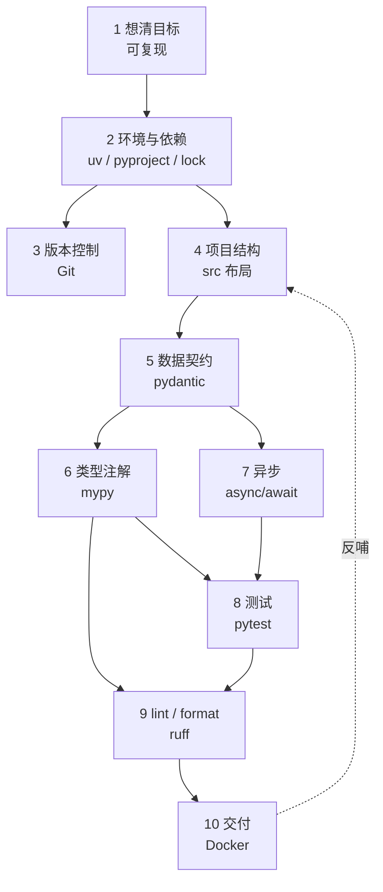
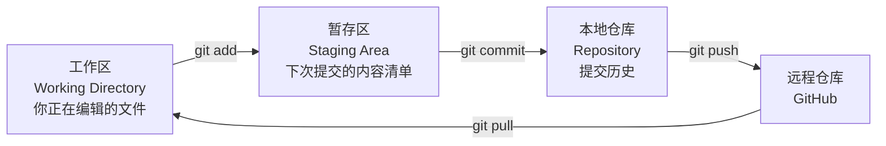
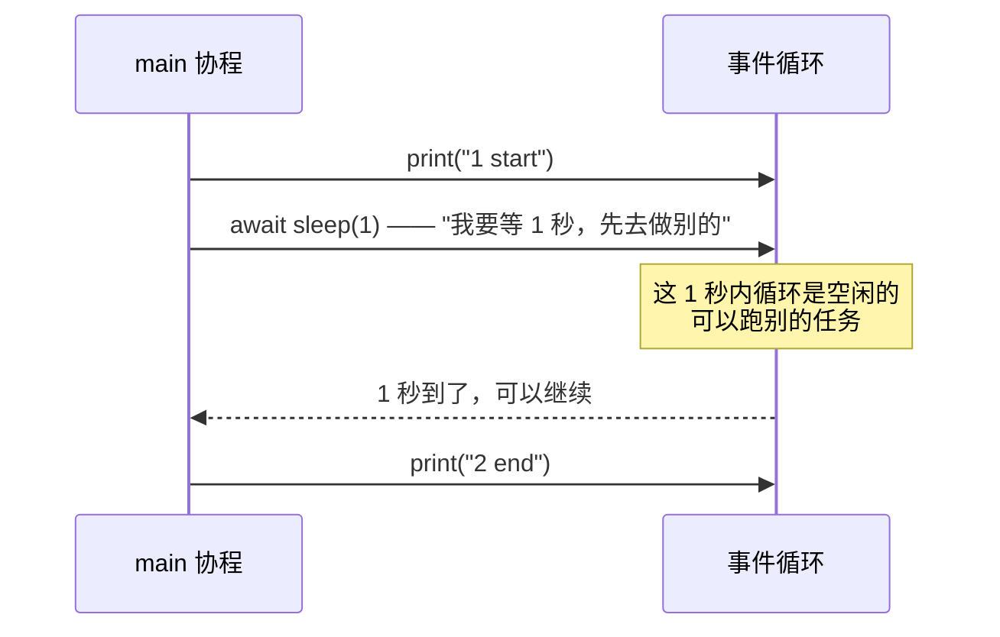
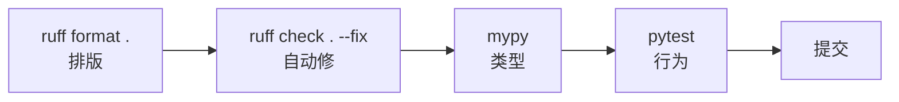
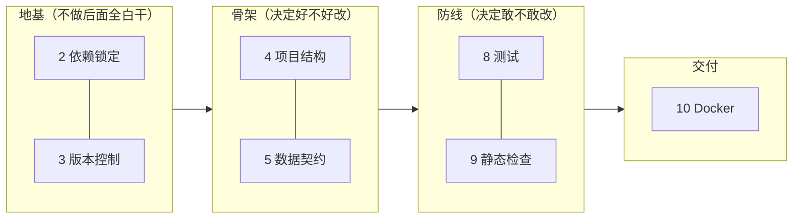
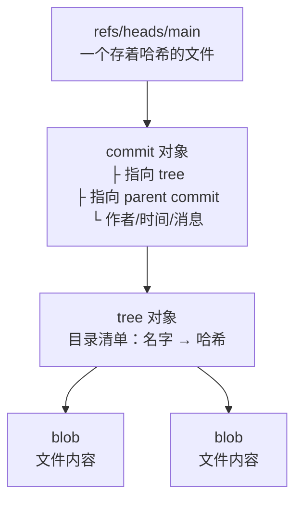
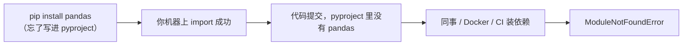

# 阶段 0 · Python 工程基础 · 学习笔记

> **用途**：把「能跑的脚本」升级成「可复现、可维护、可交付的工程」。这是后面 RAG / Agent 项目的地基。
> **写法约定**：术语后面跟一句 🧒「人话解释」，公式用 LaTeX，坑点用 ⚠️ 单独标出，重点用 ⭐。
> **目标读者**：数学背景、写过 Python 脚本、没接触过工程规范。
> **实践方式**：仓库不附带预配置的项目骨架。请跟随本笔记从空目录亲手创建项目，并用自己的环境验证每一步。
> **同系列**：ML 阶段笔记（房价预测，同一套写法）—— *该笔记不在本仓库*。

---

## 如何阅读这份笔记

**第一遍（建立全局）**
1. 先读 **「全局地图」** 和 **Step 1** —— 先想清"为什么需要工程规范"，再学工具
2. 再按 **Step 2 → Step 10** 顺序精读
3. 每读完一个 Step，在自己创建的项目中实现对应内容，**跑一遍、改坏一次、看它怎么报错**

**第二遍（补深度）**
4. 读 **「难点拓展」** —— 展开那些"会用但说不清原理"的地方（依赖解析、Git 对象模型、GIL、事件循环、Windows 编码）

**随时查阅**
5. 命令忘了 → **附录 A 命令速查**
6. 术语不懂 → **附录 C 术语速查**
7. 遇到报错 → **附录 D 常见坑总表**
8. 准备面试 → **附录 E 面试高频问题速查**

---

## 目录

| 章节 | 内容 | 一句话定位 |
|------|------|-----------|
| Step 1 | 为什么需要工程规范 | 先想清目标：可复现 > 能跑 |
| Step 2 | 虚拟环境与依赖管理（uv） | 解决"在我机器上能跑" |
| Step 3 | Git 版本控制 | 让改动可回溯、可协作 |
| Step 4 | 项目结构 | 文件放哪里是一种设计 |
| Step 5 | pydantic：把契约写下来 | 数据在自己家门口就拦住 |
| Step 6 | 类型注解与 mypy | 把错误从运行时提到写代码时 |
| Step 7 | 异步 async/await | IO 等待时别干等 |
| Step 8 | 测试 | 唯一能证明"改动有效"的手段 |
| Step 9 | lint / format / 类型检查 | 把人的注意力留给设计 |
| Step 10 | Docker | 交付一个"环境"而不只是代码 |
| 回顾 | 十步串起来 | |
| **难点拓展** | 12 个关键问题的深入解释 | 含推导，面试区分点 |
| 附录 A | 命令速查 | |
| 附录 B | 数学背景 → 工程知识对照 | |
| 附录 C | 术语速查（人话版） | |
| 附录 D | 常见坑总表 | |
| 附录 E | 面试高频问题速查 | |

---

## 学习进度

**两列含义不同**：`笔记状态` = 该节内容是否已写好；`实操状态` = 本仓库是否真的动手做过（对应 [学习过程记录.md](学习过程记录.md) 的流水编号）。

| Step | 主题 | 笔记状态 | 实操状态 |
|------|------|------|------|
| 1 | 为什么需要工程规范 | ✅ 已整理 | ✅ 已确立（规范文档 + 步骤卡流程在跑） |
| 2 | uv 依赖管理 | ✅ 已整理 | ✅ 已完成（0.2 ~ 0.4，13 个依赖经 `uv add`） |
| 3 | Git | ✅ 已整理 | 🟡 部分（提交 / 推送 / 历史核查已熟；**分支与 PR 未演练**） |
| 4 | 项目结构 | ✅ 已整理 | ✅ 已完成（0.12 ~ 0.13，`src` 布局 + 可安装包） |
| 5 | pydantic | ✅ 已整理 | ✅ 已完成（0.16 ~ 0.19 配置；0.26 数据契约） |
| 6 | 类型注解与 mypy | ✅ 已整理 | ✅ 已完成（0.20，strict 已生效） |
| 7 | 异步 | ✅ 已整理 | ✅ 已完成（0.22 ~ 0.22b 实验；0.27b ~ 0.28b 真实请求） |
| 8 | 测试 | ✅ 已整理 | ⬜ **未做**（`tests/` 按计划顺延到阶段 1） |
| 9 | lint / format | ✅ 已整理 | ✅ 已完成（0.21，三条质量门已固化为标准命令） |
| 10 | Docker | ✅ 已整理（未实机构建） | ⬜ **未做**（`Dockerfile` 按计划顺延到阶段 1） |
| 拓展 | 难点深入理解 | ✅ 已整理 | 🟡 按需查阅 |

> ⚠️ 状态含义：**✅ 已整理** = 笔记写完了；**不代表学会了**。
> 学会的判据是 **附录 E 的题能不看笔记口头讲清**。
> **阶段 0 整体**：核心（2 / 4 / 5 / 6 / 7 / 9）已完成，Step 8 与 Step 10 顺延 —— 详见
> [学习档案与路线图.md](学习档案与路线图.md) 第六节。

---

## 全局地图



**心法**：

- Step 2 是**唯一的地基**：环境不隔离、依赖不锁定，后面所有"我改进了"都无法验证
- Step 5 → 6 → 7 是一条线：**先把数据结构定义清楚（pydantic），再用类型把它固化（mypy），最后才考虑并发（async）**
- Step 8 + 9 是**自动化防线**：机器检查得越多，人越能专注设计
- Step 10 的 Docker，本质是"把 Step 2 的环境也一起交付出去"

---

## 目标岗位视角：这些"不写业务代码的事"为什么值钱

| 能力 | 面试官会怎么考 |
|------|--------------|
| 依赖管理 | "你怎么保证我这边跑出来跟你一样？" |
| Git | "给我看下你的提交历史 / 你怎么管分支？" |
| pydantic | "用户传了个乱七八糟的 JSON 进来怎么办？" |
| 类型注解 | "这个函数的输入输出到底是什么？" |
| 异步 | "你的服务要同时接 100 个用户，怎么处理？" |
| 测试 | "你怎么证明这次改动没破坏原有功能？" |
| Docker | "部署时环境不一致怎么办？" |

> ⭐ **规律**：这些问题的共同答案是「**让计算机替我保证某件事**」。
> 房价预测项目的"工程化"只占几行 `requirements.txt`；而 LLM 应用是**长期运行的在线服务**，工程规范从"加分项"变成"入场券"。

---

# Step 1 · 为什么需要工程规范

## 定位

> Step 1 不装任何软件，只回答一个问题：**"能跑"和"能交付"差了哪些东西？**

## 1.1 三种"能跑"

| 层次 | 表现 | 换台机器 / 换个人 | 一个月后的自己 |
|------|------|------------------|---------------|
| ① 能跑 | `python train.py` 有输出 | 大概率崩 | 看不懂了 |
| ② 可复现 | 固定种子 + 锁依赖 + 配置分离 | 能跑出同样结果 | 能接着改 |
| ③ 可交付 | 有测试 + 有文档 + 容器化 | 一条命令起来 | 能交给别人 |

> 🧒 **类比**：①是"我能做出这道菜"，③是"我把菜谱交给别人，他在别的厨房也能做出同一个味道"。
> 面试官关心的是 ③。

## 1.2 可复现三要素 ⭐

| 要素 | 解决什么 | 具体手段 |
|------|---------|---------|
| **环境隔离** | 依赖版本冲突 | 虚拟环境 + 锁文件 |
| **确定性** | 每次结果不同 | 固定随机种子、固定版本 |
| **配置与代码分离** | 换环境要改代码 | `.env` + 环境变量 |

> ⚠️ **在 ML 项目里**：不固定种子 → CV 分数抖动 → **你根本不知道改动是好是坏**。
> 这和 ML 阶段笔记里的拓展 16.3「改动是否真的更好——和标准差比」是同一个坑的两面。
>
> ⭐ **在 LLM 项目里更狠**：模型本身带随机性（`temperature`）。如果你连**自己代码**的随机性都没固定，就完全无法归因。

## 1.3 一个脚本是怎么烂掉的（你一定经历过）

```text
v1  train.py                    # 能跑
v2  train.py + utils.py         # 抽出函数
v3  train_v2.py                 # 怕改坏，复制一份     ← ❌ 开始分叉
v4  train_v2_final.py           # 又复制一份            ← ❌ 已有 3 份相似代码
v5  train_v2_final_fix.py       # 修了个 bug，但只改了其中一份
```

> 🧒 这就是**没有版本控制 + 没有模块化**的典型死法。正确做法是 `git commit`，而不是 `cp`。

**症状 → 解药对照**：

| 症状 | 解药 | 在哪一步 |
|------|------|---------|
| 复制文件当备份 | Git | Step 3 |
| 上次能跑这次不能 | 锁依赖 | Step 2 |
| 不知道哪份代码是对的 | Git 分支 + 提交历史 | Step 3 |
| 改了 A 坏了 B | 测试 | Step 8 |
| 换机器就崩 | Docker | Step 10 |

## 1.4 ⚠️ 心态坑：觉得"工程是杂活"

两个必须扭转的认知：

1. **工程规范的收益是"避免灾难"，不是"提升上限"** —— 它不直接提高模型分数，但没有它你会**反复丢失已经做对的东西**。
2. **面试官无法评估你"思路好不好"，只能看产出物** —— 一份有测试、有 README、有 Dockerfile 的项目，比"我调过很多参数"这种描述有说服力得多。

## 1.5 自检

> 本节自检题与简要答案已移入 [自检题清单.md](自检题清单.md)（阶段 0 · Step 1 可复现）。

---

# Step 2 · 虚拟环境与依赖管理（uv）

## 定位

> 解决 **"在我机器上能跑"**。核心是两件事：**隔离**（虚拟环境）和**锁定**（lock 文件）。

## 2.1 为什么必须隔离

Python 装包默认装到**全局** `site-packages`，所有项目共享：

```text
项目 A 需要 httpx==0.27
项目 B 需要 httpx==0.28
→ 全局只能有一个版本 → 装 B 时 A 崩了
```

> 🧒 **类比**：所有菜共用一个调料架，新菜要换酱油品牌，旧菜就变味。
> 虚拟环境 = **每道菜一套独立调料**。

**更隐蔽的灾难**：全局装了 `pandas`，你在代码里 `import pandas` 成功了，但这个依赖**没写进 `pyproject.toml`**。
→ 你的代码在别人机器上、在 Docker 里、在 CI 里全部崩，而在你机器上"明明能跑"。

> ⚠️ 这类 bug 最耗时间的地方：**它不在报错信息里，而在环境差异里**。

## 2.2 虚拟环境到底做了什么

很多人"会激活 venv"但说不清原理。真相很简单：

| 动作 | 实际发生的事 |
|------|------------|
| `python -m venv .venv` | 建了个目录，含独立 `site-packages/` 和 `python.exe` 副本 |
| 激活（`activate`） | **只改了 `PATH` 和几个环境变量**，让 `python` 指向 `.venv\Scripts\python.exe` |
| 该 python 启动时 | 通过目录结构确定 `sys.prefix`，只加载 `.venv\Lib\site-packages` |
| `deactivate` | 把 `PATH` 改回去 |

> ⭐ **关键结论**：venv 隔离的**只有 Python 包**，不隔离系统库、不隔离 Python 本体、更不隔离环境变量。
> 这既是不激活也能"绕过"它的原因，也是后来 Docker 存在的理由 —— Docker 隔离的是**整个操作系统层**。

## 2.3 `requirements.txt` 的三个致命缺陷

| 缺陷 | 后果 |
|------|------|
| 没有"直接依赖 / 间接依赖"之分 | 你写了 5 个包，实际装了 40 个，40 个都算你头上 |
| 不能表达约束 | 只能写死版本（`httpx==0.28.1`），没法写范围 |
| 与项目元数据脱节 | 包名、入口点、工具配置分散在多个文件 |

**`pip freeze` 的经典问题**：它导出**当前环境的全量快照**（含 40 个间接依赖，还带上你的平台和版本）。
→ 换到别的平台（如 Linux）可能装不上。

## 2.4 `pyproject.toml`：唯一事实来源 ⭐

Python 官方标准（PEP 518 / 621）的**单一配置文件**：

```toml
[project]                  # 项目元数据 + 依赖
[dependency-groups]        # 开发专用依赖（dev）
[build-system]             # 怎么构建这个包
[tool.ruff]                # 工具配置也放这里
[tool.pytest.ini_options]
[tool.mypy]
```

**示例项目的 `pyproject.toml`** 逐段解读：

```toml
[project]
name = "python-scaffold"
version = "0.1.0"
requires-python = ">=3.12"        # 声明支持的 Python 范围
dependencies = [                  # 只写【直接依赖】，间接依赖交给求解器
    "pydantic>=2.9",
    "pydantic-settings>=2.5",
    "httpx>=0.27",
]

[dependency-groups]
dev = [                           # 只在开发时需要，不进生产镜像
    "pytest>=8.3",
    "pytest-asyncio>=0.24",
    "ruff>=0.7",
    "mypy>=1.11",
]

[build-system]
requires = ["hatchling"]          # 用什么后端构建
build-backend = "hatchling.build"

[tool.hatch.build.targets.wheel]
packages = ["src/app"]            # 告诉构建器：包在 src/app

[project.scripts]
scaffold = "app.main:cli"         # 生成命令行入口 scaffold

[tool.ruff]
line-length = 100
src = ["src", "tests"]

[tool.ruff.lint]
select = ["E", "F", "I", "UP", "B"]   # 启用哪些规则集
```

> ⭐ **为什么 `dependencies` 只写 3 个，实际装了 20+ 个？**
> 那 3 个是**直接依赖**，其余是它们自己的依赖（间接依赖）。**声明意图，而不是声明结果。**

## 2.5 锁文件：`uv.lock` 是什么 ⭐

| 文件 | 性质 | 类比 |
|------|------|------|
| `pyproject.toml` | 我**想要**什么（范围） | 餐厅菜单 |
| `uv.lock` | 实际**求解出**什么（精确版本 + 哈希） | 后厨采购单 |

**必须提交到 Git**，理由三条：

1. 别人 `uv sync` 得到**逐位一致**的版本组合
2. 依赖升级是一次**显式提交**（`uv lock --upgrade`），而不是某天莫名其妙的漂移
3. Docker 构建可以 `--frozen`，保证镜像可复现

> ⚠️ 把 `uv.lock` 写进 `.gitignore` 是**典型错误**（有人误以为它是缓存）。
> `.venv/` 才是缓存，该忽略；`uv.lock` 是**成果**，该提交。

**依赖解析为什么需要"求解"** → 见 **难点拓展 1**。

## 2.6 uv 常用命令与背后的动作

| 命令 | 背后发生了什么 | 什么时候用 |
|------|--------------|-----------|
| `uv python install 3.12` | 下载独立 CPython 到 uv 目录 | 首次，或换版本 |
| `uv sync` | 读 `pyproject.toml` + `uv.lock`，**创建/同步** `.venv` | 拿到新项目第一步 |
| `uv sync --frozen` | 严格按 lock，**不许改动 lock** | CI / Docker |
| `uv run <cmd>` | **自动确保环境同步**后执行（不用手动激活） | 日常执行 |
| `uv add <pkg>` | 加直接依赖 → 重新解析 → **更新 lock** | 加生产依赖 |
| `uv add --dev <pkg>` | 加到 dev 组 | 加测试 / lint 工具 |
| `uv lock --upgrade` | 在允许范围内升级所有包并重写 lock | 定期升级 |
| `uv tree` | 打印依赖树（看某个间接依赖从哪来） | 排查冲突 |
| `uv pip list` | 看当前环境实际装的版本 | 验证 |

> ⭐ **`uv run` 为什么比"激活 + python"好？**
> 因为它**每次执行前都保证环境与 lock 一致**。用激活的方式，你很容易在"忘了 sync"的状态下运行，得到一份**不存在于任何 lock 文件的依赖组合** —— 这是最阴的一类环境 bug。

## 2.7 如何选择项目 Python 版本

- 大模型生态（`torch`、`vLLM`、部分向量库）对最新 Python 的跟进慢半年到一年
- 应结合目标依赖的兼容范围选择版本，并用项目配置固定下来
- 具体版本看项目自己的配置和 lock 文件 —— **别背版本号，背"为什么锁"**

## 2.8 ⚠️ 依赖管理坑清单

| 坑 | 后果 | 正确做法 |
|----|------|---------|
| 手动 `pip install` | `pyproject.toml` 与实际环境不一致 | 一律 `uv add` |
| 提交 `.venv/` | 仓库爆炸、跨平台失败 | 写进 `.gitignore` |
| 忽略 `uv.lock` | 版本漂移，无法复现 | 提交它 |
| 完全不写版本约束 | 未来大版本升级直接崩 | 至少 `>=x.y` |
| 约束写成 `==` 锁死 | 与其他包冲突时无法回旋 | 用范围，精确性交给 lock |
| dev 依赖装进生产 | 镜像变大、攻击面变大 | `uv sync --no-dev` |
| 路径含中文/空格 | 各种诡异失败 | 路径只放 ASCII |

## 2.9 自检

> 本节自检题与简要答案已移入 [自检题清单.md](自检题清单.md)（阶段 0 · Step 2 uv 与依赖）。

---

# Step 3 · Git 版本控制

## 定位

> Git 不只是"备份代码"。它是一台**时间机器 + 协作协议 + 实验记录仪**。
> 在 ML/LLM 项目里，它还承担一个更重要的职责：**记录"哪个改动带来了哪次提升"**。

## 3.1 先纠正一个最常见的误解

| 误解 | 真相 |
|------|------|
| Git 存的是"每次改动的差异" | Git 存的是**完整快照**（未变的文件只存引用，不重复存储） |
| `commit` 提交的是文件 | `commit` 提交的是**一棵目录树的哈希** |
| 分支是"一份代码副本" | 分支只是**一个指向某次提交的 41 字节指针** |

> 🧒 **快照 vs 差异**：差异像"日记里写今天改了哪几行"；快照像"每天给整个房间拍一张照"。
> 快照看似笨，但它让"回到任意一天的状态"变成 **O(1)**，也让分支便宜到可以随便开。
> 原理细节 → **难点拓展 3**。

## 3.2 三个区、四个状态 ⭐



| 状态 | 含义 | 命令 |
|------|------|------|
| Untracked | 新文件，Git 不认识 | `git add` |
| Modified | 改过，未暂存 | `git add` |
| Staged | 已进暂存区，待提交 | `git commit` |
| Committed | 已进历史 | — |

> ⭐ **暂存区的价值**：它让你**挑着提交**。改了 3 个文件但只想先提交其中 1 个逻辑改动时，`git add 文件` 就行。
> 想让提交更干净，用 `git add -p`（逐块挑选），这是"提交历史可读"的关键技巧。

## 3.3 最小工作流（每天都会用）

```powershell
git status                      # ① 先看现状，别瞎操作
git add -p                      # ② 逐块挑选要提交的内容
git commit -m "feat: 增加聊天流式接口"
git push                        # ③ 推到远程
```

**查看与回退**：

```powershell
git --no-pager log --oneline -10        # 最近 10 条历史
git --no-pager diff                     # 工作区 vs 暂存区
git --no-pager diff --staged            # 暂存区 vs 上次提交
git restore <file>                      # 丢弃工作区改动（危险，不可恢复）
git restore --staged <file>             # 从暂存区撤出（保留文件内容）
git revert <sha>                        # 生成一个"反向提交"（安全，推荐）
git reset --hard <sha>                  # 彻底回退（危险，会丢改动）
```

> ⚠️ **原则**：已经 `push` 的历史**不要**用 `reset --hard` 改，用 `revert` 追加一个反向提交。
> 因为重写历史会让所有协作者的本地仓库与远程分叉。

## 3.4 commit message 规范

**格式**：`<类型>: <做了什么>`，一行说清，必要时空一行写正文。

| 类型 | 用途 |
|------|------|
| `feat` | 新功能 |
| `fix` | 修 bug |
| `docs` | 只改文档 |
| `refactor` | 重构（行为不变） |
| `test` | 只改测试 |
| `chore` | 杂活（依赖升级、配置） |

**好 vs 坏**：

```text
❌ 修改            ← 改了啥？为什么？
❌ update code     ← 等于没写
✅ fix: 修正 SSE 流式响应缺少 [DONE] 结束标记
✅ docs: 补充阶段 0 踩坑记录（镜像 / UTF-8 / 缩进）
```

> ⭐ **判据**：三个月后的你能不能**只看 message 就知道该不该点进这次提交**。

## 3.5 `.gitignore` 与 `.gitattributes`

`.gitignore` 决定**什么不进仓库**。关键类别有：

| 类别 | 例子 | 为什么 |
|------|------|--------|
| 虚拟环境 | `.venv/` | 可重建，且体积大、跨平台不通用 |
| 缓存 | `__pycache__/`、`.pytest_cache/`、`.ruff_cache/` | 机器生成的中间产物 |
| **密钥** | `.env` | ⚠️ 见 3.6，泄露后果最严重 |
| 产物 | `dist/`、`*.log` | 可重建 |
| 编辑器 | `.vscode/`、`.idea/` | 个人偏好 |

**白名单技巧**：

```gitignore
.env          # 忽略所有 .env
.env.*        # 忽略 .env.local / .env.prod ...
!.env.example # 但保留模板！别人需要知道有哪些变量
```

> ⭐ `.env.example` **必须提交**，否则别人根本不知道要配哪些变量。这是"配置即文档"。

`.gitattributes` 可以解决另一个坑：

```gitattributes
* text=auto
uv.lock text eol=lf     # 强制 LF
```

**为什么**：Windows 的 Git 默认把文本文件检出成 `CRLF`，Linux 用 `LF`。
如果不处理，`uv.lock` 会在不同机器上产生**整文件级别的假 diff**（看起来每一行都改了，其实只是换行符）。

## 3.6 ⚠️ `.env` 为什么绝不能提交

`.env` 里有 API Key。一旦提交：

1. **Git 历史是永久的** —— 后续 `git rm .env` **删不掉历史里的内容**
2. GitHub 上有爬虫专门扫公开仓库的 Key，**分钟级**就会被盗刷
3. 一旦进入历史，唯一的彻底解法是**重写全部历史**或**删库重建**，还要把 Key **吊销重发**

**不小心已经提交了怎么办？**

| 情况 | 处理 |
|------|------|
| 刚 `add`，还没 `commit` | `git restore --staged .env`，然后确认 `.gitignore` 已包含它 |
| 刚 `commit`，还没 `push` | `git reset --soft HEAD~1` 后修正，或 `git commit --amend` |
| 已经 `push` 了 | ① **立刻去平台吊销这个 Key**（最重要）② 再考虑 `git filter-repo` 清理历史 |
| Key 是公司/生产的 | 立即上报，走泄露流程 |

> ⭐ **记忆锚点**：**Key 泄露的第一反应是"吊销"，不是"删代码"。** 因为删代码根本来不及。

## 3.7 分支与 PR

```powershell
git switch -c feature/stream-chat     # 从当前分支开新分支
# ... 改代码、提交 ...
git push -u origin feature/stream-chat
# 然后在 GitHub 上开 Pull Request
```

| 概念 | 人话 |
|------|------|
| `main` | 随时可用的主干，**永远处于能跑的状态** |
| 特性分支 | 一个改动一条分支，做完合回去 |
| PR (Pull Request) | "请把我的分支合进 main"的请求，附代码评审与 CI |
| CI | 平台自动跑测试/lint（GitHub Actions） |

> ⭐ **为什么必须用分支**：直接往 `main` 推，一次没测干净的改动就把主干弄坏了。
> 分支 + PR 的意义是**在损坏主干之前拦截问题**——这正好是 Step 8（测试）和 Step 9（lint）要自动化的内容。

## 3.8 从空仓库开始初始化

```powershell
cd <学习资料仓库>
git init -b main
git add -A
git commit -F <消息文件>      # 中文消息用文件传入，避免编码问题
git --no-pager log --oneline
```

> ⭐ 注意这里的分组方式：**每次提交只做一件事**。
> 如果第一次提交就把"骨架 + 文档 + 修 bug"混在一起，后来想单独回退某一部分就做不到。
>
> ⚠️ Windows 上中文 commit message 通过命令行参数传入可能乱码，用 `git commit -F <文件>` 更稳妥；而**文件本身必须是 UTF-8**。

## 3.9 ⚠️ Git 坑清单

| 坑 | 后果 | 正确做法 |
|----|------|---------|
| 提交 `.env` | Key 泄露，需吊销 | 严格 `.gitignore`，用 `.env.example` 兜底 |
| 提交 `.venv/` | 仓库巨大、跨平台失败 | 忽略 |
| 忽略 `uv.lock` | 环境无法复现 | 提交 |
| `push` 后 `reset --hard` | 历史分叉，协作灾难 | 用 `revert` |
| 一个提交混了多件事 | 无法单独回退 | 小步提交，用 `git add -p` |
| commit message 写"修改" | 三个月后完全看不懂 | 用 `类型: 做了什么` |
| 二进制/大文件进仓库 | 仓库永久膨胀（历史删不掉） | Git LFS 或存到对象存储 |

## 3.10 自检

> 本节自检题与简要答案已移入 [自检题清单.md](自检题清单.md)（阶段 0 · Step 3 Git）。

---

# Step 4 · 项目结构

## 定位

> 文件放在哪里不是审美问题，是**依赖关系是否清晰**的问题。

## 4.1 两种布局

| 布局 | 结构 | 问题 |
|------|------|------|
| 扁平（flat） | `app.py` 直接在项目根 | 根目录被模块文件占据，同名模块易冲突 |
| **src 布局** ⭐ | `src/app/...` | 必须"安装"才能 import，**逼你真的测打包** |

**src 布局的真实好处**：如果不安装，你就 `import` 不到包。
→ 这**强制**你在本地验证 `pyproject.toml` 的打包配置是正确的，而不是"碰巧能跑"。

> 🧒 类比：扁平布局像"把书直接堆在门口"；src 布局像"必须走书架系统才能取书"——多一步，但从未出现过"找不到书"。

### 4.1b ⚠️ 两处精修（2026-10-15 实测，学习者的提问引出的）

**① `src` 和 `app` 是【两层嵌套目录】，不是一个名字里带反斜杠的目录**

学习者在 VS Code 侧边栏看到 `src\app` 显示成一行，怀疑"是不是建错了"。实测取证（`Get-Item "src\app"`）：

| 检查 | 结果 |
|---|---|
| `Name`（只取最后一段） | `app` —— 名字里**没有** `src` |
| `Parent` | `...\_Fast_api\src` —— 它确实在 `src` 里面 |
| `src` 下子目录数 | `1` |
| 全项目搜"名字含 `\` 的目录" | 不存在（Windows 文件名不允许含 `\`） |
| `git ls-files src` | `src/app/api/app.py` 逐层嵌套 |

⭐ **原因**：VS Code 默认开启 **Compact Folders（折叠文件夹）** —— 一层目录只有一个子目录时，会被合并成一行显示。
**这是显示方式，不是文件夹名。** 在系统资源管理器里能看到两层分开。

**② 「必须安装才能 import」的说法要分对象** —— `app` 成立，`src` 不成立

| import 写法 | 在项目根跑 | 换到别的目录跑（模拟部署） |
|---|---|---|
| `from app.config import settings` | ✅ | ✅（uv 已装进虚拟环境） |
| `from src.app.config import settings` | ✅ | ❌ **`ModuleNotFoundError: No module named 'src'`** |

⭐ **这是个真陷阱**：`from src.app...` **本机能跑、部署就炸**。

**根因（PEP 420 隐式命名空间包）**：Python 3.3 起，**没有 `__init__.py` 的目录也能被当包 import**。
实测证据：

```text
src.__file__ = None                                  ← 没有实体文件
src.__path__ = _NamespacePath(['...\_Fast_api\src'])  ← 命名空间路径
```

又因为"在项目根运行 Python 时，当前目录也会进搜索路径"，`src` 就"碰巧"能被找到。

**硬规则**：**永远写 `from app.xxx import ...`，绝不写 `from src.app.xxx`。**

**谁才是"包"**：

| 目录 | 有 `__init__.py` | 身份 |
|---|---|---|
| `src\` | ❌ | 只是**容器**（普通目录） |
| `src\app\` | ✅ | **这才是包** |
| `src\app\api\` | ✅ | 子包 |

`pyproject.toml` 的 `packages = ["src/app"]` 读法：**"要打包的包是 `src` 下的 `app`"** —— `src` 只负责报位置。

## 4.2 学习仓库与练习项目结构

```text
学习资料仓库/
├── 学习档案与路线图.md
├── study_notes.md
└── notes/
    ├── 阶段0-工程基础.md
    └── 阶段1-FastAPI速成.md

自己的练习项目/                  # 学习时从空目录创建，不要复制现成骨架
├── pyproject.toml
├── src/
├── tests/
└── playground/                  # 可选：临时实验区
```

**练习项目的分层原则**：

| 目录 | 放什么 | 不放什么 |
|------|-------|---------|
| `src/` | 可复用的业务逻辑 | 一次性探索代码 |
| `tests/` | 断言"契约"是否成立 | 手动调试脚本 |
| `notes/` | 沉淀下来的知识 | 原始会议记录 |
| `playground/` | 敢删的临时实验 | 任何会被依赖的代码 |

> ⭐ **可自行创建 `playground/`**：它是一个"合法的乱写区"。
> 没有它，实验代码就会混进 `src/`，几个月后没人敢删。

## 4.3 配置与代码分离 ⭐

**反例（绝不要这样）**：

```python
client = OpenAI(api_key="sk-abc123...", base_url="https://api.openai.com/v1")
if os.environ.get("HOSTNAME") == "prod-server":   # 环境判断硬编码
    ...
```

**正确做法**：

```python
# src/app/config.py —— 所有可调参数集中在一处
settings = Settings()          # 从环境变量 / .env 读取
```

**为什么**：

| 理由 | 说明 |
|------|------|
| 安全 | 代码进 Git，配置不进 Git |
| 可部署 | 同一份镜像，靠环境变量切环境（12-Factor App 原则） |
| 可测试 | 测试里改环境变量即可，不用改代码 |
| 可查 | "有哪些配置项"一目了然，而不是全局搜索 |

## 4.4 自检

> 本节自检题与简要答案已移入 [自检题清单.md](自检题清单.md)（阶段 0 · Step 4 项目结构）。

---

# Step 5 · pydantic：把"契约"写下来

## 定位

> 一切外部输入（HTTP 请求、LLM 返回、文件内容）都**不可信**。
> pydantic 的作用是：**在数据进入业务逻辑之前，就在门口把它检查干净**。

## 5.1 为什么要校验（防御式编程）

**没有校验的世界**：

```python
def chat(messages):
    return messages[-1]["content"]        # 如果 messages 是空列表？如果缺 key？如果 content 是 None？
```

数据一路往里传，直到某个深处崩出一个 `KeyError` / `TypeError`，而这个报错**距离真正的错误源头已经很远**，排查成本极高。

> 🧒 **类比**：快递到了不验货，等拆开用的时候才发现碎了——你根本不知道是哪个环节坏的。
> pydantic 就是**当场验货**：不合格直接拒收，并且告诉你哪里不合格。

**pydantic 干的三件事**：

| 能力 | 说明 | 例子 |
|------|------|------|
| **解析（parse）** | 把"长得像"的数据转成目标类型 | `"123"` → `123` |
| **校验（validate）** | 不满足约束就报错 | `temperature=5` → 报错 |
| **序列化（serialize）** | 对象 → JSON | `.model_dump()` |

## 5.2 示例数据模型逐行解读

`src/app/schemas.py`：

```python
from datetime import UTC, datetime
from typing import Literal

from pydantic import BaseModel, Field, field_validator

Role = Literal["system", "user", "assistant"]   # ① 类型层面限定取值范围


class ChatMessage(BaseModel):
    role: Role
    content: str = Field(min_length=1, description="消息正文")   # ② 长度约束

    @field_validator("content")                                 # ③ 自定义校验
    @classmethod
    def reject_blank_content(cls, value: str) -> str:
        stripped = value.strip()
        if not stripped:
            raise ValueError("content 不能为纯空白")
        return stripped                                          # ④ 返回"清洗后"的值


class ChatRequest(BaseModel):
    messages: list[ChatMessage] = Field(min_length=1, description="至少一条消息")  # ⑤ 列表也能约束
    temperature: float = Field(default=0.7, ge=0.0, le=2.0)                        # ⑥ 数值范围
    stream: bool = False


class ChatResponse(BaseModel):
    content: str
    model: str
    created_at: datetime = Field(default_factory=lambda: datetime.now(UTC))         # ⑦ 默认值工厂
    usage_tokens: int = Field(default=0, ge=0)
```

**七个知识点逐个说清**：

| # | 写法 | 为什么这样写 |
|---|------|------------|
| ① | `Literal[...]` | 让非法值在**类型层面**就不可能。比 `if role not in (...)` 更早拦截，还能被 mypy 检查 |
| ② | `Field(min_length=1)` | 把约束**写在声明处**，而不是散落在业务代码里 |
| ③ | `@field_validator` | 内置约束表达不了的规则（如"不能是纯空白"） |
| ④ | `return stripped` | ⭐ 校验器**同时是清洗器**：后续代码拿到的已是干净数据 |
| ⑤ | `list[ChatMessage]` | **嵌套模型**：每个元素的校验递归进行，错误路径会精确到 `messages[0].content` |
| ⑥ | `ge` / `le` | 数值上下界。`temperature` 超过 2 直接拒绝，不用等到调 API 才报错 |
| ⑦ | `default_factory` | ⭐ 可变/动态默认值必须用工厂函数，**不能写 `default=datetime.now()`** |

> ⚠️ **为什么 `default=datetime.now(UTC)` 是错的？**
> Python 的默认参数在**函数定义时求值一次**。写 `default=datetime.now()` 会让**所有**对象共享同一个时间戳（模块导入的那一刻）。
> 用 `default_factory=lambda: ...` 让它在**每次创建对象时**才求值。

## 5.3 `Field` 常用约束速查

| 参数 | 用于 | 含义 |
|------|------|------|
| `default` | 全部 | 默认值（不可变类型可直接用） |
| `default_factory` | 全部 | 默认值工厂（可变/动态值必须用它） |
| `ge` / `gt` | 数值 | ≥ / > |
| `le` / `lt` | 数值 | ≤ / < |
| `min_length` / `max_length` | str, list | 长度范围 |
| `pattern` | str | 正则匹配 |
| `description` | 全部 | ⭐ 会出现在 OpenAPI 文档里 |
| `examples` | 全部 | ⭐ 同上，给 `docs` 页面用 |

> ⭐ `description` 和 `examples` 不只是注释 —— 它们会被 FastAPI 自动抽取成 **API 文档**（阶段 1 会看到）。
> **写 pydantic 模型 = 顺便写文档**，这是 FastAPI 生态最大的红利。

## 5.4 配置也是模型：`pydantic-settings`

`src/app/config.py`：

```python
from pydantic import Field
from pydantic_settings import BaseSettings, SettingsConfigDict


class Settings(BaseSettings):
    model_config = SettingsConfigDict(
        env_file=".env",            # ① 从 .env 文件读
        env_file_encoding="utf-8",  # ② 明确编码，别依赖系统默认
        env_prefix="APP_",          # ③ 只认 APP_ 开头的变量
        extra="ignore",             # ④ 无关的环境变量不报错
    )

    env: str = Field(default="local", description="运行环境：local / dev / prod")
    debug: bool = Field(default=False, description="是否输出调试信息")
    request_timeout: float = Field(default=30.0, gt=0, description="外部请求超时（秒）")

    llm_api_key: str = Field(default="", description="上游 LLM 的密钥")
    llm_base_url: str = Field(default="https://api.deepseek.com")


settings = Settings()   # ⑤ 模块级单例
```

**字段名 → 环境变量名的映射规则**：

| 字段 | 环境变量 |
|------|---------|
| `env` | `APP_ENV` |
| `debug` | `APP_DEBUG` |
| `request_timeout` | `APP_REQUEST_TIMEOUT` |
| `llm_api_key` | `APP_LLM_API_KEY` |

> ⚠️ **本节是「早期设计快照」，不是当前 `config.py` 的实况**（2026-10-14 校订）。
> 本项目最终做了三处不同选择，**以 [`src/app/config.py`](../src/app/config.py) 为准**：
> ① **不再用 `env_prefix`** —— 环境变量名 = 字段名转大写（`app_name` ← `APP_NAME`、`llm_api_key` ← `LLM_API_KEY`）；
> ② `extra="forbid"` 而非 `ignore` —— 换来"拼错键名立刻报错"（代价见下面那段说明）；
> ③ 字段名是 `app_env`（不是 `env`），并新增 `host` / `port` / `llm_model` / `request_timeout`。
> 保留下面的示例是为了讲清 `env_prefix` 与"前缀即命名空间"的原理。

> ⭐ 前缀 `APP_` 解决了什么？**命名空间**。
> 你机器上可能有几十个环境变量（`PATH`、`HOME`、`PYTHONUTF8`...），加前缀就避免了"某个无关变量恰好同名"导致的诡异 bug。

**`extra="ignore"` 的必要性**：`.env` 里同时放着 `PYTHONUTF8=1` 这类**非应用配置**（给解释器看的）。
如果设成 `forbid`，应用启动时就会因为"多了个不认识的变量"而崩溃。

> ⚠️ **`settings = Settings()` 在模块导入时就执行**：这意味着**配置错误会在启动时立刻暴露**（fail fast），而不是等第一次发请求。
> 这是刻意设计的：**早崩比晚崩便宜太多**。

## 5.5 阶段 0 的**核心结论**：校验该放在哪一层 ⭐

```text
❌ 反例：校验散落在业务逻辑里
def chat(req):
    if not req.get("messages"): raise ValueError(...)
    if req["messages"][-1].get("content") is None: raise ValueError(...)
    if not (0 <= temp <= 2): raise ValueError(...)
    # 真正的业务逻辑被淹没了，而且每个入口都要重写一遍

✅ 正例：校验集中在模型层
class ChatRequest(BaseModel):
    messages: list[ChatMessage] = Field(min_length=1)
    temperature: float = Field(default=0.7, ge=0.0, le=2.0)

def chat(req: ChatRequest):     # 进来时已经是干净的
    ...
```

**为什么必须这样分层**：

| 理由 | 说明 |
|------|------|
| **单一职责** | 模型负责"数据长什么样"，函数负责"做什么" |
| **复用** | 同一个模型被 HTTP 接口、CLI、批处理共用，校验只写一次 |
| **可测试** | 直接实例化模型就能测校验规则，不需要启动服务 |
| **文档化** | 约束即文档，FastAPI 直接生成 OpenAPI |
| **类型检查** | mypy 能在**编译期**发现字段名写错 |

> ⭐ **一句话**：**"进来的数据是否合法"是模型的问题，不是业务逻辑的问题。**

## 5.6 ⚠️ pydantic 坑清单

| 坑 | 后果 | 正确做法 |
|----|------|---------|
| `default=datetime.now()` | 所有实例共享一个时间戳 | `default_factory=` |
| `default=[]` | 所有实例共享同一个列表（经典 bug） | `default_factory=list` |
| 校验写在业务函数里 | 每个入口都要重写，容易漏 | 放进模型 |
| 用 `dict` 传数据 | 没有校验、没有补全、字段名写错也不知道 | 用模型 |
| 忘记 `env_prefix` | 环境变量撞车 | 加前缀 |
| 不写 `description` | 生成的 API 文档一片空白 | 顺手写上 |
| 拿 `model_dump()` 当 `json` | 日期等类型不是 JSON 原生 | 用 `model_dump(mode="json")` |

> ⚠️ `default=[]` 那个坑值得单独记：它和 Python 函数默认参数的经典陷阱**是同一个问题**。
> ML 项目里 `def train(callbacks=[])` 也是同样的 bug。

## 5.7 自检

> 本节自检题与简要答案已移入 [自检题清单.md](自检题清单.md)（阶段 0 · Step 5 pydantic）。

---

# Step 6 · 类型注解与 mypy

## 定位

> Python 的类型是**运行时**才知道的。mypy 用**静态检查**把一部分错误提前到"写代码时"。
> 你和 AI 协作写代码越多，这一步越值钱 —— 类型是给**人和工具**的双重说明书。

## 6.1 动态类型的真实代价

```python
def echo(request):
    return request.messages[-1].content
```

这行代码里藏着 4 个"想当然"：

1. `request` 有 `messages` 属性吗？
2. `messages` 是列表吗？会不会是 `None`？
3. 列表**非空**吗？（空列表 → `IndexError`）
4. `content` 一定是 `str` 吗？

**没有类型注解**：这些只能在运行时暴露，而且可能只在某个罕见分支才触发。
**有类型注解 + mypy**：第 3 条（非空）mypy **查不出来**（这需要 `Field(min_length=1)` 在运行时保证），但另外 3 条能在写代码时就被拦下。

> ⭐ **重要认知**：mypy **不是万能的**。它管"类型对不对"，不管"值合不合理"。
> 所以 **类型注解 + pydantic 校验是互补的**：一个管静态形状，一个管运行时内容。

## 6.2 注解语法速查

```python
def f(a: int, b: str = "x", *args: int, **kwargs: str) -> bool: ...
```

| 场景 | 写法 | 人话 |
|------|------|------|
| 可能没有 | `str \| None` | 要么是 str，要么是 None |
| 列表 | `list[int]` | 元素是 int 的列表 |
| 字典 | `dict[str, object]` | 键 str，值类型未知 |
| 元组（定长） | `tuple[int, str]` | 第 1 个 int，第 2 个 str |
| 任意类型 | `object` | ⭐ 优先用它，而不是 `Any` |
| 禁止检查 | `Any` | ⚠️ 会让 mypy 放弃整条链路 |
| 可选类型（旧写法） | `Optional[str]` | 等价 `str \| None`，新代码用 `\|` |
| 带元数据 | `Annotated[int, Field(gt=0)]` | 类型 + 附加信息（FastAPI 大量使用） |

> ⭐ **`object` vs `Any` 的关键区别**：
> `Any` 会**污染**：一旦某变量是 `Any`，对它做任何操作 mypy 都不报错，整条调用链失去保护。
> `object` 则相反 —— 你必须先 `isinstance` 收窄类型才能用。本仓库的 JSON 解析正是这个模式，见 6.4。

## 6.3 `mypy --strict` 在检查什么

示例项目的 `pyproject.toml`：

```toml
[tool.mypy]
python_version = "3.12"
strict = true
files = ["src"]
```

`strict = true` 打开了一组严格开关，最重要的几个：

| 开关 | 检查什么 | 为什么重要 |
|------|---------|-----------|
| `disallow_untyped_defs` | 所有函数必须有注解 | 否则"检查盲区"会扩散 |
| `no_implicit_optional` | `x: int = None` 报错 | 隐藏的 None bug |
| `warn_return_any` | 返回 Any 时警告 | 防止类型污染 |
| `disallow_any_generics` | 必须写 `list[int]` 而非 `list` | 泛型参数不能省 |
| `warn_unused_ignores` | 多余的 `# type: ignore` 报错 | 防止"用 ignore 掩盖问题"后忘记清理 |

> ⚠️ **`warn_unused_ignores` 是最被低估的一条**。
> 它逼你在被修好之后**删掉**旧的 ignore，否则代码里会积累一堆"看起来有坑、其实早没了"的注释，后来人不敢碰。

**本仓库实测结果**（2026-10-14）：`uv run mypy .` → `Success: no issues found in 7 source files`（全项目，含 `playground/`）

## 6.4 真实例子：为什么本仓库的 JSON 解析长这样

```python
def fetch_model_ids(client: httpx.AsyncClient) -> list[str]:
    response = await client.get(...)
    response.raise_for_status()
    payload: dict[str, object] = response.json()      # ①

    data = payload.get("data")                        # ② 类型是 object
    if not isinstance(data, list):                    # ③ 收窄
        return []
    return [str(item["id"]) for item in data if isinstance(item, dict) and "id" in item]   # ④
```

| # | 为什么这么写 |
|---|-------------|
| ① | `httpx` 的 `.json()` 返回 `Any`。**显式标注**成 `dict[str, object]` 阻止污染扩散 |
| ② | 从字典取值得到的是 `object`，**不假设**它是列表 |
| ③ | `isinstance` **收窄**类型，mypy 从此处起知道 `data` 是 `list` |
| ④ | 再对每个元素收窄成 `dict` 并检查键存在 —— 全程没有 `Any` |

> 🧒 **人话**：外部数据（尤其是大模型的返回）**什么都可能是**。
> 这段代码的态度是"我先不信，逐个验证再使用"，而不是"我猜它一定长这样"。
>
> ⭐ **这在 LLM 应用里不是洁癖，是刚需**：模型可能返回多一个字段、少一个字段、返回一段 markdown、返回 `null`。
> **凡是跨越系统边界的数据，都必须当作敌意输入处理。**

## 6.5 什么时候可以用 `# type: ignore`

**可以用**：

```python
ChatMessage(role="tool", content="hi")  # type: ignore[arg-type]   # 测试里故意传非法值
```

**不该用**：

```python
result = do_something()  # type: ignore     # ❌ 无理由、无错误码，掩盖真实问题
```

**规则**：

| 规则 | 理由 |
|------|------|
| 必须带**错误码** `[arg-type]` | 否则以后别的错误也被吞掉 |
| 必须能**说清为什么** | 说不清说明是设计问题 |
| 测试里允许，`src/` 里尽量不允许 | 测试要故意制造非法输入 |

> ⚠️ 无错误码的 `# type: ignore` 会**连带屏蔽**那一行未来的所有类型错误 —— 这是类型系统被"腐蚀"的主要途径。

## 6.6 自检

> 本节自检题与简要答案已移入 [自检题清单.md](自检题清单.md)（阶段 0 · Step 6 类型注解与 mypy）。

---

# Step 7 · 异步 async/await

## 定位

> 异步解决**"IO 等待时 CPU 闲着"**的问题。
> 这是 LLM 应用**最关键的工程能力** —— 因为 LLM 应用的时间几乎全花在等模型返回上。

## 7.1 为什么需要异步：先看数量级

| 操作 | 典型耗时 | 相对 CPU 计算 |
|------|---------|-------------|
| CPU 一次加法 | ~0.3 ns | 1 |
| 内存访问 | ~100 ns | ~300 倍 |
| SSD 随机读 | ~100 μs | ~300,000 倍 |
| 同机房网络请求 | ~1 ms | ~3,000,000 倍 |
| **LLM 一次生成** | **1 ~ 30 s** | **~100,000,000,000 倍** |

> ⭐ **结论**：一次 LLM 调用，CPU 真正干活的时间可以忽略不计，**99.999% 的时间在等**。
> 同步模型下，一个用户请求就把整个进程**堵死**了。异步的意义就是：**等的时候去干别的**。

**同步 vs 异步的直观对比**：

```text
同步（1 个服务员，陪 1 桌客人聊到最后）：
客人A ████████████████████ (20s)
客人B                      ████████████████████ (20s)   ← 总 40s
客人C                                            ████████████████████ (20s)  ← 总 60s

异步（1 个服务员，点完单就去下一桌）：
客人A ████████████████████ (20s)
客人B ████████████████████   ← 重叠等待，总 20s
客人C ████████████████████
```

## 7.2 三个概念（人话版）

| 概念 | 人话 | 技术含义 |
|------|------|---------|
| **协程 coroutine** | "可以中途暂停、之后接着跑"的函数 | `async def` 定义的函数，调用它只是**创建**协程，不执行 |
| **事件循环 event loop** | 一个"任务调度员" | 反复问：谁的 IO 好了？好了就接着跑它 |
| **任务 Task** | 已被调度员登记在册的协程 | 把协程交给事件循环，它才会真正开始跑 |

> ⚠️ **最反直觉的一点**：`async def` 的函数**调用后不会执行任何代码**，只是返回一个协程对象。
> 必须 `await` 它，或者交给事件循环（`asyncio.run` / `gather` / `create_task`）。
>
> 🧒 类比：定义协程 = "写了一张待办卡"；`await` = "把卡交给调度员并等它办完"。
> 只写卡片不给出去，什么都不会发生 —— 这是新手最常见的"代码没执行"原因。

## 7.3 执行顺序：看图说话

```python
async def main() -> None:
    print("1 start")
    await asyncio.sleep(1)      # ← 让出控制权 1 秒
    print("2 end")

asyncio.run(main())
```

**内部到底发生了**：



⭐ **关键**：`await` 的作用不是"花掉 1 秒"，而是**"把控制权交还给事件循环"**。
这正是并发的来源：在 A 让出的这段时间里，循环可以去跑 B。

**串行 vs 并发写法对比**：

```python
# 串行：总耗时 = 3 秒
r1 = await fetch(1); r2 = await fetch(1); r3 = await fetch(1)

# 并发：总耗时 ≈ 1 秒
r1, r2, r3 = await asyncio.gather(fetch(1), fetch(1), fetch(1))
```

## 7.4 并发 vs 并行 ⭐（数学背景最容易混的地方）

| | 并发 Concurrency | 并行 Parallelism |
|---|-----------------|-----------------|
| 本质 | **同一时间段内交替推进**多个任务 | **同一时刻真正同时**执行 |
| 前提 | 只要任务有**等待**就能并发 | 需要**多个 CPU 核心** |
| 比喻 | 一个人同时照看 5 锅菜（轮着看） | 5 个人各看一锅 |
| Python 手段 | `asyncio` | `multiprocessing` |

> ⭐ **一句话**：**并发是关于"结构"，并行是关于"硬件"。**
> `asyncio` 只给你**并发** —— 它在**单线程**里跑，任何时刻只有一段 Python 代码在执行。
> 它能让"等 LLM 返回"这种场景提速 100 倍，但**不能让矩阵乘法变快**。

**为什么单线程也能提速**：因为瓶颈不是 CPU，而是"等待"。等待期间让出控制权，就等价于"平行处理"了。

## 7.5 ⚠️ 最大的坑：阻塞事件循环

```python
# ❌ 灾难：这是同步阻塞调用，整个事件循环停摆
@app.get("/bad")
async def bad():
    time.sleep(5)              # 所有其他请求全部卡住 5 秒！
    return data

# ✅ 正确 A：换异步库
@app.get("/good")
async def good():
    await asyncio.sleep(5)     # 让出控制权
    return data

# ✅ 正确 B：必须用同步阻塞库时，丢到线程池
from starlette.concurrency import run_in_threadpool

@app.get("/good2")
async def good2():
    result = await run_in_threadpool(time.sleep, 5)
    return result
```

| 错误 | 后果 | 特征 |
|------|------|------|
| `time.sleep` / `requests.get` / 同步数据库驱动 | **整个服务卡死** | 并发下响应时间突然爆炸 |
| 大量 CPU 计算（如本地跑 embedding） | 同上 | CPU 打满、请求排队 |
| 大数据量文件同步读写 | 同上 | 磁盘 IO 期间全卡 |

> ⚠️ **识别方法**：看到 `async def` 里出现 `requests`、`time.sleep`、`psycopg2`、`open()` 大文件、`model.encode()`，
> **立刻怀疑**："这行会阻塞多久？"
>
> ⭐ **这是面试高频追问**：面试官问"你的接口为什么用 `async def`"，正确的回答必须谈到**库是不是异步的**，
> 而不只是"async 更快"。用 `async def` 搭配同步阻塞库，**比用 `def` 更糟**（因为 `def` 路由会被 FastAPI 丢进线程池，反而不会卡事件循环）。

## 7.6 什么时候**不该**用异步

| 场景 | 该用什么 | 理由 |
|------|---------|------|
| 大量 CPU 计算 | `multiprocessing` / 多进程 / 向量化 | 单线程绕不过 GIL |
| 纯脚本、一次性任务 | 同步就够了 | 异步增加复杂度，没有收益 |
| IO 很少的批处理 | 同步 | 同上 |
| 需要极致吞吐的 IO 服务 | `asyncio` ⭐ | 异步的主场 |

> ⭐ **判断口诀**：**"这段代码的时间花在等，还是花在算？"**
> 花在等 → 异步有收益；花在算 → 异步没用，得上多进程。

## 7.7 示例 `main.py` 逐段解读

```python
async def main(argv: list[str]) -> int:
    if len(argv) > 1 and argv[1] == "ping":
        if not settings.llm_api_key:
            print("未配置 LLM_API_KEY，跳过网络检查")
            return 1
        async with create_client() as client:          # ①
            model_ids = await fetch_model_ids(client)  # ②
        print(f"可用模型 {len(model_ids)} 个：{', '.join(model_ids[:5])}")
        return 0

    request = build_demo_request()                     # ③
    response = echo(request)
    print(f"env={settings.env} debug={settings.debug} timeout={settings.request_timeout}s")
    print(f"收到 {len(request.messages)} 条消息 -> 响应内容：{response.content}")
    return 0


def cli() -> None:
    raise SystemExit(asyncio.run(main(sys.argv)))      # ④


if __name__ == "__main__":
    cli()                                              # ⑤
```

| # | 知识点 | 说明 |
|---|--------|------|
| ① | `async with` | 异步上下文管理器，**确保连接被关闭**（即使抛异常）。`httpx.AsyncClient` 内部维护连接池，复用连接比每次新建快得多 |
| ② | `await` | 真正发起请求并等待。这里是唯一"花时间"的地方 |
| ③ | 同步函数 | **不需要** async，因为它是纯 CPU 计算（构造对象），没有等待 |
| ④ | `asyncio.run()` | 创建事件循环 → 跑协程 → 关闭循环。**一个程序通常只调用一次** |
| ⑤ | `if __name__ == "__main__"` | 只在直接运行时执行；被 import 时不执行 |

**为什么 `fetch_model_ids(client)` 要求把 `client` 传进来？** ⭐

```python
# 当前设计：依赖注入（可测试）
async def fetch_model_ids(client: httpx.AsyncClient) -> list[str]: ...

# 反例：内部自己创建
async def fetch_model_ids() -> list[str]:
    async with httpx.AsyncClient() as client:   # ❌ 测试时必须真联网
```

| 设计 | 可测试性 | 连接复用 |
|------|---------|---------|
| 参数传入 client | ✅ 可以传 `MockTransport` 的假 client | ✅ 由调用方控制 |
| 内部创建 client | ❌ 只能真的发网络请求 | ❌ 每次新建 |

> ⭐ 这就是**依赖注入**：**把"依赖什么"从函数内部搬到函数签名上**。
> 好处用一句话概括：**调用方可以决定给真的还是给假的**。（FastAPI 的 `Depends` 就是把这套机制自动化，阶段 1 详讲）

**为什么 `echo()` 取 `messages[-1]`？**

```python
def echo(request: ChatRequest) -> ChatResponse:
    return ChatResponse(content=request.messages[-1].content, ...)
```

`-1` 是"最后一条"。**在真实 LLM 对话里，"最后一条"就是用户当前的问题** —— 前面的都是历史上下文。
所以这个占位实现**语义上是对的**，阶段 1 换成真模型时逻辑不用改。

> ⚠️ 但如果最后一条是 `system` 角色呢？`echo` 会把系统提示词当成用户问题回显。
> **真实实现里必须检查 `request.messages[-1].role == "user"`** —— 这类"边界情况"正是测试该覆盖的地方（已列为项目待办，见 [自检题清单.md](自检题清单.md) 阶段 0 · Step 7 第 6 题）。

## 7.8 自检

> 本节自检题与简要答案已移入 [自检题清单.md](自检题清单.md)（阶段 0 · Step 7 异步）。

---

# Step 8 · 测试

## 定位

> 测试是**唯一能证明"这次改动没有破坏原有功能"的手段**。
> 它同时是**重构的许可证**：没有测试，你不敢改代码；有了测试，你才敢动结构。

## 8.1 为什么必须写：一个真实案例 ⭐

本项目开发过程中真实发生过这样一次事故（2026-10-07）。

**改动前（正确）**：

```python
async def main(argv: list[str]) -> int:
    if len(argv) > 1 and argv[1] == "ping":
        if not settings.llm_api_key:
            print("未配置 LLM_API_KEY，跳过网络检查")
            return 1
        async with create_client() as client:        # ← 8 空格缩进，在 if 里面
            model_ids = await fetch_model_ids(client)
        print(f"可用模型 {len(model_ids)} 个：{', '.join(model_ids[:5])}")
        return 0

    request = build_demo_request()                   # ← 默认路径
    ...
```

**一次重构中，缩进被意外"合并"了**：

```python
async def main(argv: list[str]) -> int:
    if len(argv) > 1 and argv[1] == "ping":
        if not settings.llm_api_key:
            print("未配置 LLM_API_KEY，跳过网络检查")
            return 1
    async with create_client() as client:            # ← ❌ 变成 4 空格，不再属于 if
        model_ids = await fetch_model_ids(client)
    print(f"可用模型 {len(model_ids)} 个：{', '.join(model_ids[:5])}")
    return 0

    request = build_demo_request()                   # ← ❌ 变成死代码！
    response = echo(request)
    ...
```

**后果**：

1. 运行 `python -m app.main`（本应走**离线演示**路径）→ **竟然去联网了**，然后 `ConnectError` 崩溃
2. 原本的演示分支变成 `return` 之后的**死代码**，永远执行不到
3. `pytest` 当时只有 15 个用例，**全都是测模型的，没有一个测入口分支** → 全绿

**最关键的发现 —— 静态检查全部放过了它**：

```text
uv run ruff check .       → All checks passed!
uv run ruff format --check .  → 7 files already formatted
uv run mypy .             → Success: no issues found
uv run pytest             → 15 passed        ← 测试也没覆盖到
```

**为什么 mypy `--strict` 都没发现**（实测验证，不是猜的）：

```text
$ uv run mypy --strict dead_code.py
Success: no issues found in 1 source file          ← ❌ 什么都没报

$ uv run mypy --strict --warn-unreachable dead_code.py
dead_code.py:3: error: Statement is unreachable  [unreachable]
Found 1 error in 1 source file                     ← ✅ 报了
```

> ⚠️ **`warn_unreachable` 不在 `--strict` 里**。这是很多人（包括我）会想当然的地方：
> 以为开了 strict 就万事大吉，实际上"死代码"这个类别**默认不检查**。

**结论（本 Step 的核心）**：

| 工具 | 能保证什么 | **不能**保证什么 |
|------|-----------|----------------|
| ruff | 风格、常见错误模式 | 逻辑对不对 |
| mypy | 类型一致 | **分支行为对不对**（且不含 unreachable） |
| **测试** | **行为符合预期** | 需求是否正确（人才能判断）|

> ⭐ **一句话**：**静态检查只能看"形状"，测试才能看"行为"。**
> 这三者不是"选一个"，是"必须有层次"。

**修复方式**：补 4 个入口测试（`tests/test_schemas.py` 的 `TestMainEntry`）：

```python
class TestMainEntry:
    """入口分支必须被覆盖：默认路径绝不能联网。"""

    async def test_default_path_prints_demo(self, capsys): ...
    async def test_ping_without_key_skips_network(self, capsys, monkeypatch): ...
    async def test_ping_with_key_reports_models(self, capsys, monkeypatch): ...
    def test_cli_exits_with_zero(self, monkeypatch): ...
```

**测试数从 15 → 19**，覆盖率补上，这类回归被永久锁死。

## 8.2 AAA 结构

每个测试都应该有三段，**顺序固定**：

```python
def test_blank_content_is_rejected() -> None:
    # Arrange（准备）
    blank = "   "

    # Act + Assert（执行 + 断言）
    with pytest.raises(ValidationError):
        ChatMessage(role="user", content=blank)
```

| 段 | 干什么 | 原则 |
|----|-------|------|
| Arrange | 构造输入 | **具体值写死**，别算 |
| Act | 调用被测代码 | **通常只有一行** |
| Assert | 断言结果 | **一个测试一个主题** |

> ⭐ **"一个测试一个原因"**：测试名应该能描述"什么情况下期望什么"。
> 失败时看名字就知道哪条契约破了，不用去读代码。

## 8.3 pytest 基础

**示例测试文件结构**（`tests/test_schemas.py`）：

| 测试类 | 覆盖什么 |
|--------|---------|
| `TestChatMessage` | 字段清洗、空白拒绝、非法角色拒绝 |
| `TestChatRequest` | 空列表拒绝、温度范围、echo 行为 |
| `TestSettings` | 默认值、覆盖、非法值 |
| `TestFetchModelIds` | JSON 解析、异常 payload、HTTP 错误 |
| `TestMainEntry` | **入口分支**（上面那个 bug 的补丁） |

**分组方式**：用 `class` 把相关测试聚在一起。pytest 只要求类名以 `Test` 开头，**不需要继承任何基类**。

**异步测试 —— 零装饰器**：

```toml
# pyproject.toml
[tool.pytest.ini_options]
asyncio_mode = "auto"      # ← 有了这行，async def test_xxx 直接就能跑
```

```python
async def test_parses_openai_style_payload() -> None:
    ...      # 不用 @pytest.mark.asyncio，asyncio_mode=auto 自动处理
```

> ⭐ 这是 `pytest-asyncio` 1.x 的推荐用法。老教程里到处写 `@pytest.mark.asyncio`，现在没必要了。

**`parametrize`：一组用例表**：

```python
@pytest.mark.parametrize("blank", ["", "   ", "\n\t"])
def test_blank_content_is_rejected(self, blank: str) -> None:
    with pytest.raises(ValidationError):
        ChatMessage(role="user", content=blank)
```

等价于写了 3 个测试，但**意图更清晰、增删更容易**。⭐ 这是"用数据表达边界"的最佳工具：
温度用 `[-0.1, 2.1]` 测边界，长度用 `["", "a"*1000]` 测两端。

**`fixture`：共享准备逻辑**：

```python
@pytest.fixture
def client() -> TestClient:
    with TestClient(app) as c:      # setup
        yield c                      # 交给测试
    # teardown（这里会自动执行 lifespan 的关闭逻辑）
```

> ⭐ 用 `yield` 的 fixture 天然支持**清理**。本仓库 `get_session` 依赖也是同样结构 —— **这不是巧合，是同一个模式**。

## 8.4 不联网也能测 HTTP：`httpx.MockTransport` ⭐

**问题**：`fetch_model_ids` 要发网络请求。测试总不能真去调 OpenAI（慢、要 key、结果不稳定、还可能花你钱）。

**解法**：`httpx` 允许替换**传输层**——URL 照旧，但请求不出去。

```python
async def test_parses_openai_style_payload(self) -> None:
    def handler(request: httpx.Request) -> httpx.Response:     # ① 假的服务器
        return httpx.Response(200, json={"data": [{"id": "gpt-a"}, {"id": "gpt-b"}]})

    transport = httpx.MockTransport(handler)                    # ② 假的传输层
    async with httpx.AsyncClient(transport=transport) as client:  # ③ 注入
        assert await fetch_model_ids(client) == ["gpt-a", "gpt-b"]
```

| # | 作用 |
|---|------|
| ① | 定义"服务器收到请求后返回什么"——**测试里你就是服务器** |
| ② | 把真实网络层换成假实现 |
| ③ | 因为 `fetch_model_ids` 接受外部传入的 `client`（Step 7.7 的依赖注入），**这里才能注入假的** |

**能测的错误分支**（真实网络下极难构造）：

```python
async def test_raises_on_http_error(self) -> None:
    def handler(request): return httpx.Response(500)     # 500 错误
    ...
    with pytest.raises(httpx.HTTPStatusError):
        await fetch_model_ids(client)

async def test_tolerates_unexpected_payload(self) -> None:
    def handler(request): return httpx.Response(200, json={"data": "oops"})   # 格式不对
    ...
    assert await fetch_model_ids(client) == []           # 应优雅降级
```

> ⭐ **这一段是 Step 7 依赖注入的兑现**：
> 当初"把 client 当参数传进来"看着像多此一举，现在它的价值体现出来了 —— **依赖注入的唯一目的就是"让调用方可以决定给真的还是给假的"**。

## 8.5 覆盖率：数字的意义与陷阱

```powershell
uv run pytest --cov=src --cov-report=term-missing
```

| 覆盖率 | 大致含义 |
|--------|---------|
| < 50% | 有大量代码从未被执行过 |
| 70% ~ 85% | 正常工程项目的合理区间 |
| > 95% | 好，但**要警惕"为了数字而写测试"** |

> ⚠️ **覆盖率的三个陷阱**：
> 1. **它只测"执行过"，不测"断言过"** —— 一个没有任何 `assert` 的测试也能刷满覆盖率
> 2. **100% 覆盖率 ≠ 没有 bug** —— 上面那个缩进 bug 就算那 15 个测试全绿，覆盖率也不低
> 3. **别把覆盖率当 KPI** —— 该测的是**分支和边界**，不是行数

**判断该测哪里**：看**分支**而不是看**行**。
本项目 `main()` 有 4 条路径（无参 / ping无key / ping有key / ping成功），**4 条都要覆盖** —— 这就是"分支覆盖"的思路。

## 8.6 该测什么，不该测什么

| ✅ 该测 | 为什么 |
|--------|--------|
| **业务规则** | 温度范围、消息不能为空 —— 这是你的产品逻辑 |
| **边界值** | 空列表、0、上限、超长字符串 |
| **错误分支** | 网络失败、格式异常、权限不足 |
| **回归补丁** | 每修一个 bug，补一个测试 —— 这是最有价值的测试 |
| **契约** | 函数输入输出格式（重构时不会变的东西） |

| ❌ 不该测 | 为什么 |
|----------|--------|
| 第三方库内部行为 | 那是库作者的责任 |
| 私有实现细节 | 一重构就全红，**反而阻碍重构** |
| 打印内容的具体格式（除非是契约） | 改个措辞就挂 |
| 需要真实网络/真实大模型的路径 | 慢、贵、不稳定 → 用 Mock 或标 `@pytest.mark.integration` |

> ⭐ **测试应该"对着契约，不针对实现"**。
> 判据：**重构后不改行为的改动，不应该让任何测试失败。**
> 本仓库测的是 `ChatMessage(...).content` 的结果，而不是它内部怎么实现校验 —— 所以后来我把 `datetime.timezone.utc` 改成 `datetime.UTC`（内部实现变化），测试一个都不用改。

## 8.7 ⚠️ 测试坑清单

| 坑 | 后果 | 正确做法 |
|----|------|---------|
| 测试之间共享状态 | 单独跑过、一起跑挂（顺序依赖） | 每个测试自建数据，用 fixture 隔离 |
| 用真实网络/API Key | 慢、不稳定、可能被计费 | `MockTransport` / 假实现 |
| 只测正常路径 | **就是上面那个 bug** | 专门列边界和错误分支 |
| 只断言"没抛异常" | 覆盖率高但什么都没验证 | 必须断言**返回值/状态** |
| 断言打印的全部文本 | 改个文案就挂 | 只断言关键子串 |
| 为覆盖率写测试 | 浪费生命 | 对着分支写 |
| 测私有方法 | 阻碍重构 | 测公开行为 |

## 8.8 自检

> 本节自检题与简要答案已移入 [自检题清单.md](自检题清单.md)（阶段 0 · Step 8 测试）。

---

# Step 9 · lint / format / 类型检查

## 定位

> 三者分工不同，**别混为一谈**。它们共同的目标是：**把机械性的检查交给机器，把人的注意力留给设计**。

## 9.1 三者分工

| 工具 | 管什么 | 是"风格"还是"正确性"？ |
|------|-------|---------------------|
| `ruff format` | 代码**排版**（空格、换行、引号） | 纯风格，**不该用脑** |
| `ruff check` | **可疑代码模式**（未用导入、变量未定义、`datetime.timezone.utc` 应改 `datetime.UTC`） | 偏正确性 |
| `mypy` | **类型一致性** | 正确性 |

> ⭐ **`ruff` 一件事取代了过去的一堆工具**（flake8、isort、pyupgrade、部分 pylint），
> 因为它用 Rust 写的，速度快 10~100 倍，所以能"边打字边检查"。

## 9.2 示例配置解读

```toml
[tool.ruff]
line-length = 100              # 行长上限
src = ["src", "tests"]         # 告诉 ruff 包根在哪（影响导入排序判断）

[tool.ruff.lint]
select = ["E", "F", "I", "UP", "B"]
```

| 规则集 | 内容 | 举例 |
|--------|------|------|
| `E` | pycodestyle 错误 | 空格、空行 |
| `F` | pyflakes | **未使用的导入/变量**、未定义名字 |
| `I` | isort | 导入排序分组 |
| `UP` | pyupgrade | 用新语法替代旧的 |
| `B` | flake8-bugbear | **常见陷阱模式**（可变默认参数等） |

> ⭐ **`B` 是最值钱的一组**。它专抓"看起来对但有坑"的写法 —— 比如 `def f(x=[])` 这个经典 bug，
> `B006` 会直接报出来。**这类"语言级陷阱"让工具管，比靠记忆可靠得多。**

**但 ruff 抓不到本文 Step 8 那个 bug** —— 因为那个写法**语法合法、风格合法、模式不常见**。
工具再强也覆盖不了"逻辑意图"。这就是测试存在的理由。

## 9.3 自动修复 vs 报告

```powershell
uv run ruff check .              # 只报告
uv run ruff check . --fix        # 自动修可安全修的
uv run ruff format .             # 直接格式化（会改文件）
uv run ruff format --check .     # 只检查，不改（CI 用这个）
```

> ⭐ **CI 里必须用 `--check`**：否则 CI 会把代码改掉却没人看到，等于没检查。
> 本地用不带 `--check` 的版本，让工具直接改掉。

**实际发生过的一次**（2026-10-07）：

```text
$ uv run ruff check .
UP017 [*] Use `datetime.UTC` alias
  --> src\app\schemas.py:36:71
36 | created_at: datetime = Field(default_factory=lambda: datetime.now(timezone.utc))
help: Convert to `datetime.UTC` alias

$ uv run ruff check . --fix
All checks passed!
```

> 🧒 这就是 lint 的日常价值：**Python 3.11+ 有了 `datetime.UTC`，旧写法仍然对，但新写法更短更快。**
> 这种事你不可能全靠记忆跟上，交给工具。注意它标了 `[*]` = 可自动修。

## 9.4 执行顺序（推荐）



**为什么这个顺序**：

| 理由 | 说明 |
|------|------|
| format 在前 | 先把它改完，后面的错误信息行号才稳定 |
| check 在 mypy 前 | 快的先跑；且自动修复可能引入类型问题 |
| pytest 最后 | 最慢，前面能挂就不必跑 |
| **提交前四件都过** | 一次 `git commit` 前跑一遍，成本 3 秒 |

**完成项目初始化后，用一条命令串起来**：

```powershell
cd <你的项目目录>
uv run ruff format . ; uv run ruff check . ; uv run mypy . ; uv run pytest -q
```

## 9.5 pre-commit（可选的进阶）

`pre-commit` 能把上面这些**挂到 `git commit` 上自动执行** —— 不过关就提交不了。

**收益 vs 成本**：

| 收益 | 成本 |
|------|------|
| 永远不会提交 lint 不过的代码 | 多一个工具、多一个配置文件 |
| 团队标准统一 | 首次运行慢（要建环境） |
| CI 里同样的检查能复用 | 有时想紧急提交时的摩擦 |

> ⭐ 阶段 0 **先不装**。等你的 `projects/` 下有了 2~3 个项目、开始觉得"总是忘记跑检查"时再上，
> 那时你才会真正理解它解决了什么。

## 9.6 自检

> 本节自检题与简要答案已移入 [自检题清单.md](自检题清单.md)（阶段 0 · Step 9 lint/format）。

---

# Step 10 · Docker

## 定位

> Docker 交付的不是"代码"，而是 **"代码 + 运行环境"**。
> 它解决的是虚拟环境**解决不了**的那部分：Python 版本、系统库、系统环境变量、依赖装在哪一层。
> ⚠️ 本机未安装 Docker，本 Step 的代码**未实机构建**，请以"读懂每一行"为验收标准（实机构建留到阶段 4）。

## 10.1 为什么 venv 不够

| 问题 | venv 能解决？ | Docker 能解决？ |
|------|-------------|---------------|
| Python 包版本冲突 | ✅ | ✅ |
| **Python 本身版本不一致** | ❌ | ✅ |
| **系统库缺失**（如 `libgomp`、`libpq`） | ❌ | ✅ |
| **部署机器的环境变量/时区/字体** | ❌ | ✅ |
| "部署时手动敲了 5 条命令" | ❌ | ✅（写进 Dockerfile） |

> 🧒 **类比**：venv 是"每道菜一套调料"；Docker 是"**连厨房一起打包快递**"。
> 对方收到的是一个完整的、能立刻开火的厨房，而不是"菜谱 + 请自备厨具"。

**对 LLM 项目尤其重要**：`torch`、`faiss`、`CUDA` 这类依赖对系统层极其敏感。
"我这边能跑"在 AI 项目里发生频率远高于 Web 项目。

## 10.2 三个概念（人话版）

| 概念 | 人话 | 关键性质 |
|------|------|---------|
| **镜像 image** | 一个只读的"系统快照模板" | 分层、可复用、可推送 |
| **容器 container** | 镜像跑起来后的一个实例 | 可写层、用完即删 |
| **层 layer** | 镜像里每一步操作的产物 | **只读 + 可缓存** |

**联合文件系统（UnionFS）的核心思想**：

```text
容器看到的文件系统 = 镜像的各只读层 叠加 + 最上面一个可写层
```

> ⭐ **这解释了 Docker 最大的行为特征**：
> **容器里改的任何东西，删掉容器就没了**（除非挂载 volume）。
> 所以"进容器手改配置文件"不是方案 —— 改了不落盘，下次重启就没了。
> **正确做法是改 Dockerfile 或挂载 volume。**

## 10.3 示例 Dockerfile 逐行解读

```dockerfile
# ① 基础镜像
FROM python:3.12-slim

# ② 把 uv 的二进制从官方镜像"借"过来（这是 Docker 多阶段/外部镜像复用的用法）
COPY --from=ghcr.io/astral-sh/uv:latest /uv /uvx /usr/local/bin/

# ③ 构建期环境变量
ENV UV_COMPILE_BYTECODE=1 \
    UV_LINK_MODE=copy \
    UV_PYTHON_DOWNLOADS=never

# ④ 工作目录
WORKDIR /app

# ⑤ 先只拷依赖清单 → 这一层命中缓存的关键
COPY pyproject.toml uv.lock ./
RUN uv sync --frozen --no-dev --no-install-project

# ⑥ 再拷源码并安装本项目
COPY README.md ./
COPY src ./src
RUN uv sync --frozen --no-dev

# ⑦ 让 venv 里的可执行文件可直接调用
ENV PATH="/app/.venv/bin:$PATH"

# ⑧ 非 root 用户
RUN useradd --create-home --uid 1000 appuser \
    && chown -R appuser:appuser /app
USER appuser

# ⑨ 启动命令
CMD ["python", "-m", "app.main"]
```

**逐行的"为什么"**：

| # | 指令 | 为什么这么写 |
|---|------|------------|
| ① | `python:3.12-slim` | **必须与开发时的 3.12 一致**（`slim` 去掉编译工具，镜像小很多） |
| ② | `COPY --from=` | 不在容器里 `pip install uv`，直接拷二进制，省时间也省依赖 |
| ③ | `UV_COMPILE_BYTECODE=1` | 构建期把 `.py` 预编译成 `.pyc`，**加速启动** |
| ③ | `UV_LINK_MODE=copy` | 容器里不要用硬链接（跨层硬链接会出问题） |
| ③ | `UV_PYTHON_DOWNLOADS=never` | **禁止 uv 自己下载 Python**，必须用镜像里那个 → 保证版本可控 |
| ⑤ | `--frozen` | 严格按 `uv.lock` 装，**不许改动 lock** → 镜像可复现 |
| ⑤ | `--no-dev` | 不装 pytest/ruff/mypy → 镜像更小、攻击面更小 |
| ⑤ | `--no-install-project` | **先只装依赖，不装本项目** → 见 10.4 |
| ⑦ | `ENV PATH` | 让后面 `CMD` 里的 `python` 指向 venv 那个 |
| ⑧ | `useradd` + `USER` | 见 10.5 |
| ⑨ | `CMD ["python","-m","app.main"]` | 用 **JSON 数组形式**（exec form）→ 进程能正确接收信号；shell form 会让 PID 1 变成 shell，`docker stop` 收不到信号 |

## 10.4 ⭐ 为什么要"依赖层在前，代码层在后"

Docker 构建的规则：**某一层没变化，就复用缓存；一旦某层变化，它和它之后的所有层全部失效。**

**反例（每次改代码都重装依赖）**：

```dockerfile
COPY . .                        # ← 代码和依赖清单一起拷
RUN uv sync --frozen --no-dev   # ← 代码一改，这层缓存失效 → 重新装 20 个包（几分钟）
```

**正例**：

```dockerfile
COPY pyproject.toml uv.lock ./          # 只拷依赖清单
RUN uv sync --frozen --no-dev --no-install-project   # ← 只有依赖变了才重跑
COPY src ./src                          # 代码在这里才拷
```

| 改动内容 | 反例的构建耗时 | 正例的构建耗时 |
|---------|-------------|--------------|
| 改一行 `src/app/main.py` | 重新装全部依赖（~1 分钟） | **几乎瞬间** |
| 加一个依赖 | 重新装（~1 分钟） | 重新装（~1 分钟，必要） |

> ⭐ **原理**：缓存键是"**上一层的内容哈希**"。
> 把**变化频率低**的东西（依赖清单）放前面，**变化频率高**的东西（源码）放后面 —— 这是 Dockerfile 唯一的性能优化心法。
>
> 🔗 这和 `uv.lock` 必须提交是**同一件事的两面**：lock 稳定 → 依赖层缓存稳定。

## 10.5 为什么要用非 root 运行 ⚠️

```dockerfile
RUN useradd --create-home --uid 1000 appuser && chown -R appuser:appuser /app
USER appuser
```

| 风险 | 容器内 root 的后果 |
|------|------------------|
| 应用被攻破 | 攻击者在容器内是 **root**，更容易提权到宿主机 |
| 误操作 | 容器内 root 可以改系统文件、装东西，掩盖真实依赖 |
| 生产规范 | 很多集群（K8s）**默认禁止** root 容器 |

> ⭐ **一句话**：容器内 root ≠ 宿主机 root，但只要有一层隔离被突破，起点是 root 就危险得多。
> 这是**零成本的安全改进**，没有任何理由不做。

## 10.6 ⚠️ Docker 坑清单

| 坑 | 后果 | 正确做法 |
|----|------|---------|
| 用 `latest` 基础镜像 | 构建结果随时间漂移，不可复现 | 固定版本（如 `python:3.12-slim`） |
| 容器里装依赖再 `commit` | 不可复现，无法 code review | 一切写进 Dockerfile |
| 忘记 `.dockerignore` | 把 `.venv/`、`.git/` 全传到构建上下文 → 构建极慢 | 配 `.dockerignore` |
| 镜像里带 `.env` | **密钥泄露** | `.dockerignore` 排除，改用运行时环境变量 |
| 大文件 `COPY . .` | 每次改一行都失效全部缓存 | 分层 + `.dockerignore` |
| `CMD` 用 shell 形式 | 进程收不到 `SIGTERM`，停不掉 | 用 JSON 数组形式 |
| 容器内改配置 | 重启就没了 | 改 Dockerfile 或挂 volume |
| 直接跑成 root | 安全风险 | `USER` 非 root |

**`.dockerignore` 为什么重要**：
构建时 Docker 会先把**整个目录树**发给 daemon。如果里面含 `.venv/`（几百 MB）、`.git/`（历史全量），
**光传输就要很久**，而它们一条都不需要进镜像。

## 10.7 自检

> 本节自检题与简要答案已移入 [自检题清单.md](自检题清单.md)（阶段 0 · Step 10 Docker）。

---

# 本项目实录（真实踩坑，带日期）

> 这一节只记**真实发生过**的事。以后每踩一次就加一行 —— 这是最有个人价值的资产。

| 日期 | 问题 | 原因 | 解决 |
|------|------|------|------|
| 2026-10-07 | `pip install uv` 卡了 3 分钟无进展 | 直连 `pypi.org` 实测 **20s 超时**（国内网络） | 切清华镜像，实测 **2.2s**；并写入用户级 `%APPDATA%\uv\uv.toml`，之后所有项目生效 |
| 2026-10-07 | `pip install uv` 从镜像装成功（18.1 MB，**49.8 MB/s**） | — | 结论：**装大包前先确认镜像**，能省 10 倍时间 |
| 2026-10-07 | 中文输出乱码、`open()` 读 UTF-8 文件报错 | Windows 上 Python 默认 IO 编码是 **GBK**（`sys.stdout.encoding == 'gbk'`） | 设用户级永久变量 `PYTHONUTF8=1` → `utf8_mode=1`、`preferred encoding=utf-8` |
| 2026-10-07 | `PYTHONUTF8=1` 写进 `.env` 无效 | `PYTHONUTF8` 必须在**解释器启动前**就位；而 uv 的 `run` **默认不把 `.env` 注入子进程**（需显式 `--env-file .env`） | 改为用户级环境变量，一次解决所有项目 |
| 2026-10-07 | 重构后 `main()` 的 ping 分支变成无条件执行、默认分支成死代码 | 缩进被合并；**语法合法**，所以 ruff/mypy 全放过；当时测试没覆盖入口分支 | 补 4 个 `TestMainEntry` 测试（15 → 19）；详见 Step 8.1 |
| 2026-10-07 | `mypy --strict` 不报"不可达代码" | `warn_unreachable` **不在 `--strict` 预设里**（实测确认） | 在 `[tool.mypy]` 里显式开启 `warn_unreachable` |
| 2026-10-07 | 镜像 PyPI 的 JSON 元数据是旧快照（报 pydantic 2.8.2，实际 2.13.5） | 镜像的 `/pypi/<pkg>/json` 可能有缓存 | **以实际安装的版本为准**，别信元数据接口；`uv.lock` 才是事实 |
| 2026-10-07 | `uv.lock` 提交时提示 `LF will be replaced by CRLF` | Windows Git 默认转换换行符 | 加 `.gitattributes`：`uv.lock text eol=lf` |
| 2026-10-07 | 中文 commit message 用 `-m` 传入有乱码风险 | Windows 命令行参数编码 | 用 `git commit -F <UTF-8 文件>` |

> ⭐ **三条坑的共同点**：**报错信息之外的原因，往往在环境层**（网络、编码、缩进、缓存）。
> 遇到"明明应该能用"的情况，先做**最小复现**验证假设，再动手改。

---

# 十步回顾 🎉



| 步骤 | 一句话 | 一句话为什么 |
|------|-------|-------------|
| 1 | 想清"可复现 > 能跑" | 没有可靠环境，所有实验结论都不可信 |
| 2 | 用 uv 锁依赖 | 隔离 + 锁定 = 可复现的前提 |
| 3 | Git 管历史 | 让"哪次改动带来了提升"可追溯 |
| 4 | src 布局 + 分层 | 结构决定依赖方向是否清晰 |
| 5 | pydantic 定契约 | 不可信数据在门口就拦住 |
| 6 | 类型注解 + mypy | 错误从运行时提前到写代码时 |
| 7 | async 解 IO 等待 | LLM 应用 99.999% 时间在等 |
| 8 | 测试保行为 | **静态检查看形状，测试看行为** |
| 9 | ruff 管机械检查 | 把人的注意力留给设计 |
| 10 | Docker 交付环境 | 解决 venv 解决不了的系统层 |

**串起来的一句话**：

> **先让环境可复现（2、3），再让结构清晰（4），再让数据可信（5），再让类型固化（6），然后才考虑并发（7），
> 用测试和静态检查把正确性锁住（8、9），最后连同环境一起交付（10）。**

**与阶段 1 的衔接**：FastAPI 恰好把这一整套串起来了 ——
路由用的是 pydantic 模型（5），服务靠 async 撑并发（7），接口靠测试锁行为（8），交付用同一个 Dockerfile（10）。

---

# 难点拓展 · 深入理解关键问题

## 拓展 1 · 依赖解析到底难在哪

**问题**：`pyproject.toml` 里写了 3 个直接依赖，为什么 `uv.lock` 里有 **27 个包、587 行、105 KB**？

```text
直接依赖                间接依赖（依赖的依赖）
pydantic>=2.9      →   pydantic-core, typing-extensions, annotated-types ...
pydantic-settings  →   python-dotenv, pydantic ...
httpx>=0.27        →   httpcore, h11, certifi, idna, anyio ...
```

**每个包都对其他包有版本约束**，于是问题变成：

> 给每个包挑一个版本，使得**所有约束同时满足**。

**这是一个约束满足问题（CSP）**，一般形式下属于 NP 完全类问题。具体难点：

| 难点 | 说明 |
|------|------|
| **版本是一个格（lattice）** | `1.2.3` 不是孤点，而是带序关系的集合（`1.2.3 < 1.3.0`） |
| **约束是区间** | `>=1.2,<2.0` 与 `>=1.8` 求交，可能交集为空 |
| **存在回溯** | 选了 A 的 `1.5` 之后可能导致 B 无解，必须**退回重选** |
| **失败的代价不同** | 大版本之间可能有破坏性变更，不能"随便挑新的" |

**两类求解器的历史教训**：

| 策略 | 做法 | 后果 |
|------|------|------|
| **贪心（旧 pip）** | 按顺序选最新可用的，**不回溯** | 前 20 个包挑好了，第 21 个无解 → 报错说"conflict"，但**原因早在前面** |
| **回溯（PubGrub 系）** | 遇到冲突就**退回**，并**记录"为什么失败"** | 能给出人类可读的冲突解释 |

> ⭐ **实际意义**：如果你见过 pip 那种"明明只加了一个包，却报一堆 conflict"的报错，
> 就是因为旧求解器没有回溯推导能力。**现代工具（uv / poetry）用的是带回溯 + 冲突推导的算法。**
>
> 🧒 **类比**：贪心像"走迷宫只往前走，撞墙就喊救命"；回溯像"撞墙就退回来，并记住这条路不通"。

**所以 `uv.lock` 为什么这么大**：它记录的不只是版本号，还有

| 内容 | 为什么需要 |
|------|-----------|
| 每个包的**精确版本** | 可复现 |
| **哈希（指纹）** | 防止包被篡改/内容漂移 |
| 包的**来源**（索引 / Git / 本地路径） | 同一版本可能来自不同源 |
| **依赖边**（谁依赖谁） | 安装顺序 |
| **平台标记**（`sys_platform == 'win32'`） | 跨平台条件依赖 |

> ⭐ **一句话**：`pyproject.toml` 是**意图**（3 行），`uv.lock` 是**求解结果**（27 个包的全部细节）。
> 这也解释了为什么"只声明直接依赖"是正确做法 —— **求解是机器的活，不是人的活**。

---

## 拓展 2 · 版本约束符号的实际语义

| 写法 | 含义 | 允许的升级 |
|------|------|-----------|
| `httpx` | 无约束 | 随便（⚠️ 危险） |
| `httpx>=0.27` | 至少 0.27 | 含 1.0、2.0（⚠️ 可能破坏） |
| `httpx>=0.27,<1.0` | 0.27 ~ 0.x | 只升小版本 |
| `httpx~=0.27.0` | **≥0.27.0 且 ==0.27.\*** | 只升补丁 |
| `httpx==0.27.1` | 精确锁定 | 不能升（⚠️ 与其他包冲突时无回旋） |

**语义化版本（SemVer）的约定**：

```text
        1  .  2  .  3
        │     │     └── PATCH：修 bug，行为不变
        │     └──────── MINOR：加功能，向后兼容
        └────────────── MAJOR：破坏性变更
```

> ⚠️ **两个现实**：
> 1. **不是所有库都遵守 SemVer** —— 大模型生态尤其混乱（很多库还在 0.x，0.x 之间就互相破坏）
> 2. **`>=1.2` 是危险写法** —— 因为它允许将来升到 2.0，而 2.0 可能删掉了你在用的 API

**本仓库的做法与理由**：

```toml
dependencies = [ "pydantic>=2.9", "httpx>=0.27" ]     # 声明宽松范围
```

| 层次 | 谁负责 | 目标 |
|------|-------|------|
| `pyproject.toml` 里的范围 | 人 | 表达"我能接受的兼容区间" |
| `uv.lock` 里的精确版本 | 求解器 | 保证**今天和明天装出一样的东西** |

> ⭐ **这是一种分工**：人定**边界**，机器定**取值**。
> 直接写 `==` 等于放弃了机器的回旋空间，遇到冲突就无解。

---

## 拓展 3 · Git 对象模型：为什么分支是"免费"的

Git 仓库里只有 4 种对象，全是**内容寻址**的：



| 对象 | 存什么 | 类比 |
|------|-------|------|
| **blob** | 文件**内容**（不含文件名） | 一张照片 |
| **tree** | 一层目录（名字 → blob/tree） | 相册的目录页 |
| **commit** | 指向 tree + 父提交 + 元信息 | 相册封面上写的日期 |
| **ref** | 一个**指向 commit 的文件**（41 字节） | 书签 |

> ⭐ **`git switch -c new-branch` 为什么瞬间完成？**
> 因为它只是**写了一个 41 字节的文件**（`.git/refs/heads/new-branch` 内容 = 当前 commit 的哈希）。
> **没有复制任何代码。**
>
> 🧒 这就是"Git 鼓励你多开分支"的根本原因：**开分支成本 ≈ 0**，而复制目录的成本是 O(文件数)。

**由此推出的几个事实**：

| 现象 | 原因 |
|------|------|
| 改文件后 `git status` 很快 | 只比较文件哈希/mtime，不解压全历史 |
| 同样的文件只存一份 | 内容相同 → 哈希相同 → 天然去重 |
| 提交后文件没变但不占空间 | 新 commit 的 tree 里仍然指向**同一个 blob** |
| `git log` 是**有向无环图** | 每个 commit 记录父提交 → 合并就有两个父 |

---

## 拓展 4 · 为什么 Git 用哈希而不是自增编号

| 用哈希 | 用自增编号 |
|--------|-----------|
| 内容变了，ID 一定变 | 内容变了，ID 可能不变（危险） |
| **可离线生成**：两个人各自提交不会撞号 | 需要中心服务器分配编号 |
| **天然去重**：相同内容只存一份 | 相同内容存多份 |
| **完整性校验**：拿到数据重算哈希即可验证 | 无法验证是否被篡改 |
| 需要全局扫描才知道"有没有" | 编号有序，易排序 |

**代价**：哈希**没有顺序**（`a3f9` 和 `b1c2` 谁先谁后无法从 ID 看出）。
所以 Git 需要**单独的序**——这就是 `parent` 指针构成的有向无环图，以及 `git log` 的**拓扑排序**。

> ⭐ **这是一个经典的工程权衡**：**用"内容标识"换掉"顺序标识"**。
> 有意思的是，这和内容寻址存储（Docker 层、IPFS、Nix）是**同一个设计思想**。

---

## 拓展 5 · GIL 是什么，它和 async 什么关系

**GIL（Global Interpreter Lock，全局解释器锁）**：CPython 里的一把互斥锁，
保证**同一时刻只有一个线程在执行 Python 字节码**。

| 场景 | GIL 的影响 |
|------|-----------|
| 纯 Python 计算 ÷ 多线程 | ❌ **没有加速**，甚至更慢（线程切换开销） |
| `numpy` / `torch` 计算 ÷ 多线程 | ✅ 能加速（这些库在 C 层**主动释放 GIL**） |
| **IO 等待 ÷ 多线程** | ✅ 能加速（IO 系统调用期间**释放 GIL**） |
| **IO 等待 ÷ asyncio** | ✅ 能加速，且在**单线程**内完成，没有线程切换开销 |

> ⭐ **核心结论**（面试高频）：
> **GIL 让"多线程做计算"没用，但"多线程/协程做 IO"依然有效。**
> 因为瓶颈本来就不是 CPU。

**为什么 `asyncio` 不受 GIL 影响**：

```text
asyncio = 单线程 + 事件循环
→ 只有一个线程 → 根本不需要 GIL 保护 → 也就没有 GIL 竞争开销
→ 但代价：也**不能**并行（同一时刻仍只有一段代码在跑）
```

> 🧒 **一句话**：`asyncio` 是"用单线程把等待时间叠起来"，不是"用多核把计算切开来"。
> 想让矩阵乘法变快，得用 `multiprocessing` 或多核库（`torch` 自带），**跟 async 无关**。

**GIL 正在被移除**（2026 年现状）：Python 3.13 起提供**自由线程（free-threaded）构建**（PEP 703，"no-GIL"）。
本机实测可以直接装到：

```text
$ uv python list
cpython-3.14.8+freethreaded-windows-x86_64-none    <download available>
cpython-3.15.0rc3+freethreaded-windows-x86_64-none  <download available>
```

> ⚠️ 注意：自由线程构建是**独立的解释器版本**（带 `+freethreaded` 后缀），不是开关。
> 现阶段生态兼容性还不完善（很多 C 扩展尚未适配），**生产环境别急着用**。
> 趋势是明确的：**GIL 会被拿掉，但那是渐进过程。**

---

## 拓展 6 · 事件循环的底层：`O(1)` 是怎么来的

**问题**：一个事件循环要同时看护上万个连接，它怎么知道"哪个可以读了"？
**答案**：操作系统提供的 **IO 多路复用**机制。

| 机制 | 平台 | 每次调用要做什么 |
|------|------|---------------|
| `select` | 全平台 | **遍历全部** fd，检查谁就绪 → $O(n)$ |
| `poll` | Linux | 同上，位图换成数组 → $O(n)$ |
| **`epoll`** | Linux | 内核维护"就绪列表"，**只返回就绪的** → 不用遍历 |
| `kqueue` | macOS/BSD | 同 epoll 思路 |
| **`IOCP`** | Windows | 完成端口，事件**完成后**通知（Proactor 模型） |

> ⭐ `epoll` 的"O(1)"指的是：**它不需要遍历你注册的全部 fd**。
> 你注册 10 万个连接，但只有 3 个活跃，`epoll_wait` 就只返回那 3 个。
> 而 `select` 每次都要把 10 万个 fd 全扫一遍 —— 这就是"高并发下 select 会崩"的原因。

**一个关键细节：`epoll` 是"就绪通知"（Reactor），`IOCP` 是"完成通知"（Proactor）。**

| 模型 | 谁做数据拷贝 | 谁在实现 |
|------|------------|---------|
| Reactor（select/epoll） | **应用**自己调 `recv` 读数据 | `SelectorEventLoop` |
| Proactor（IOCP） | **内核**拷好再通知你 | `ProactorEventLoop`（Windows 默认） |

> ⚠️ **这就是为什么同样的 `asyncio` 代码在 Windows 和 Linux 上行为**可能有细微差别**** ——
> 底层是两套不同的 IO 模型。

---

## 拓展 7 · pydantic v2 为什么快

| 版本 | 内核 | 相对速度 |
|------|------|---------|
| v1 | 纯 Python 校验 | 基准 |
| **v2** | **Rust 写的 `pydantic-core`** | 实测通常快 5 ~ 20 倍（复杂模型更多） |

**v2 的三个关键机制**：

| 机制 | 说明 |
|------|------|
| **核心 schema（core schema）** | 模型类在定义时被**编译**成一份中间描述（一个 dict/结构），而不是每次校验都读 Python 反射 |
| **Rust 执行校验** | 校验由 Rust 代码按 schema 执行，避免 Python 层的函数调用开销 |
| **校验器图（validator graph）** | 嵌套模型的校验被编译成"一张图"，一次遍历完成，而不是递归 Python 调用 |

> 🧒 **类比**：v1 像"每次做菜都翻食谱"；v2 像"把食谱**预处理成流水线工位**，之后照着流水线走"。
> 代价是：模型定义那一次会慢一点（编译），但之后每次校验都快得多 —— **典型的一次性成本换长期收益**。

**由此推出的实用技巧**：

| 技巧 | 收益 |
|------|------|
| `ChatRequest.model_validate_json(raw_bytes)` | **直接在 JSON 上校验**，跳过"先 parse 成 dict 再校验"的中间步骤 |
| `model_dump(mode="json")` | 直接产出 JSON 原生类型（datetime→str），避免二次转换 |
| 慎用 `Any` 字段 | `Any` 会打断编译优化，退化成动态检查 |
| 别用 `model_construct()` 绕过校验（除非你知道在干什么） | 它**完全跳过校验**，快但危险 |

> ⭐ **为什么这对 LLM 应用重要**：你的接口每秒钟可能校验上千个请求体。
> v2 的这点速度差异，在 FastAPI 这种"I/O 之外全是序列化开销"的场景里是**实打实的吞吐差异**。

---

## 拓展 8 · Windows 编码地狱的完整解释

这是本项目**真实踩到**的坑，值得彻底讲清。

**三套并存的编码**：

| 名称 | 内容 | 在哪用 |
|------|------|-------|
| **UTF-16** | Windows 内部字符串 | NT 内核、`...W` 版 API |
| **ANSI（本地代码页）** | 简体中文 Windows = **代码页 936 = GBK** | `...A` 版 API、控制台默认 |
| **UTF-8** | 互联网标准 | 现在的文件、网络、Linux |

**Win32 API 每个函数都有两个版本**：`CreateFileA`（ANSI）和 `CreateFileW`（Wide/UTF-16）。
Python 在 Windows 上和这些 API 打交道，于是"用哪个编码"就成了一道必须显式做的选择题。

**Python 的默认行为（本机实测）**：

```text
$ uv run python -c "import sys, locale; print(sys.stdout.encoding, locale.getpreferredencoding())"
gbk gbk          ← 设置 PYTHONUTF8 之前
utf-8 utf-8      ← 设置之后
```

| 场景 | 默认行为 | 后果 |
|------|---------|------|
| `print("中文")` 到控制台 | 用代码页 936（GBK） | 在中文 Windows 上**看得见**，但重定向到文件/管道就变味 |
| `open("f.txt")` | 用 `locale.getpreferredencoding()` = **gbk** | 读 UTF-8 文件 → **`UnicodeDecodeError`** ⚠️ |
| 网络/JSON | 规范要求 UTF-8 | 一般没事 |

> ⚠️ **最坑的一点**：`print` 看起来正常，让你以为"编码没问题"；
> 直到某天 `open()` 读一个 UTF-8 文件时才炸，而且报错信息是 `UnicodeDecodeError: 'gbk' codec can't decode byte...`
> —— 报错说的是"**解码失败**"，但根因是"**你用错了编码**"。

**三种解法对比**：

| 解法 | 作用范围 | 评价 |
|------|---------|------|
| **`PYTHONUTF8=1`** | 整个解释器进程（所有 IO） | ⭐ 推荐，一次解决 |
| `python -X utf8` | 单次调用 | 适合临时/脚本 |
| 每个 `open()` 显式 `encoding="utf-8"` | 单个调用 | ⭐ **仍然必须做**，因为团队协作时不能假设环境 |

> ⭐ **为什么 `PYTHONUTF8=1` 必须是环境变量，而不能写在代码/`.env` 里？**
> 因为 **UTF-8 模式必须在解释器启动前决定**（它影响 `sys.stdin/stdout` 的初始化）。
> 而 uv 的 `run` **默认不把 `.env` 注入子进程环境**（需要显式 `--env-file .env`）—— 这就是本项目那次"写了 `PYTHONUTF8=1` 却无效"的原因。

**正确的工程习惯**（无论是否开了 UTF-8 模式）：

```python
# ✅ 读文本永远显式指定编码
with open("corpus.txt", encoding="utf-8") as f: ...

# ✅ 写文本同理
with open("out.jsonl", "w", encoding="utf-8") as f: ...

# ✅ 二进制用 "rb"/"wb"，不涉及编码
with open("model.bin", "rb") as f: ...
```

> 🔗 这一条在**阶段 3 处理中文语料**时是生死线：
> PDF 解析出的文本、爬来的网页、用户上传的文档，**编码五花八门**，
> 而且**读错了不一定报错**（可能只是乱码，静默污染你的向量库）。

---

## 拓展 9 · pip 的"环境漂移"是怎么发生的



**为什么这个 bug 特别贵**：

| 原因 | 说明 |
|------|------|
| **不在报错信息里** | 报错发生在别人机器上，你无法复现 |
| **发现得晚** | 往往在部署/CI 阶段才暴露 |
| **诱因隐蔽** | 你只是"顺手装了一下试试" |

**防线**：

| 防线 | 做法 |
|------|------|
| 流程 | **只允许 `uv add`**，禁止裸 `pip install` |
| 环境 | 用 `uv run`（每次自动同步），而不是激活环境后手动跑 |
| 验证 | 定期在**干净的 Docker 容器**里跑一次 |
| 检查 | CI 里 `uv sync --frozen` + 跑测试 |

> ⭐ **一句话**：**"在我机器上能跑"这句抱怨，90% 是环境漂移造成的。**
> 而它的根治方法不是"更小心"，是**让环境无法漂移**（声明式依赖 + 锁文件 + 容器）。

---

## 拓展 10 · 依赖注入为什么叫"控制反转"

先看**不用依赖注入**的写法：

```python
async def fetch_model_ids() -> list[str]:
    async with httpx.AsyncClient() as client:   # ← 函数自己决定用哪个 client
        ...
```

**控制权在谁手上？** 在被调用者（`fetch_model_ids`）手上 —— 它**自己 new** 了一个 client。

**用了依赖注入**：

```python
async def fetch_model_ids(client: httpx.AsyncClient) -> list[str]: ...
```

控制权**反转到调用方**：调用方决定传真的（生产）还是假的（测试）。

| 术语 | 含义 |
|------|------|
| **控制反转（IoC）** | 把"用什么实现"的决定权从内部交出去 |
| **依赖注入（DI）** | 实现 IoC 的**具体手段**：通过参数把依赖传进来 |
| **好莱坞原则** | "Don't call us, we'll call you" —— 别自己找依赖，等别人给你 |

**收益清单**（不只是"为了测试"）：

| 收益 | 说明 |
|------|------|
| **可测试** | 可以注入假实现（本项目 `MockTransport` 正是靠它） |
| **可替换** | 换个 base_url / 换个向量库，不用改函数 |
| **生命周期可管** | 连接池的创建与关闭由调用方统一控制（`async with`） |
| **可观测** | 想加日志/重试，在注入点包一层即可 |

> ⭐ **阶段 1 的预警**：FastAPI 的 `Depends()` 就是把这套机制**自动化 + 声明式化**。
> 理解了本仓库"为什么把 client 当参数传"，`Depends` 就只是语法糖了 —— 这也是为什么阶段 0 要先手写一遍。

---

## 拓展 11 · 快问快答（本项目实测数字）

| 问题 | 实测答案 |
|------|---------|
| 直连 PyPI 有多慢？ | `pypi.org` 单次请求 **20s 超时**（`--max-time 20` 打满） |
| 镜像有多快？ | 清华镜像同一请求 **2.2s**；装 uv 的 18.1 MB wheel 达 **49.8 MB/s** |
| `uv python install 3.12` 多久？ | **46.39s**（下载 21.0 MiB） |
| 3 个直接依赖 → 多少间接依赖？ | **27 个包**，`uv.lock` **587 行 / 105 KB** |
| 19 个测试跑多久？ | **0.24 ~ 0.6s** |
| mypy 检查几个文件？ | **4 个源文件**，全绿 |
| Windows 下 Python 默认 stdout 编码？ | **gbk**（设 `PYTHONUTF8=1` 后为 `utf-8`） |
| 事件循环在 Windows 上用什么？ | **Proactor（IOCP）**；Linux 用 **epoll** |
| `--strict` 包含不可达代码检查吗？ | **不包含**，需显式 `--warn-unreachable` |

---

# 附录 A · 命令速查

## uv

```powershell
uv python install 3.12        # 装一个独立 Python
uv python list                # 看有哪些可用/已装
uv init                       # 新建项目
uv sync                       # 按 pyproject + lock 同步 .venv
uv sync --frozen --no-dev     # 严格按 lock、不装 dev（CI/Docker 用）
uv run python -m app.main     # 执行（自动确保环境同步）
uv add httpx                  # 加生产依赖
uv add --dev pytest           # 加开发依赖
uv remove httpx               # 删依赖
uv lock --upgrade             # 在允许范围内升级并重写 lock
uv tree                       # 依赖树
uv pip list                   # 当前环境实际装的版本
```

## Git

```powershell
git status                                  # 看现状（第一步永远是它）
git add -p                                  # 逐块挑选
git commit -m "feat: ..."                   # 提交
git commit -F msg.txt                       # 中文消息建议用文件
git --no-pager log --oneline -10            # 最近历史
git --no-pager diff                         # 工作区 vs 暂存区
git --no-pager diff --staged                # 暂存区 vs 上次提交
git restore <file>                          # 丢弃工作区改动（危险）
git restore --staged <file>                 # 撤出暂存区
git revert <sha>                            # 反向提交（安全）
git switch -c feature/x                     # 开分支
git push -u origin feature/x                # 首次推送
git blame <file>                            # 每行最后是谁改的
git log -S "关键词" --oneline                # 搜"哪次提交引入/删除了这段代码"
```

## 质量检查（提交前跑一遍）

```powershell
uv run ruff format .          # 格式化
uv run ruff check . --fix     # lint + 自动修
uv run mypy .                 # 类型检查（全项目，含 playground/）
uv run pytest -q              # 测试
uv run pytest --cov=src --cov-report=term-missing   # 覆盖率
```

---

# 附录 B · 数学背景 → 工程知识对照

| 数学武器 | 对应工程知识 | 学习成本 |
|---------|------------|---------|
| 集合论 / 布尔逻辑 | `Literal`、类型约束、校验规则 | ⭐ |
| 格（lattice）/ 偏序 | 版本约束求解、语义化版本 | ⭐⭐ |
| 约束满足问题（CSP） | **依赖解析**、回溯搜索（拓展 1） | ⭐⭐ |
| 图论（DAG） | Git 提交图、依赖图、事件循环任务图 | ⭐⭐ |
| 内容寻址 / 哈希函数 | Git 对象模型、Docker 层、去重 | ⭐ |
| 并发 vs 并行 | GIL、asyncio、多进程的取舍（拓展 5） | ⭐⭐ |
| IO 多路复用、复杂度 | `epoll`/`IOCP`、$O(n)$ vs $O(1)$（拓展 6） | ⭐⭐ |
| 编译与解释、中间表示 | pydantic 的 core schema（拓展 7） | ⭐⭐ |
| 编码 / 信息论 | UTF-8 / GBK / UTF-16（拓展 8） | ⭐ |
| 状态机 | 请求生命周期、连接池状态 | ⭐⭐ |
| **要新建的** | **工程直觉、命名、分层、取舍判断** | ⭐⭐⭐⭐ |

> ⭐ 注意最后一行：**数学给的是"分析能力"，缺的是"工程直觉"**。
> 工程直觉只能靠**踩坑 + 复盘**建立 —— 这也是"本项目实录"那一节存在的意义。

---

# 附录 C · 术语速查（人话版）

| 术语 | 人话 |
|------|------|
| 可复现 | 换台机器、换个人，也能跑出**一样的结果** |
| 虚拟环境 venv | 每道菜一套独立调料（隔离 Python 包） |
| 依赖解析 | 给每个包挑一个版本，让所有约束同时成立 |
| 直接依赖 | 你自己在 `pyproject.toml` 里写的 |
| 间接依赖 | 你的依赖自己的依赖（你不管，但必须记进 lock） |
| 锁文件 lock | "这次求解出的精确结果"清单，保证装出一样的东西 |
| 暂存区 | 下次提交的内容清单，让你能挑着提交 |
| 快照（Git） | 每次提交保存整棵目录树（未变的部分只存引用） |
| 内容寻址 | 用"内容的哈希"当名字 → 天然去重 + 可校验 |
| `src` 布局 | 源码放 `src/` 子目录，强制真正"安装"才能 import |
| 契约 | 函数/接口对"输入输出长什么样"的约定 |
| 校验 validate | 检查数据是否符合契约（不合法就拒绝） |
| 解析 parse | 把"长得像"的数据转成目标类型（`"123"` → `123`） |
| 依赖注入 DI | 别自己 new 依赖，让别人从参数传给你 |
| 控制反转 IoC | 把"用哪个实现"的决定权交出去 |
| 协程 coroutine | 可以中途暂停、之后再接着跑的函数（`async def`） |
| 事件循环 | 单线程里的任务调度员：谁 IO 好了就接着跑谁 |
| 阻塞事件循环 | 在 async 里干了同步的活 → 整个服务卡死 |
| 并发 | 一段时间内交替推进多个任务（一个服务员照看多桌） |
| 并行 | 同一时刻真的在同时执行（需要多核） |
| GIL | CPython 的全局锁：同一时刻只有一个线程跑字节码 |
| IO 多路复用 | 一个"看护者"帮你盯着上万个连接谁就绪 |
| 静态检查 | 不运行代码就找出问题（mypy） |
| lint | 找可疑代码模式（未用导入、语言陷阱） |
| 覆盖率 | 测试执行过的代码行占比（**不保证正确性**） |
| 回归测试 | "修过的 bug 不会再犯"的测试 |
| 分层缓存 | Docker 按层复用：没变的层不重建 |
| 联合文件系统 | 容器看到的 FS = 只读镜像层 + 一个可写层 |
| 构建上下文 | 构建时发给 Docker daemon 的目录内容（越少越快） |
| 环境漂移 | 实际安装的东西与声明的不一致（"在我机器上能跑"） |

---

# 附录 D · 常见坑总表

| 阶段 | 坑 | 后果 |
|------|----|------|
| 依赖 | 裸 `pip install` | 环境漂移，别人机器上 `ModuleNotFoundError` |
| 依赖 | 提交 `.venv/` | 仓库巨大、跨平台失败 |
| 依赖 | `.gitignore` 掉 `uv.lock` | 版本漂移，无法复现 |
| 依赖 | 约束写成 `>=x` 不管上界 | 未来大版本升级直接崩 |
| 依赖 | dev 依赖进生产镜像 | 镜像变大、攻击面变大 |
| 依赖 | 路径含中文/空格 | 各种诡异失败 |
| Git | 提交 `.env` | **Key 泄露，必须吊销** |
| Git | `push` 后 `reset --hard` | 历史分叉，协作灾难 |
| Git | 一个提交混多件事 | 无法单独回退 |
| Git | commit message 写"修改" | 三个月后看不懂 |
| Git | 不处理 CRLF | `uv.lock` 出现整文件假 diff |
| 结构 | 硬编码 `api_key` / `base_url` | 泄露 + 换环境要改代码 |
| 结构 | 实验代码混进 `src/` | 没人敢删，逐渐腐烂 |
| 校验 | `default=[]` / `default=datetime.now()` | 实例间串数据 |
| 校验 | 校验写在业务函数里 | 每个入口重复，容易漏 |
| 校验 | 用 `Any` / 裸 dict 传数据 | 类型系统失效，字段名错了也不知道 |
| 校验 | 忘记 `env_prefix` | 环境变量撞车 |
| 类型 | 到处 `# type: ignore` 无错误码 | 屏蔽未来所有错误，腐蚀类型系统 |
| 类型 | 用 `Any` 当"省事"出口 | 污染整条调用链 |
| 类型 | 以为 `--strict` 会查不可达代码 | **它不查**（实测确认） |
| 异步 | `async def` 里调同步阻塞库 | **整个服务卡死** |
| 异步 | 定义协程后忘了 `await` | 代码静默不执行 |
| 异步 | 用 `asyncio` 跑 CPU 密集任务 | 没有加速，还更慢 |
| 测试 | 只测正常路径 | 分支 bug 逃逸（本项目真实发生） |
| 测试 | 测试依赖真实网络/API | 慢、贵、不稳定 |
| 测试 | 只断言"没抛异常" | 覆盖率高但什么都没验证 |
| 测试 | 为覆盖率数字写测试 | 浪费生命 |
| 测试 | 测私有实现细节 | 重构时无故全红，阻碍重构 |
| Docker | 基础镜像用 `latest` | 构建结果随时间漂移 |
| Docker | 漏配 `.dockerignore` | 构建上下文巨大、构建极慢 |
| Docker | 镜像里带 `.env` | **密钥泄露** |
| Docker | 先 `COPY . .` 再装依赖 | 改一行代码重装全部依赖 |
| Docker | 容器直接跑 root | 安全风险 |
| Docker | 容器内手改配置 | 重启即丢失 |
| 编码 | 依赖系统默认编码 | Windows 下读 UTF-8 中文报错 |
| 编码 | 写了 `PYTHONUTF8=1` 到 `.env` | **无效**（必须解释器启动前生效） |
| 流程 | 不跑检查就提交 | 把问题留给别人/CI/生产 |

---

# 附录 E · 面试高频问题速查

> 每题答案都在对应 Step 里；**能不看笔记口头讲清 30 题以上**，说明这套体系已经掌握。

## 一、环境与依赖（高频）

1. `pyproject.toml` 和 `uv.lock` 各是什么？谁该进 Git？
2. 为什么"只写直接依赖"是正确的？间接依赖谁负责？
3. 虚拟环境隔离了什么？**没有**隔离什么？那什么能补上？
4. 为什么 `uv run` 比"激活后再 python"更安全？
5. "在我机器上能跑"的根本原因是什么？怎么根治？
6. 依赖解析为什么是难问题？现代求解器和旧 pip 的区别？

## 二、版本控制

7. Git 存快照还是差异？这带来什么好处？
8. 分支为什么"免费"？背后是什么数据结构？
9. `reset` 和 `revert` 的区别？什么时候只能用 `revert`？
10. 已经 push 了 `.env`，第一步做什么？
11. 为什么 `uv.lock` 要提交而 `.venv/` 不要？

## 三、数据契约与类型

12. 为什么校验要放在模型层，而不是业务函数里？（**架构题**）
13. `Any` 和 `object` 的区别？为什么优先用后者？
14. `field_validator` 里 `return stripped` 有什么额外好处？
15. `default=[]` 为什么是 bug？和 Python 的哪个经典陷阱同源？
16. mypy 能保证什么、不能保证什么？那"值合不合理"由谁保证？

## 四、异步与并发（高频）

17. `await` 的本质作用是什么？
18. 并发和并行的区别？`asyncio` 提供哪个？
19. GIL 是什么？它为什么让多线程做计算无效、但做 IO 仍然有效？
20. 在 `async def` 路由里写 `time.sleep(5)` 会怎样？为什么比写 `def` 更糟？
21. 什么时候**不该**用异步？
22. `epoll` 相对 `select` 的复杂度优势从哪来？Windows 上是什么？

## 五、质量保障

23. 为什么 lint 和 mypy 都过、代码仍然是错的？（举本项目的真实例子）
24. `--strict` 包含不可达代码检查吗？
25. 覆盖率 100% 能保证没 bug 吗？举反例。
26. 怎么判断一个测试"该不该存在"？
27. 为什么测试要"针对契约，不针对实现"？

## 六、交付与部署

28. Docker 解决了 venv 解决不了的哪三件事？
29. Dockerfile 里为什么依赖层要在源码层之前？
30. 为什么容器里不应该用 root？
31. `.dockerignore` 漏了 `.venv/` 会有什么具体后果？
32. `CMD` 为什么推荐 exec 形式（JSON 数组）？

## 七、编码与工程细节

33. Windows 上 `open()` 读 UTF-8 文件为什么会失败？根因是什么？
34. 为什么 `PYTHONUTF8=1` 写在 `.env` 里无效？
35. 为什么容器里手改配置不是方案？
36. pydantic v2 为什么比 v1 快？
