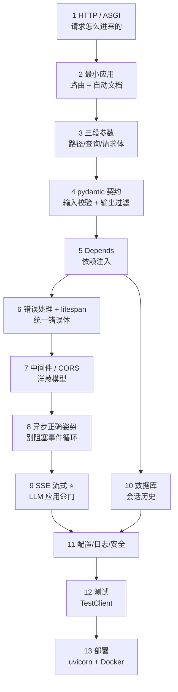
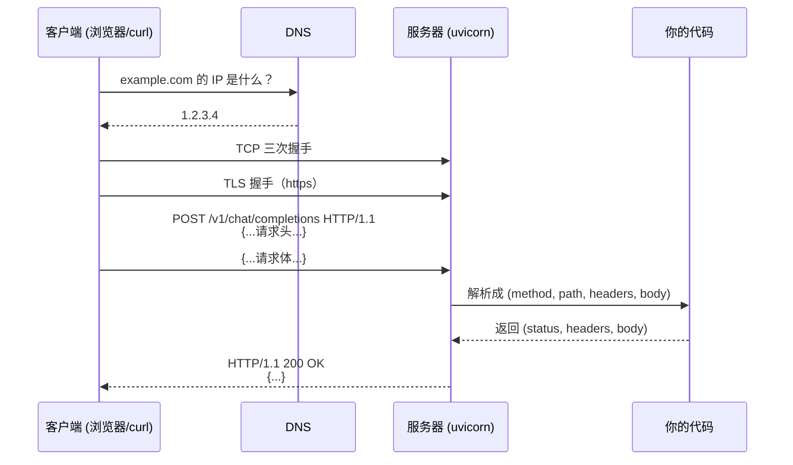
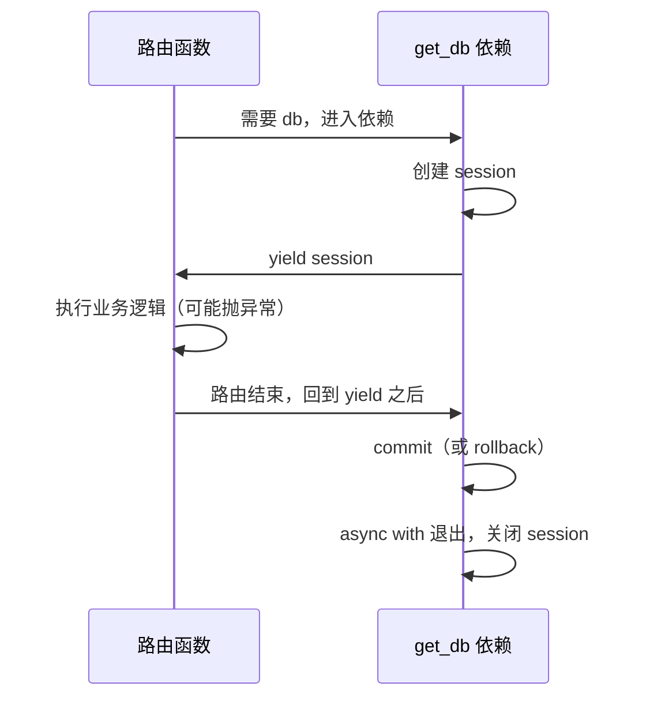
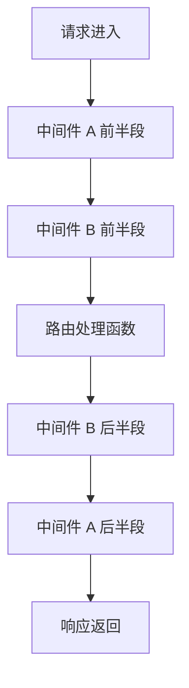
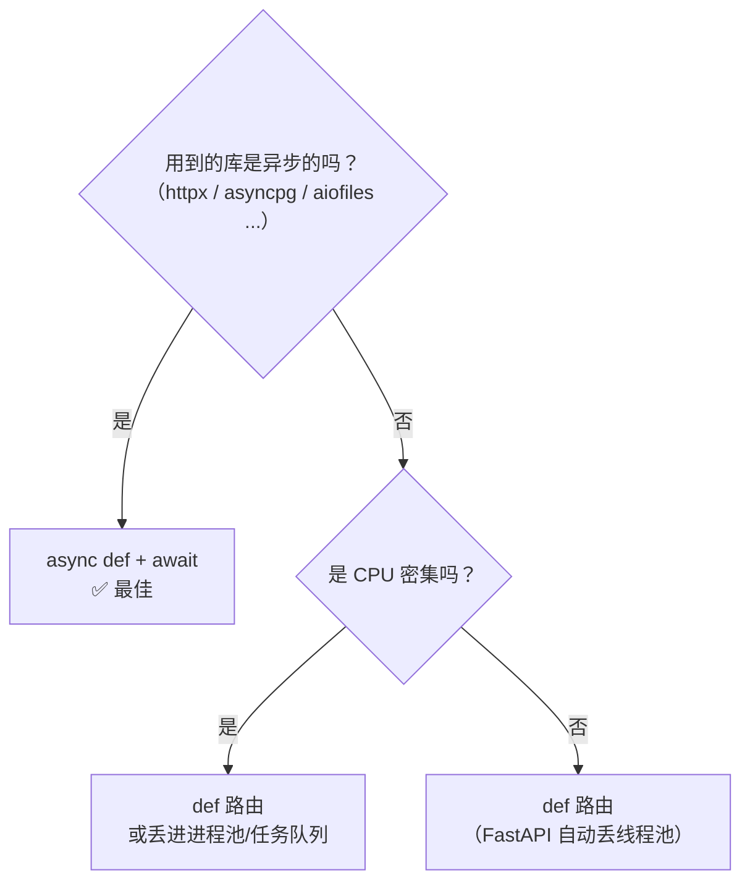
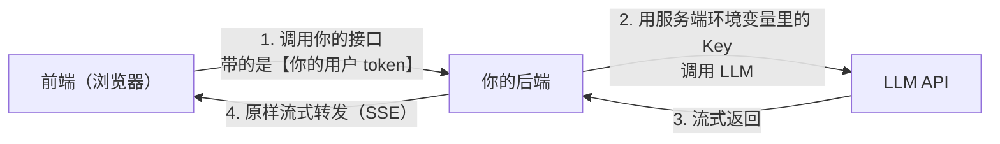
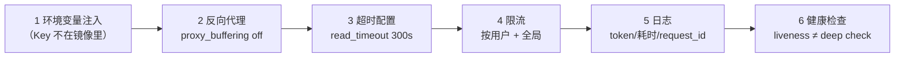
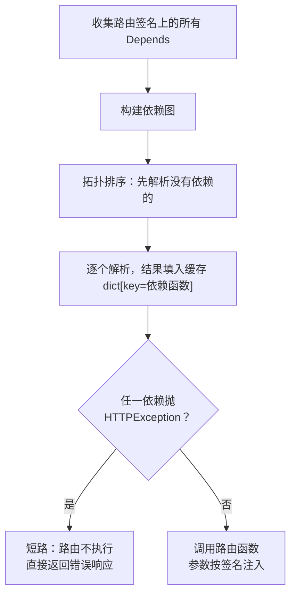
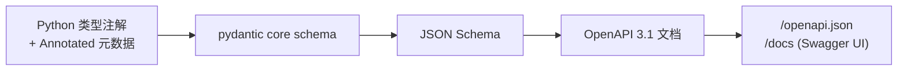

# 阶段 1 · FastAPI 速成 · 学习笔记

> **用途**：用最短路径掌握**能交付 LLM 应用后端**的 FastAPI 核心能力（含 SSE 流式、依赖注入、数据库、测试、部署）。
> **写法约定**：术语后面跟一句 🧒「人话解释」，公式用 LaTeX，坑点用 ⚠️ 单独标出，重点用 ⭐。
> **目标读者**：已完成阶段 0（[阶段0-工程基础.md](./阶段0-工程基础.md)），会 pydantic 与 async 基础。
> **实践产出**：跟随本笔记从空目录亲手搭建一个可流式返回的聊天后端；仓库不附带预配置项目。
> **同系列**：ML 阶段笔记（房价预测，同一套写法）—— *该笔记不在本仓库*。

---

## 本笔记的代码**全部实测过**

| 依赖 | 实测版本 |
|------|---------|
| Python | 3.12.15 |
| fastapi | **0.143.0**（2026-10-14 本仓库实测；本笔记其余示例写于 0.142.2 时期） |
| starlette | **1.8.0**（2026-10-14 本仓库实测；原为 1.7.0） |
| uvicorn | 0.54.0（2026-10-14 实测一致） |
| pydantic | 2.13.5 |
| httpx | 0.28.1 |
| sqlalchemy | **2.1.3**（+ `greenlet` 3.5.6） |
| aiosqlite | 0.22.1 |
| pytest / pytest-asyncio | 9.1.1 / 1.4.0 |

> ⭐ **为什么强调这个**：网上大量 FastAPI 教程停留在 0.7x / pydantic v1 时代，
> 而 **Starlette 已经从 0.x 跨到 1.x**，写法有变（本笔记标注了每一处"旧写法已废弃"）。
> 下面每一段代码都在上述版本上**真实跑通**，并有断言支撑。

**2026-10-14 本仓库 `uv add fastapi "uvicorn[standard]"` 的实际结果**（步骤 1.1）：

```text
Resolved 31 packages | Installed 11 packages

直接依赖（我们声明的）：fastapi==0.143.0、uvicorn==0.54.0
间接依赖（它们自己带来的）：
  annotated-doc==0.0.5    click==8.5.0        httptools==0.9.0
  opentelemetry-api==1.45.1  pyyaml==6.0.3    starlette==1.8.0
  watchfiles==1.3.0       websockets==17.2
```

| 观察 | 说明 |
|---|---|
| `fastapi 0.142.2 → 0.143.0`、`starlette 1.7.0 → 1.8.0` | **文档写的是当时版本，装到的是新版本** —— 这正是"版本号必须实测"的原因 |
| `click` / `pyyaml` / `watchfiles` | uvicorn 的 `[standard]` extras 带来的（`watchfiles` 支撑 `--reload`） |
| `httptools` / `websockets` | 更快解析 / 支持 WebSocket 协议 |
| `annotated-doc` / `opentelemetry-api` | fastapi 新版引入的间接依赖（标注文档 / 可观测性接口） |
| `Resolved 31 packages` | 是**整张依赖图**的解析总数，不是新增 31 个 |

---

## 如何阅读这份笔记

**第一遍（建立全局）**
1. 先读 **「全局地图」** 和 **Step 1** —— 不搞清 HTTP/ASGI，后面全是黑盒魔法
2. 按 **Step 2 → Step 13** 顺序精读，每步都手敲一遍
3. **Step 9（SSE 流式）是重点** —— 这是"LLM 应用"和"普通后端"的分水岭

**第二遍（补深度）**
4. 读 **「难点拓展」** —— ASGI 协议细节、依赖注入解析算法、OpenAPI 生成原理、并发模型

**随时查阅**
5. 写代码时 → **附录 A 代码片段速查**（可直接抄）
6. 术语不懂 → **附录 C 术语速查**
7. 踩坑 → **附录 D 常见坑总表**
8. 准备面试 → **附录 E 面试高频问题速查**

---

## 目录

| 章节 | 内容 | 一句话定位 |
|------|------|-----------|
| Step 1 | HTTP 与 ASGI 地基 | 不搞懂这个，FastAPI 就是玄学 |
| Step 2 | 最小应用与自动文档 | 5 行代码换来一个交互式文档站 |
| Step 3 | 三段参数：路径 / 查询 / 请求体 | FastAPI 的核心"魔法"其实是类型注解 |
| Step 4 | pydantic 契约与 `response_model` | 输入校验 + 输出过滤 |
| Step 5 | 依赖注入 `Depends` | 阶段 0 手工注入的自动化版 |
| Step 6 | 错误处理与 `lifespan` | 统一错误体 + 启动/关闭逻辑 |
| Step 7 | 中间件与 CORS | 洋葱模型 / 前端跨域 |
| Step 8 | 异步的正确姿势 | `async def` 不是"更快"，是"不阻塞" |
| **Step 9** | **SSE 流式响应** ⭐⭐ | **LLM 应用的命门：首字延迟** |
| Step 10 | 数据库（SQLAlchemy 2.0 异步） | 会话历史存哪 |
| Step 11 | 配置 / 日志 / 安全 | API Key 绝不能进前端 |
| Step 12 | 测试 FastAPI | TestClient / ASGITransport / 依赖覆盖 |
| Step 13 | 部署 | uvicorn + Docker + 反向代理 |
| 回顾 | 聊天后端设计蓝图 | 把 13 步拼成一个可交付项目 |
| **难点拓展** | 10 个关键问题的深入解释 | 含协议细节与算法 |
| 附录 A | 代码片段速查 | 可直接抄 |
| 附录 B | 数学背景 → 后端知识对照 | |
| 附录 C | 术语速查（人话版） | |
| 附录 D | 常见坑总表 | |
| 附录 E | 面试高频问题速查 | |

---

## 学习进度

**两列含义不同，别混**：`笔记状态` = 这份笔记该节内容是否已写好；`实操状态` = **本仓库是否真的动手做过**（对应 [学习过程记录.md](学习过程记录.md) 的流水编号）。

| Step | 主题 | 笔记状态 | 实操状态 |
|------|------|------|------|
| 1 | HTTP 与 ASGI 地基 | ✅ 已整理 | ✅ 已完成（1.2；新增 §1.4b / §1.4c 两组本仓库实测：并发三种命运、原始报文与状态码） |
| 2 | 最小应用与自动文档 | ✅ 已整理 | ✅ 已完成（1.1：`/health` + `/docs` + `/openapi.json` 实测 200） |
| 3 | 三段参数 | ✅ 已整理 | ⬜ 未开始 |
| 4 | pydantic 契约 | ✅ 已整理 | 🟡 部分（`schemas.py` 已在阶段 0 完成，尚未接入路由 / `response_model`） |
| 5 | `Depends` 依赖注入 | ✅ 已整理 | ⬜ 未开始（阶段 0 手工版已掌握） |
| 6 | 错误处理与 `lifespan` | ✅ 已整理 | ⬜ 未开始 |
| 7 | 中间件与 CORS | ✅ 已整理 | ⬜ 未开始 |
| 8 | 异步正确姿势 | ✅ 已整理 | 🟡 部分（阶段 0 的 `playground/` 实验已覆盖协程与并发基础） |
| 9 | **SSE 流式** | ✅ 已整理 ⭐ | ⬜ 未开始（**本阶段重点**） |
| 10 | 数据库 | ✅ 已整理 | ⬜ 未开始 |
| 11 | 配置/日志/安全 | ✅ 已整理 | 🟡 部分（配置已由阶段 0 的 `config.py` 解决；日志/安全未做） |
| 12 | 测试 | ✅ 已整理 | ⬜ 未开始 |
| 13 | 部署 | ✅ 已整理（本机未装 Docker） | ⬜ 未开始 |

> ⚠️ **别把"笔记已整理"当成"学会了"** —— 这是本表的用途。笔记写得再全，只有"实操状态 ✅"才算真的做过。

---

## 全局地图



**心法**：

- **Step 1 是唯一"看起来不实用"但必须读的一步**：不搞清 HTTP 与 ASGI，后面全是"记住这个写法"
- Step 3 → 4 → 5 是一条线：**参数怎么进来（3）→ 怎么校验（4）→ 依赖怎么复用（5）**
- Step 6 → 7 → 8 是"服务能扛住"的三件事：**错误可控、横切逻辑集中、不阻塞**
- **Step 9 是你的岗位命门**：LLM 应用的体验 = 首字延迟（TTFT），不做流式等于产品不可用
- Step 12 → 13 是"能交付"：**测试锁行为，容器锁环境**

---

## 快速上手：5 分钟跑起来

```python
# main.py
from fastapi import FastAPI

app = FastAPI()


@app.get("/health")
async def health() -> dict[str, bool]:
    return {"ok": True}
```

```powershell
uv add fastapi uvicorn
uv run uvicorn main:app --reload
# 打开 http://127.0.0.1:8000/docs —— 你已经有交互式 API 文档了
```

> ⭐ 那行 `-> dict[str, bool]` 不是注释。**FastAPI 读的就是它**：类型注解 → JSON Schema → OpenAPI → `/docs` 页面。
> 这就是为什么阶段 0 要先把**类型注解**和 **pydantic** 学扎实 —— 在 FastAPI 里它们是功能，不是风格。

---

# Step 1 · HTTP 与 ASGI 地基

## 定位

> FastAPI 是一层**薄封装**。它把 HTTP 请求变成 Python 函数调用，再把返回值变成 HTTP 响应。
> 不理解这层，你就不明白"为什么函数签名能决定路由行为"。

## 1.1 一次请求发生了什么



⭐ **关键认知**：**HTTP 是无连接的请求-响应模型**。
服务端**不记得**上一个请求是谁发的 —— "记住用户状态"这件事**必须你自己做**（Cookie / Token / 数据库）。

> 🧒 **类比**：HTTP 像"每次打电话都换一个陌生客服"，你必须在每通电话里自报家门（带 token）。
> 这就是为什么有 `Authorization` 头、有 session 表。

## 1.2 HTTP 报文结构

**请求**：

```http
POST /v1/chat/completions HTTP/1.1          ← 请求行：方法 + 路径
Host: api.example.com                        ← 请求头开始
Content-Type: application/json
Authorization: Bearer sk-xxx
Content-Length: 42
                                             ← 空行 = 头结束
{"messages":[{"role":"user","content":"hi"}]} ← 请求体
```

**响应**：

```http
HTTP/1.1 200 OK                              ← 状态行
Content-Type: application/json
                                             ← 空行
{"content":"你好"}                            ← 响应体
```

| 位置 | FastAPI 里对应什么 |
|------|------------------|
| 方法 + 路径 | `@app.post("/v1/chat/completions")` |
| 路径里的变量 | 路径参数（`/items/{item_id}`） |
| 查询串 `?limit=10` | 查询参数 |
| `Content-Type` | 决定请求体怎么解析 |
| 请求体 | pydantic 模型 |
| 响应状态码 | `status_code=` 或抛 `HTTPException` |

## 1.3 方法、状态码、幂等

| 方法 | 语义 | 幂等？ | 有请求体？ |
|------|------|-------|-----------|
| `GET` | 读取 | ✅ | 通常无 |
| `POST` | 创建 / 执行动作 | ❌ | 有 |
| `PUT` | 整体替换 | ✅ | 有 |
| `PATCH` | 局部更新 | ❌（通常） | 有 |
| `DELETE` | 删除 | ✅ | 通常无 |

> ⭐ **幂等 = 执行一次和执行 N 次，结果一样**。
> 为什么重要：网络会超时重试。**如果是 `POST /orders`，重试可能下两个单**！
> 所以支付类接口要配"幂等键"（idempotency key）。

**必须记住的状态码**：

| 码 | 含义 | 何时用 |
|----|------|-------|
| 200 | OK | 普通成功 |
| 201 | Created | POST 创建成功 |
| 204 | No Content | 成功但无返回体（如 DELETE） |
| 400 | Bad Request | 请求本身有问题 |
| 401 | Unauthorized | **没登录**（没带/带错凭证） |
| 403 | Forbidden | **登录了但没权限** |
| 404 | Not Found | 资源不存在 |
| **422** | **Unprocessable Entity** | ⭐ **参数校验失败（FastAPI 默认）** |
| 429 | Too Many Requests | 限流 |
| 500 | Internal Server Error | 服务端 bug |

> ⭐ **401 vs 403 的区别**（高频面试题）：
> 401 = "你是谁？"（未认证）；403 = "我知道你是谁，但你不能这么做"（未授权）。
>
> ⭐ **为什么 FastAPI 用 422 而不是 400**：400 是"请求格式就是错的"；422 是"格式对，但内容不合法"。
> pydantic 校验失败属于后者。细节见 **难点拓展 7**。

## 1.4 WSGI vs ASGI ⭐

**同步服务（WSGI）的工作方式**：

```text
一个请求 = 一个线程（或进程）
线程在等待 IO 时被操作系统挂起，什么也干不了
1 万个并发连接 → 需要 1 万个线程 → 内存爆炸
```

**异步服务（ASGI）的工作方式**：

```text
一个事件循环 + N 个协程
协程 await 时主动让出 → 循环去推进其他协程
1 万个并发连接 → 1 个（或几个）线程就够
```

| | WSGI | ASGI |
|---|------|------|
| 代表框架 | Flask、Django（传统） | **FastAPI / Starlette**、Django 3+ |
| 接口签名 | `def app(environ, start_response)` | `async def app(scope, receive, send)` |
| 并发模型 | 线程/进程 | 事件循环 |
| 支持 WebSocket | ❌ | ✅ |
| 支持 SSE 长连接 | 勉强（占线程） | ✅ 原生 |
| 适配的服务器 | gunicorn、uwsgi | **uvicorn**、hypercorn |

> ⭐ **对你的岗位意味着什么**：LLM 应用是"**长等待、多并发**"的典型场景。
> 一个 LLM 请求要 5~30 秒，WSGI 下 100 个用户就要 100 个线程全部挂在那里等；
> ASGI 下单线程就能扛住，**这就是选 FastAPI 的根本原因**（不是"因为它新"）。

### 1.4b 本仓库实测：三种写法的并发命运 ⭐⭐（2026-10-14）

> ⚠️ **说明**：下面的数字来自一个**临时演示应用**（写在系统临时目录、实验后已删除），
> **不是本项目 `src/app/api/app.py` 里的代码** —— 我们的应用目前**只有 `/health` 一条路由**。
> 造临时应用的原因：要量出"三种写法"的差别，就需要三条**只在等待方式上不同**的路由，`/health` 演示不了。
> 下表里的 `/async-sleep`、`/sync-def`、`/blocking-async` 都是那个临时应用的路由名，**本项目里不存在**。

> 上表是"讲道理"，这里给**量出来的数字**。用真实 uvicorn 起一个小应用，三条路由**内部都等 1 秒**，
> 唯一区别是写法；然后同时打 **8 个并发请求**。

| 路由写法 | 8 个并发的总耗时 | 结论 |
|---|---|---|
| `async def` + `await asyncio.sleep(1)` | **1.08 秒** | ✅ 理想：`await` 让出控制权，8 个请求重叠等待 |
| `def`（无 async）+ `time.sleep(1)` | **1.04 秒** | ⚠️ 不阻塞，但**代价是占线程** —— Starlette 把它丢进**线程池**（`anyio.to_thread`，默认上限约 40） |
| ⚠️ `async def` + `time.sleep(1)` | **8.03 秒** | ❌ **完全串行**：阻塞调用把事件循环的**唯一线程**按住了 1 秒 × 8 |

⭐ **最反直觉的结论：`async def` 里调用阻塞函数，比干脆写成 `def` 还糟。**

| 写法 | 谁在执行 | 阻塞谁 |
|---|---|---|
| `def` + 阻塞调用 | 线程池里的**一个线程** | 只占那一个线程 |
| `async def` + 阻塞调用 | **事件循环的唯一线程** | **整个服务**（所有请求一起等） |

**为什么**：`async def` 是对事件循环的**承诺**——"我在等待时会让出"。而 `time.sleep` / `requests.get` / 同步数据库驱动 / 大文件读 / 大计算**都不会让出**。许了做不到的承诺，被坑的是**所有其他请求**。

> ⚠️ **识别法**：看到 `async def` 里出现 `requests` / `time.sleep` / 同步 DB 驱动 / 大计算 → 立刻怀疑"这行会阻塞多久？"
> 这正是本项目选 `httpx`（异步）而非 `requests`、Step 10 要用 `aiosqlite` / `asyncpg` 的原因。

**WSGI 的线程账（1000 个并发、每个等 20 秒）**：

| | WSGI | ASGI |
|---|---|---|
| 一个请求占什么 | 一个线程/进程 | 一个协程（仅几个 Python 对象） |
| 1000 并发等待 | 需要 **1000 个线程**同时挂着，每线程栈约 1 MB → **≈ 1 GB 光栈**（典型值） | **1 个线程** + 1000 协程 → **几十 MB** |
| 额外开销 | 线程上下文切换与调度 | 协程切换是纯内存操作，几乎为零 |

**再叠加 SSE（Step 9）**：一个流式回答要占住连接 30 秒以上。WSGI 下一个 SSE 连接**占一个线程 30 秒**；ASGI 下这些协程在 `await` 时全部让出。

⭐ **一句话：同步模型里"等待"要占着一个工人；异步模型里"等待"是免费的。**

### 1.4c 本仓库实测：报文与状态码

**原始 HTTP 报文（用裸 socket 服务器抓 httpx 的真实字节）**：

```http
GET /health HTTP/1.1                      ← 请求行：方法 + 路径 + 版本
Host: 127.0.0.1:8138                      ← 以下 5 行都是 httpx 自动加的
Accept: */*
Accept-Encoding: gzip, deflate
Connection: keep-alive
User-Agent: python-httpx/0.28.1
                                          ← 空行 = 头结束
                                          ← 正文（GET 无）
```

```http
HTTP/1.1 200 OK                           ← 状态行
Content-Type: application/json
Content-Length: 15
                                          ← 空行
{"status":"ok"}                           ← 正文，正好 15 字节
```

| 观察 | 含义 |
|---|---|
| `Connection: keep-alive` + **同一条连接上成功发了两个请求** | HTTP/1.1 默认**复用连接** → 这就是客户端要维护**连接池**、要 `async with` 关闭的原因 |
| `Content-Length` **必须与正文长度精确一致** | 写错（如声明 20 只发 15）→ 客户端一直等剩下 5 字节，**两端都不报错**，界面永久转圈 |

**状态码实测**：

> ⚠️ **同样是那个临时演示应用**（已删除，见 §1.4b 开头的说明）。其中 `/items/{item_id}` 与
> `/no-such-path`、`POST /health` 是为了"造出 404 / 405 / 422"而特意写的，**本项目里不存在**。
> 本项目目前只有 `/health` 一条自定义路由（FastAPI 另白送 4 条：`/docs`、`/redoc`、`/openapi.json`、`/docs/oauth2-redirect`）。

```text
GET  /health        -> 200    正常（⭐ 本项目的真实路由）
GET  /items/42      -> 200    item_id: int，42 可转整数        ← 临时应用
GET  /items/abc     -> 422    内容不合法（格式没坏）           ← 临时应用
GET  /no-such-path  -> 404    路径未注册                       ← 临时应用
POST /health        -> 405    路径存在但方法不对                ← 临时应用
（无人监听的端口）   -> 无状态码，抛 ConnectError：连接都没建立
```

| 家族 | 口诀 | 实测例 |
|---|---|---|
| 2xx | 事办成了 | 200 |
| 3xx | 去那边找（⚠️ httpx 默认 `follow_redirects=False`，**不会自动跟**） | — |
| **4xx** | **你的问题（调用方）** | 401 / 404 / 405 / 422 |
| **5xx** | **我的问题（服务端）** | 500 |

> ⭐ **排查第一刀**：看到 4xx 就别翻服务端日志找 bug，先看**自己传了什么**。

**ASGI 接口长什么样**（看懂了就明白 FastAPI 在干什么）：

```python
async def app(scope, receive, send):
    # scope: 类似请求元信息（method/path/headers）
    # receive: 异步取请求体（可多次，用于流式上传）
    # send: 异步发响应（可多次，用于流式返回！）
    ...
```

> ⭐ 注意 `send` 可以被**调用多次** —— 这就是 SSE / WebSocket 能在 ASGI 上工作的原因。
> **WSGI 的 `start_response` 只能调一次**，所以同步框架做流式很别扭。

## 1.5 自检

1. HTTP 为什么被称为"无状态"？那登录状态靠什么维持？
2. 401 和 403 的区别？
3. 幂等性为什么对支付接口是刚需？
4. WSGI 和 ASGI 的并发模型区别？为什么 LLM 应用必须选 ASGI？
5. ASGI 的 `send` 能被调用多次，这件事解锁了什么能力？

### 1.5b 自检批改（2026-10-14 学习者作答后订正）⭐

| 题 | 作答情况 | 订正要点 |
|---|---|---|
| 1 | 🟡 半分 | **无状态的定义对**，但"登录状态靠 uvicorn 维持"**错** —— 见下 |
| 2 | ✅ 满分 | "身份没填/完全错" vs "身份传了但没权限"，判据说得很准 |
| 3 | 🟡 半分 | 幂等的危险对，但**场景归错**：见下 |
| 4 | 🟡 半分 | "一次性 vs 分段"对，**漏了"并发模型"**（这才是首要理由） |
| 5 | ✅ 满分 | "边生成边输出"正确 —— 正是 Step 9 的实现基础 |

**⚠️ 订正 1：登录状态**靠什么**维持**（第 1 题）

| 谁 | 能记住什么 | 能维持登录状态吗 |
|---|---|---|
| **uvicorn**（服务器） | 什么业务状态都不记；它连 `Authorization` 头都不解析（那是**你的应用**的事） | ❌ 不能 |
| **你的 Python 进程内存** | 能记，但**重启就归零**；且 `--workers 4` 时各进程**互不可见** | ⚠️ 只在"单进程且不重启"时凑效 |
| **数据库 / Redis** | 真正持久 | ✅ **标准答案** |

实测证据（同一份代码，两个进程）：

```text
进程 A（第一次启动）： visits=1 → visits=2     ← 进程内变量还活着
进程 B（模拟重启）：   visits=1                 ← ⛔ 归零
```

⭐ 呼应 1.1c：`--reload` 是"杀掉重启"，所以存在进程内存里的状态**每改一次代码就全丢**。

> **标准答案**：HTTP 无状态 → 服务器不记得上一个请求。登录状态只能靠 ① **每次带凭证**（token）
> ② **服务端把状态存进共享持久层**（数据库 / Redis），客户端带 session id 认领。
> **uvicorn 和应用进程都不负责这件事。** 这也是"JWT vs Session"争论的根源。

**⚠️ 订正 2：幂等要解决的场景**（第 3 题）

- ❌ 归错：把"流式中断"当成支付幂等的原因 —— **流式中断是 LLM 调用的场景**（重试 = 白花两次 token 钱）
- ✅ 正解：支付幂等要解决的是"**客户端不知道服务器到底收到没**"

```text
POST /orders 发出 → 等 10 秒无响应 → 客户端【分不清】：
   A. 服务器根本没收到        → 重试是对的 ✅
   B. 服务器处理成功了，但响应回来的路上丢了 → 重试 = 下两个单 ⛔
```

⭐ 问题出在"**响应丢失导致客户端不确定**"，不是"流式中断"。解法是**幂等键**：客户端生成 UUID 一起发，
服务端记住"这个键处理过了"，第二次直接返回上次结果、不再执行。

**⚠️ 订正 3：第 4 题要答两层**（并行模型 + 输出方式）

| | WSGI | ASGI |
|---|---|---|
| **并发模型** ← 最容易漏 | **一个请求 = 一个线程/进程** | **一个事件循环 + N 个协程** |
| 输出方式 | 一次性 `return` 完整响应 | `send()` 可多次调用（分段） |

- **别只说"ASGI 更快"** —— 单个请求跑同样代码，**速度一样**。ASGI 的价值是 **"等待不占工人"**
- 两条理由都要说：① 等待不占资源（可扛高并发）② 能做流式（LLM 必需）

**本次两处错误是同一类型：把"某件事"归错了主体。**
（把"维持登录状态"归给 uvicorn、把"流式中断"归给支付。）
⭐ **这与本周踩过的 TOML 表头、`.gitattributes` 位置是同一类问题 —— "归错主体"。**
养成习惯：说到"谁负责 X"时，先问**"这个能力真的在那一层吗？"**

---

# Step 2 · 最小应用与自动文档

## 2.1 三行起一个服务

```python
from fastapi import FastAPI

app = FastAPI(title="chat-backend", version="0.1.0")


@app.get("/health")
async def health() -> dict[str, bool]:
    return {"ok": True}
```

| 部分 | 作用 |
|------|------|
| `FastAPI(...)` | 应用实例（`title`/`version` 会出现在文档页里） |
| `@app.get("/health")` | **路径操作装饰器**：把函数注册到 `GET /health` |
| `async def health()` | 处理函数；可 `async` 也可同步（差别见 Step 8） |
| `-> dict[str, bool]` | **响应类型** → 决定文档与序列化 |

## 2.2 `uvicorn main:app` 这个参数怎么读

```powershell
uv run uvicorn main:app --reload --host 127.0.0.1 --port 8000
```

| 部分 | 含义 |
|------|------|
| `main:app` | 模块 `main.py` 里的变量 `app`（**import 路径:属性名**） |
| `--reload` | 改代码自动重启（**仅开发用**，生产绝不能用） |
| `--host 0.0.0.0` | 允许外部访问（默认 `127.0.0.1` 只能本机访问） |
| `--port` | 端口 |
| `--workers N` | 多进程（生产用，见 Step 13） |

> ⚠️ `main:app` 是 **import 路径**，不是文件路径。
> 如果应用在 `src/app/main.py` 里，且项目根在 `sys.path` 上，就是 `app.main:app`。
> **写错了报 `ModuleNotFoundError` 或 `AttributeError: module has no attribute 'app'`。**

## 2.3 白送的三个端点 ⭐

FastAPI 自动生成：

| 端点 | 内容 |
|------|------|
| `/docs` | **Swagger UI**（可交互，能直接在页面发请求） |
| `/redoc` | ReDoc（另一种风格的文档） |
| `/openapi.json` | 机器可读的 OpenAPI 3 规范 |

**实测验证**：

```text
$ curl -s -o NUL -w "docs: %{http_code}\n" http://127.0.0.1:8123/docs
docs: 200

$ curl -s http://127.0.0.1:8123/openapi.json | ...
{"info": {"title": "verify", ...}, "paths": {"/chat": {...}, "/health": {...}}}
```

> ⭐ **这对 LLM 应用有额外价值**：你的后端要暴露给前端 / 别的 Agent 调用。
> 有 OpenAPI，对方可以直接生成客户端代码，**不用你写接口文档**（而且它永远和代码同步）。
>
> 🧒 **类比**：等于"你写完函数，文档自动生成且不会过期"。手写 API 文档最大的问题就是**它会过期**。

## 2.4 路由参数的顺序陷阱 ⚠️

```python
@app.get("/users/me")
async def me(): ...

@app.get("/users/{user_id}")
async def get_user(user_id: str): ...
```

**顺序必须这样**！如果把 `/{user_id}` 放前面，请求 `/users/me` 会**先匹配到** `/{user_id}`，
于是 `user_id="me"` —— 这是新手最常见的 404/类型错误来源。

> ⭐ **规则**：**具体路径写在参数化路径之前**。FastAPI 按注册顺序匹配。

## 2.5 自检

1. `uvicorn main:app` 里的 `main:app` 分别指什么？
2. `/docs` 和 `/openapi.json` 的关系是什么？
3. 为什么 `/users/me` 必须写在 `/users/{user_id}` 前面？
4. 为什么说"自动生成的文档不会过期"这件事对协作特别重要？

---

# Step 3 · 三段参数：路径 / 查询 / 请求体

## 定位

> FastAPI 最"反直觉"又最省事的地方：**它从函数签名推断出参数从哪来**。
> 这一段讲清推断规则，之后你看任何 FastAPI 代码都能一眼看懂。

## 3.1 三类参数的位置

```text
POST /v1/items/42?verbose=true&limit=10
                 ↑              ↑        ↑
              路径参数        查询参数   查询参数
请求体：{"name": "apple"}   ← 请求体参数
```

```python
@app.post("/v1/items/{item_id}")
async def update_item(
    item_id: int,                                    # ← 路径参数（出现在路径里）
    verbose: bool = False,                           # ← 查询参数（标量 + 有默认值）
    limit: int = 10,                                 # ← 查询参数
    payload: ItemIn = ...,                           # ← 请求体（pydantic 模型）
) -> ItemOut: ...
```

## 3.2 FastAPI 的判定规则 ⭐

| 参数类型 | 位置 | 例子 |
|---------|------|------|
| 出现在路径 `{}` 里的名字 | **路径参数** | `item_id: int` |
| **pydantic 模型** / `dict` / `list[模型]` | **请求体** | `payload: ItemIn` |
| 其余**标量**（`int`/`str`/`bool`/`float`） | **查询参数** | `limit: int = 10` |

> 🧒 **一句话**：**"路径里有的算路径，复杂对象算 body，剩下的算查询串。"**
> 记住这条，你就能读懂任何 FastAPI 路由签名。

## 3.3 路径参数

```python
@app.get("/items/{item_id}")
async def get_item(item_id: int) -> dict[str, int]:
    return {"item_id": item_id}
```

**实测行为**：

| 请求 | 结果 | 说明 |
|------|------|------|
| `GET /items/5` | `200 {"item_id": 5}` | ⭐ `"5"` **自动转成** `5`（类型转换） |
| `GET /items/abc` | **`422`** | 转不成 int → 校验失败，**不是 500** |
| `GET /items/404` | 取决于你的代码 | 抛 `HTTPException` 才返回 404 |

> ⭐ **这就是"类型即校验"**：你只写了 `int`，就同时得到了
> **文档里的类型说明 + 运行时转换 + 转换失败的自动 422**。零额外代码。

**带校验的路径参数**：

```python
from typing import Annotated
from fastapi import Path

@app.get("/items/{item_id}")
async def get_item(item_id: Annotated[int, Path(ge=1, le=1000)]) -> dict[str, int]:
    return {"item_id": item_id}
```

## 3.4 查询参数

```python
@app.get("/items")
async def list_items(
    skip: int = 0,
    limit: Annotated[int, Query(ge=1, le=100)] = 10,
    q: Annotated[str | None, Query(max_length=50)] = None,
) -> dict[str, object]:
    return {"skip": skip, "limit": limit, "q": q}
```

| 写法 | 含义 |
|------|------|
| `limit: int = 10` | 可选，默认 10 |
| `limit: int`（无默认值） | **必填**查询参数，缺了 → 422 |
| `q: str \| None = None` | 可选，可以是 None |
| `Annotated[int, Query(ge=1, le=100)]` | 带范围约束 |

**实测：约束真的会拦**：

```text
$ curl "http://127.0.0.1:8123/health?limit=0"
HTTP 422        ← Query(ge=1) 拦住了
```

> ⚠️ **`bool` 查询参数的坑**：`?flag=true` / `?flag=1` / `?flag=yes` 都能解析，
> 但 `?flag=false` **是 False**，而 `?flag=` （空值）**会报 422**。
> 前端传参时务必注意"空字符串 ≠ 布尔值"。

## 3.5 请求体

```python
from pydantic import BaseModel, Field


class MessageIn(BaseModel):
    role: Literal["system", "user", "assistant"]
    content: str = Field(min_length=1)


class ChatRequest(BaseModel):
    messages: list[MessageIn] = Field(min_length=1)
    temperature: float = Field(default=0.7, ge=0.0, le=2.0)
    stream: bool = False


@app.post("/v1/chat")
async def chat(req: ChatRequest) -> dict[str, str]:
    return {"content": req.messages[-1].content}
```

> ⭐ **一个请求体参数 = 一个 pydantic 模型**。校验、默认值、文档全部来自阶段 0 学的那些能力。
> **阶段 0 的 pydantic 在这里直接变成"接口契约"** —— 这是两个阶段之间最自然的衔接点。

**多个请求体参数**（少见但要知道）：

```python
@app.post("/multi")
async def multi(a: ItemIn, b: UserIn) -> None:
    ...
    # 请求体变成 {"a": {...}, "b": {...}}   ← 自动加了字段名做 key
```

## 3.6 `Annotated` 为什么是现在的推荐写法 ⭐

**旧写法（过渡期）**：

```python
async def list_items(limit: int = Query(default=10, ge=1, le=100)): ...
```

**新写法（推荐）**：

```python
LimitParam = Annotated[int, Query(ge=1, le=100)]

async def list_items(limit: LimitParam = 10): ...
```

| 优势 | 说明 |
|------|------|
| **可复用** | `LimitParam` 定义一次，多处使用 |
| **默认值就是默认值** | 不用塞进 `Query(default=...)`，签名更干净 |
| **类型仍是真的 int** | 函数体内 `limit` 就是 `int`，mypy 开心，IDE 补全正常 |
| **静态检查友好** | 旧写法的默认值是 `QueryInfo` 对象，mypy 常要 ignore |

> ⭐ **FastAPI 官方从 0.95 起推荐 `Annotated`**。看到旧写法不用慌，但新代码一律用 `Annotated`。

### 3.6b 本仓库实测：1.3 的 4 条路由（2026-10-15）

> ✅ **代码在 [`src/app/api/app.py`](../src/app/api/app.py)**（本项目真实文件，非临时演示）。
> 验证方式：用 `httpx.ASGITransport` 直接打 `app`（不启服务、不占端口）。

**实装的 4 条路由**：

| 路由 | 演示哪种参数 | 要点 |
|---|---|---|
| `GET /v1/models` | **查询参数** | `prefix` 可选（前缀过滤）、`limit` 可选（默认 20） |
| `GET /v1/models/latest` | 无参数（固定路径） | ⚠️ **必须写在 `{model_name}` 之前**（见 2.4 的顺序陷阱） |
| `GET /v1/models/{model_name}` | **路径参数** | 路径里的 `{model_name}` 与参数名**必须一字不差** |
| `POST /v1/chat` | **请求体** | 参数类型是 `ChatRequest`（pydantic 模型）→ 判定为 JSON body |

**15 组请求实测结果**：

```text
GET  /health                         -> 200  {"status":"ok"}
GET  /v1/models                      -> 200  {"total":2,"items":["deepseek-flash","deepseek-v4-pro"]}
GET  /v1/models?limit=1              -> 200  {"total":2,"items":["deepseek-flash"]}
GET  /v1/models?prefix=deepseek-v4   -> 200  {"total":1,"items":["deepseek-v4-pro"]}   ← 前缀过滤生效
GET  /v1/models?prefix=flash         -> 200  {"total":0,"items":[]}
GET  /v1/models?limit=abc            -> 422  loc=['query','limit'] type=int_parsing     ← ⭐ 自动拦截
GET  /v1/models/latest               -> 200  {"model_name":"deepseek-flash"}            ← 固定路径优先
GET  /v1/models/deepseek-v4-pro      -> 200  {"model_name":"deepseek-v4-pro"}           ← 路径参数
POST /v1/chat {"messages":[{"role":"user","content":"你好"}]}
                                     -> 200  {"content":"[echo] 你好","model":"deepseek-flash"}
POST /v1/chat {"messages":[]}        -> 422  loc=['body','messages'] type=too_short     ← ⭐ min_length=1 生效
POST /v1/chat {"messages":[{"role":"tool",...}]}
                                     -> 422  loc=['body','messages',0,'role'] type=literal_error  ← ⭐ Literal 生效
```

⭐ **最后两组是"阶段 0 的 `schemas.py` 开始干活"的证据**：`Field(min_length=1)` 与 `Literal["system","user","assistant"]`
变成了**自动的请求校验**，我们**一行校验代码都没写**。

**⚠️ 三个"工具抓不到、只能实测发现"的坑**：

| 坑 | 现象 | 谁来发现 |
|---|---|---|
| `prefix: str \| None` **漏写 `= None`** | `/v1/models` 直接 **422 `Field required`** —— `str \| None` 只说"能装空"，不等于"可以不传" | ❌ ruff / ❌ mypy / ✅ **打请求** |
| `?limit=0` | 200，但 `items` 为空 | 同上 |
| `?limit=-1` | 200，返回 `["deepseek-flash"]` ⛔ **负索引切片**（`matched[:-1]` = "去掉最后一个"），**静默给出错误结果** | 同上 |

**修法**：给 `limit` 加约束（`Query(ge=1, le=100)`），让 `0` / `-1` / `101` 都被 422 拦下：

```python
limit: Annotated[int, Query(ge=1, le=100, description="最多返回几条")] = 20
```

**⚠️ 第四个坑：多余字段被静默忽略。**

```text
POST /v1/chat {"messages":[...], "extra":1}  ->  200  ✅（没报错！）
```

原因：pydantic `BaseModel` **默认 `extra="ignore"`** —— ⚠️ **与 `config.py` 里特意设的 `extra="forbid"` 相反**。

| 模型 | 设置 | 客户端多传字段 |
|---|---|---|
| `Settings`（配置） | `extra="forbid"`（故意选的） | 报错 |
| `ChatRequest`（数据契约） | **默认 `ignore`** | **静默忽略** |

⭐ **这意味着**：客户端把 `max_token`（少个 `s`）发过来，服务端会**默默用默认值**，两边都以为没问题 —— 又一处**静默失效**。
**要不要改成 `forbid` 是真实取舍**（严格能挡拼写错误，但客户端多传就 422），Step 4 正式讨论。

**⭐ 顺便：`mypy` 在本步抓到了一个会变成 500 的 bug**（详见 [学习过程记录](../study_notes/学习过程记录.md)）：

```text
src\app\api\app.py:65: error: "ChatRequest" has no attribute "message"; maybe "messages"?  [attr-defined]
```

`request.message`（少一个 `s`）**语法合法、`ruff` 也通过**，但运行时会抛 `AttributeError` → FastAPI 回 **500**。
**mypy 静态抓到它并直接给出正确拼写** —— 这正是"给数据模型写注解"的额外红利：**字段名拼写检查**。

### 3.6c ⚠️ 用 PowerShell 测中文接口的两个坑（2026-10-15 实测）⭐⭐

> 背景：用 `Invoke-RestMethod` 打 `/v1/chat` 传中文，结果回声是 `[echo] ??` —— **请求返回 200，但数据已经坏了**。

**两个独立的问题，必须分开判断**（判据：**看服务端实际收到的字节**，不能靠肉眼看终端）：

| # | 坑 | 现象 | 实测证据（服务端返回的原始字节） |
|---|---|---|---|
| 1 | **发**：`-Body "<含中文的字符串>"` | 中文被替换成 `?`，**请求侧真实损坏**，且返回 200 | 字节为 `3F-3F`（`??`） |
| 2 | **收**：PowerShell 显示响应时按 Latin-1 解码 | 看到 `ä½ å¥½` —— **只是显示乱码，数据是对的** | `-InFile` 时收到的是 `E4-BD-A0-E5-A5-BD`（`你好` 的正确 UTF-8） |

**三种发法实测对照**：

| 发法 | 服务端收到的中文 | PowerShell 显示 |
|---|---|---|
| `-Body '{"c":"你好"}'`（中文写在命令里） | ❌ `??`（损坏） | `??` |
| `-Body $utf8Bytes`（先转 UTF-8 字节数组） | ✅ 正确 | 乱码（显示问题） |
| `-InFile <UTF-8 文件>` | ✅ 正确 | 乱码（显示问题） |
| **Python `httpx`** | ✅ 正确 | ✅ **正确** |

**实践结论**：

```text
① 只想验证"接口逻辑对不对" → 用纯 ASCII 内容（hello / test），最省事
② 用 PowerShell 传中文 → 必须用 -InFile 或 UTF-8 字节数组（别把中文写在命令里）
③ 要"发和收都正确" → 改用 Python httpx（本项目已装）
④ 看到乱码先分清病因：是"发的时候坏了"（`??`）还是"只是显示坏了"（`ä½ å¥½`）
```

> ⭐ **这是本项目第 N 次编码坑**（前有 `.python-version` 的 BOM、`Get-Content` 按 GBK 读、中文经管道喂给 ruff）。
> **共同规律：Windows 上凡涉及"非 ASCII 文本进出命令行工具"，都要显式指定 UTF-8，并用字节级证据验证。**
>
> ⚠️ 附带一条能力边界：**注释 / docstring 里的英文单词拼错，没有任何工具能抓**
> （ruff / mypy 都不查拼写）。这与**属性名**拼错形成对比 —— 后者 mypy 的 `attr-defined` 能抓。

## 3.7 自检

1. 说出 FastAPI 判定"参数从哪来"的规则。
2. `GET /items/abc` 返回什么？为什么不是 500？
3. `limit: int = 10` 和 `limit: int` 有什么区别？
4. `Annotated[int, Query(ge=1)]` 比 `Query(default=10, ge=1)` 好在哪三个地方？

---

# Step 4 · pydantic 契约与 `response_model`

## 定位

> 输入用 pydantic 校验；**输出也要用 pydantic 约定** —— 因为输出的风险是**泄露**。

## 4.1 输入契约

同 Step 3.5。核心是：**校验在进入业务逻辑之前完成**（阶段 0 的结论）。

## 4.2 校验失败时到底返回什么

**实测原始响应**（`POST /chat`，body 为 `{"messages":[]}`）：

```http
HTTP 422 Unprocessable Entity

{
  "detail": [
    {
      "type": "too_short",
      "loc": ["body", "messages"],
      "msg": "List should have at least 1 item after validation, not 0",
      "input": [],
      "ctx": {"field_type": "List", "min_length": 1, "actual_length": 0}
    }
  ]
}
```

**逐字段解读**：

| 字段 | 含义 | 用途 |
|------|------|------|
| `type` | 错误类型码 | 前端可据此做 i18n |
| **`loc`** | **错误位置路径** | ⭐ `["body","messages"]` = body 下的 messages 字段 |
| `msg` | 人类可读信息 | 直接展示给用户（英文！见下） |
| `input` | 实际收到的值 | ⚠️ **可能含敏感数据，注意别原样回显** |
| `ctx` | 约束上下文 | 调试用 |

> ⭐ **`loc` 是嵌套路径**：如果是 `messages[0].content` 不合法，`loc` 会是
> `["body", "messages", 0, "content"]` —— **精确到第几条消息的哪个字段**。
> 这是 pydantic 递归校验带来的直接好处。

> ⚠️ **两个注意点**：
> 1. `msg` 是**英文**的。面向中文用户的产品需要自定义错误响应（见 Step 6 的异常处理器）。
> 2. `input` 会把用户传的数据**原样回显**。如果请求体里含密码/token，你可能不希望它出现在响应里 —— 生产环境通常要**改写 422 响应体**。

## 4.3 `response_model`：输出也要管 ⭐

```python
class UserOut(BaseModel):
    id: int
    name: str
    email: str


class UserDb(BaseModel):          # 内部模型（含敏感字段）
    id: int
    name: str
    email: str
    password_hash: str
    internal_note: str


@app.get("/users/{user_id}", response_model=UserOut)
async def get_user(user_id: int) -> UserDb:
    return db.get_user(user_id)   # 返回的是 UserDb（含密码哈希！）
```

**实测：`response_model` 真的会过滤**：

```python
# 被测函数返回 ChatResponse(content=..., model=..., usage_tokens=...)
# 但 response_model 只声明了三个字段里的一部分时，多余字段被剔除

r = client.post("/chat", json={...})
assert set(r.json()) == {"content", "model", "usage_tokens"}   # ✅ 实测通过
```

| 作用 | 说明 |
|------|------|
| **字段过滤** | 只暴露 `response_model` 里声明的字段 → **防泄露** |
| **类型转换** | `datetime` → ISO 字符串；`Decimal` → 字符串 |
| **文档** | 响应 schema 出现在 `/docs` |
| **校验** | 返回值不符合模型会报错（说明你的代码有 bug，**早发现**） |

> ⭐ **这是 FastAPI 最被低估的安全特性**：
> 你可以在内部模型里随便加字段，**只要 `response_model` 没声明，它就不会出去**。
> 反过来说：**不加 `response_model` 就等于把内部模型的所有字段暴露给客户端**。
>
> 🧒 **类比**：`response_model` 是"出门前检查口袋"的白名单机制 —— 只放行清单上的东西。

**常见变体**：

| 写法 | 场景 |
|------|------|
| `response_model=UserOut` | 标准 |
| `response_model=list[UserOut]` | 列表（实测通过） |
| `response_model=UserOut \| None` | 可能返回 null |
| `response_model_exclude_none=True` | 省略值为 None 的字段 |
| `response_model_exclude_unset=True` | 只输出被显式赋值的字段 |
| `return {"..."} ` 直接写 dict | 也可以，但**没有过滤保护**（不推荐） |

## 4.4 状态码指定

```python
@app.post("/v1/conversations", response_model=ConversationOut, status_code=201)
async def create_conversation(...) -> Conversation:
    ...
```

**实测**：`POST` 返回 `201`（默认是 200）。

```python
@app.delete("/items/{item_id}", status_code=status.HTTP_204_NO_CONTENT)
async def delete_item(item_id: int) -> Response:
    ...                                    # 204 不能有响应体
    return Response(status_code=status.HTTP_204_NO_CONTENT)
```

> ⚠️ **204 不允许有响应体**。如果你 `return {...}` 同时声明 204，某些客户端会报错。
> 用 `status` 常量（`status.HTTP_204_NO_CONTENT`）而不是魔法数字 `204`，可读性更好。

## 4.5 模型的复用策略（工程实践）

```text
UserCreate    ← 创建时用（含密码）
UserUpdate    ← 更新时用（字段都可选）
UserOut       ← 返回时用（不含密码）
UserInDb      ← 数据库内部用（含密码哈希）
```

| 做法 | 评价 |
|------|------|
| 一个 `User` 模型到处用 | ⚠️ **早晚泄露**：某个接口忘了过滤 |
| **按用途分模型 + 继承复用** | ⭐ 推荐 |

```python
class UserBase(BaseModel):
    name: str
    email: str


class UserCreate(UserBase):
    password: str


class UserOut(UserBase):
    id: int
    # 注意：这里没有 password
```

> ⭐ **判据**：**"这个数据会离开我的系统边界吗？"**
> 会 → 单独定义输出模型；不会 → 可以共用。

## 4.6 自检

1. `loc` 字段为什么能精确到"第几条消息的哪个字段"？
2. 422 响应体的 `input` 字段有什么风险？
3. **不写 `response_model` 有什么安全风险？**（这是面试题）
4. 204 状态码为什么不能有响应体？
5. 你会给"用户"设计几个 pydantic 模型？分别为什么？

---

# Step 5 · 依赖注入 `Depends`

## 定位

> 阶段 0 你手工做过依赖注入（把 `httpx.AsyncClient` 当参数传进 `fetch_model_ids`）。
> `Depends` 就是**把这件事自动化 + 声明式化**：FastAPI 帮你解析参数、创建对象、管理生命周期。

## 5.1 为什么需要它：先看重复代码

**没有 `Depends`**：

```python
@app.get("/conversations")
async def list_conversations(request: Request):
    token = request.headers.get("Authorization")           # ① 每个接口都要写
    if not token or not verify(token):
        raise HTTPException(401, "invalid token")
    async with SessionMaker() as db:                       # ② 每个接口都要写
        result = await db.execute(select(Conversation))
        return list(result.scalars().all())
```

**有 `Depends`**：

```python
@app.get("/conversations")
async def list_conversations(
    current_user: CurrentUserDep,     # ← 认证和数据库都"声明"出来就行
    db: DbDep,
):
    result = await db.execute(select(Conversation))
    return list(result.scalars().all())
```

> ⭐ **收益**：**接口函数只剩下它真正关心的事**。
> 认证、数据库、限流、分页参数……全部变成签名上的"声明"，实现被藏进可复用、可测试、可替换的依赖里。

## 5.2 函数依赖

```python
from typing import Annotated
from fastapi import Depends, Header, HTTPException


async def get_current_user(authorization: Annotated[str | None, Header()] = None) -> str:
    if not authorization or not authorization.startswith("Bearer "):
        raise HTTPException(status_code=401, detail="missing bearer token")
    token = authorization.removeprefix("Bearer ")
    if token != "valid-token":                     # 真实项目这里查库/JWT 验签
        raise HTTPException(status_code=401, detail="invalid token")
    return "user-001"


CurrentUserDep = Annotated[str, Depends(get_current_user)]


@app.get("/me")
async def me(user: CurrentUserDep) -> dict[str, str]:
    return {"user": user}
```

**三个关键点**：

| 点 | 说明 |
|----|------|
| 依赖的**参数**也能是别的依赖/参数 | `authorization: Annotated[str \| None, Header()]` 由 FastAPI 解析 |
| 依赖里 `raise HTTPException` | **在依赖阶段就短路**，路由函数根本不会被调用 |
| `Annotated[X, Depends(f)]` | ⭐ 让 `user` 的类型仍然是 `str`，mypy 和 IDE 都开心 |

## 5.3 类依赖：把一组参数打包

**实测通过的写法**（注意 `__init__` 里可以直接写 `Query`）：

```python
class PageDep:
    def __init__(self, limit: Annotated[int, Query(ge=1, le=100)] = 10) -> None:
        self.limit = limit


@app.get("/health")
async def health(page: Annotated[PageDep, Depends()]) -> dict[str, object]:
    return {"limit": page.limit}
```

**实测结果**：

```text
GET /health            → 200, limit = 10    （默认值生效）
GET /health?limit=3    → 200, limit = 3
GET /health?limit=0    → 422                 （Query(ge=1) 拦住）
```

> ⭐ `Depends()` **不带参数**表示"依赖这个类本身"，FastAPI 会去解析它的 `__init__` 签名。
> 这套写法适合"一组总是同时出现的参数"（分页、时间范围、排序），**一次声明，处处复用**。

## 5.4 `yield` 依赖：资源管理 ⭐

```python
async def get_db() -> AsyncIterator[AsyncSession]:
    async with SessionMaker() as session:
        try:
            yield session             # ① 交给路由使用
            await session.commit()    # ② 路由正常返回后提交
        except Exception:
            await session.rollback()  # ③ 出错回滚
            raise
```

**执行顺序**：



**实测**：`finally` 里的清理**确实执行**（本项目用一个记录列表验证过）。

| 关键点 | 说明 |
|--------|------|
| `yield` 前是 **setup** | 创建连接/会话 |
| `yield` 后是 **teardown** | 提交/回滚/关闭 |
| **即使抛异常也会走 teardown** | 和 `async with` / `try-finally` 同理 |
| ⚠️ 别在 `yield` 之后 `return` | 那里的返回值**不会被使用** |

> ⭐ **这是阶段 0 `async with create_client()` 的"框架版"**。
> 你自己写的时候要记得手动 `async with`；用 `Depends` 时，FastAPI 帮你记住生命周期。

## 5.5 ⭐ 依赖缓存：同一次请求内只算一次

**实测结果**：

```python
def base_dep() -> str:
    calls["count"] += 1
    return "base"


def derived_dep(value: BaseDep, other: BaseDep) -> str:   # 请求了同一个依赖两次
    return value + "!"


# POST /v1/chat/completions 返回 call_count = 1     ← 实测：只执行了一次！
```

| 结论 | 说明 |
|------|------|
| 同一次请求内，**同一个依赖只执行一次** | 结果被缓存复用 |
| 缓存范围 | **单次请求**（不是全局） |
| 想强制不缓存 | `Depends(f, use_cache=False)` |

> ⭐ **为什么这个很重要**：`get_current_user` 可能要做 JWT 验签 + 查库。
> 如果 5 个依赖都用它，没有缓存就是**一次请求查 5 次库**。
> 有了缓存，无论谁要用，都只查 1 次 —— **这是 FastAPI 帮你做的性能优化**。

## 5.6 依赖覆盖：测试的杀手锏

```python
app.dependency_overrides[get_current_user] = lambda: "test-user"

try:
    response = client.get("/me")     # 现在不需要真实 token 了
finally:
    app.dependency_overrides.clear()  # ⚠️ 一定要清理，否则污染其他测试
```

| 用途 | 说明 |
|------|------|
| 绕过认证 | 测试业务逻辑时不想造 token |
| 换假数据库 | 换成内存库，测试快且隔离 |
| 模拟外部服务 | 假 LLM、假向量库 |

> ⚠️ **务必 `clear()`**（或用 fixture 自动清理），否则覆盖会**泄漏到后续测试**，造成"单独跑过、一起跑挂"。
>
> ⭐ 回到阶段 0 的结论：**依赖注入的全部价值就是"让调用方决定给真的还是给假的"**。
> `dependency_overrides` 把这句话变成了框架级能力。

## 5.7 依赖可以嵌套（会形成一棵树）

```python
def get_settings() -> Settings: ...
def get_client(settings: SettingsDep) -> Client: ...
def get_service(client: ClientDep) -> Service: ...
def get_user(settings: SettingsDep, service: ServiceDep) -> User: ...
```

FastAPI 会：
1. 从最底层开始解析（**拓扑排序**）
2. 每个依赖**只解析一次**（缓存）
3. 任一环节抛 `HTTPException` → **整条链短路**

> ⭐ 细节（DAG、缓存、短路）见 **难点拓展 3**。

## 5.8 自检

1. `Depends` 相比"函数里自己 new"，收益有哪四条？
2. `yield` 依赖里 `yield` 之后的代码什么时候执行？抛异常时呢？
3. 同一次请求里请求同一个依赖两次，会执行几次？这个设计的理由？
4. `dependency_overrides` 用完后必须做什么？不做会怎样？
5. `Annotated[X, Depends(f)]` 比 `x: X = Depends(f)` 好在哪？

---

# Step 6 · 错误处理与 `lifespan`

## 定位

> 好的服务不是"不报错"，而是**报错时报得清楚、格式统一、不泄露内部细节**。

## 6.1 `HTTPException`：可预期的错误

```python
from fastapi import HTTPException, status

@app.get("/items/{item_id}")
async def get_item(item_id: int) -> dict[str, int]:
    if item_id == 404:
        raise HTTPException(status_code=404, detail="item not found")
    return {"item_id": item_id}
```

**实测响应**：

```http
HTTP 404
{"detail": "item not found"}
```

| 要点 | 说明 |
|------|------|
| 抛出后**立刻停止**，后续代码不执行 | 不用写 `return` |
| `detail` 必须是**可 JSON 序列化**的 | 可以是 `dict`（见下） |
| 默认响应体形状是 `{"detail": ...}` | 想改就得用异常处理器 |

**带结构化 detail**（前端更好处理）：

```python
raise HTTPException(
    status_code=400,
    detail={"code": "INVALID_MODEL", "message": "模型不支持", "model": model_name},
)
```

## 6.2 自定义异常 + 全局处理器

```python
class AppError(Exception):
    def __init__(self, code: str) -> None:
        self.code = code


@app.exception_handler(AppError)
async def app_error_handler(request: Request, exc: AppError) -> JSONResponse:
    return JSONResponse(
        status_code=status.HTTP_409_CONFLICT,
        content={"error": exc.code},
    )


@app.get("/boom")
async def boom() -> None:
    raise AppError("duplicate")
```

**实测**：`GET /boom` → `409 {"error": "duplicate"}`

| 好处 | 说明 |
|------|------|
| **业务代码不用关心 HTTP** | 抛 `AppError("duplicate")` 即可，映射逻辑集中在一处 |
| **响应格式统一** | 前端只需要处理一种错误形状 |
| **不会漏掉** | 不用每个路由都记得 `try/except` |

> ⭐ **推荐分层**：
> | 异常 | 谁抛 | 映射成 |
> |------|------|-------|
> | `HTTPException` | 路由层（"这个请求有问题"） | 4xx（可直接指定） |
> | 自定义业务异常 | **服务层**（"业务规则不允许"） | 由处理器统一映射 |
> | 未捕获异常 | 任何地方 | **500**（+ 日志告警，⚠️ 绝不回显堆栈） |

## 6.3 ⚠️ 500 错误绝不回显堆栈

**危险做法**：

```python
@app.exception_handler(Exception)
async def all_errors(request: Request, exc: Exception) -> JSONResponse:
    return JSONResponse(status_code=500, content={"detail": str(exc), "traceback": ...})
```

**为什么危险**：

| 风险 | 说明 |
|------|------|
| **泄露内部结构** | 堆栈里有文件路径、库版本、代码行号、变量名 |
| 泄露配置 | 报错信息里可能带连接串、Key 片段 |
| 给攻击者导航 | "哦，它用的是旧版 xxx，有已知漏洞" |

> ⭐ **正确做法**：
> **对用户**返回一个**请求 ID**；**对日志**记录完整堆栈（含请求 ID）。
> 排查时用 ID 关联 —— 用户看不到内部细节，你又能精确定位。

```python
return JSONResponse(status_code=500, content={"error": "internal_error", "request_id": rid})
```

## 6.4 `lifespan`：启动与关闭 ⭐

**⚠️ 旧写法已废弃**：

```python
@app.on_event("startup")      # ❌ 已废弃
async def startup(): ...

@app.on_event("shutdown")     # ❌ 已废弃
async def shutdown(): ...
```

**实测弃用警告原文**（FastAPI 0.142.2）：

```text
DeprecationWarning:
        on_event is deprecated, use lifespan event handlers instead.
        Read more about it in the
        [FastAPI docs for Lifespan Events](https://fastapi.tiangolo.com/advanced/events/).
```

**新写法**：

```python
from contextlib import asynccontextmanager


@asynccontextmanager
async def lifespan(app: FastAPI) -> AsyncIterator[dict[str, object]]:
    # ---- 启动时：只执行一次 ----
    app.state.startup_done = True
    await init_db()                       # 建表 / 建连接池 / 预热模型

    yield {"store_version": 7}            # ① 这里的 dict 会并入 request.state

    # ---- 关闭时：只执行一次 ----
    await engine.dispose()                # 关连接池 / 释放资源


app = FastAPI(lifespan=lifespan)
```

**实测：`yield` 的 dict 真的能拿到**：

```python
@app.get("/health")
async def health(request: Request) -> dict[str, object]:
    return {
        "startup_done": getattr(request.app.state, "startup_done", False),
        "lifespan_state": getattr(request.state, "store_version", None),
    }

# 实测 GET /health →
# {"ok": true, "limit": 10, "startup_done": true, "lifespan_state": 7}
```

| 场景 | 该放哪 |
|------|-------|
| 建数据库表 / 连接池 | lifespan 启动段 |
| **加载模型 / 建向量库客户端** | lifespan 启动段 ⭐ |
| 关闭连接池、flush 日志 | lifespan 关闭段 |
| 每次请求都要做的 | 依赖（`Depends`），**不是 lifespan** |

> ⭐ **为什么不能在模块顶层加载模型**：
> ```python
> model = load_model()   # ❌ 模块导入时执行 → 测试 import 也会加载、--reload 会重复加载
> ```
> lifespan 让它**在服务真正启动时**加载一次，**测试时可以绕过**（甚至不触发）。
> 对 LLM 应用尤其关键 —— 加载 embedding 模型可能要好几十秒。

## 6.5 自检

1. `HTTPException` 和自定义异常分别适合哪一层？
2. 为什么 500 不能回显堆栈？正确的排查方式是什么？
3. `lifespan` 的 `yield` 里返回的 dict 有什么用？
4. 为什么"在模块顶层加载模型"是反模式？
5. `on_event` 现在还能用吗？该换成什么？

---

# Step 7 · 中间件与 CORS

## 定位

> 中间件管的是**"每个请求都要做的事"**：日志、耗时、请求 ID、鉴权预检、跨域头。
> 它的定位和 `Depends` 相似但层次不同：**中间件在路由之外，对所有请求生效**。

## 7.1 洋葱模型



> 🧒 **人话**：中间件像**洋葱的层**。请求从外往里穿，响应从里往外穿。
> **注册顺序 = 最外层到最内层**（后注册的反而离路由更近，见 7.3 的坑）。

**中间件 vs 依赖**：

| | 中间件 | `Depends` |
|---|-------|-----------|
| 作用范围 | **所有**请求 | 声明了它的那个路由 |
| 能否拿到路由参数 | ❌ | ✅ |
| 能否改响应 | ✅ | 有限（通过 `Response`） |
| 典型用途 | 日志、请求 ID、CORS、限流 | 认证、数据库会话、分页 |

## 7.2 写一个请求 ID 中间件

```python
import uuid

@app.middleware("http")
async def add_request_id(request: Request, call_next):
    request_id = request.headers.get("X-Request-Id") or str(uuid.uuid4())
    response = await call_next(request)              # ① 交给内层（最终到路由）
    response.headers["X-Request-Id"] = request_id    # ② 拿到响应后加工
    return response
```

**实测**：响应头里确实出现了 `X-Request-Id`。

| # | 要点 |
|---|------|
| ① | `await call_next(request)` 是**必须的** —— 不调用它，请求永远到不了路由 |
| ① | 在这里可以做 `try/except` 统一兜底 |
| ② | 返回前可以改 header、加统一字段 |

> ⚠️ **`@app.middleware("http")` 的函数必须接收 `call_next`，且必须返回 `Response`**。
> 忘了 `await` 或忘了 return，症状是"请求卡住"或"500 无信息"，非常难查。

## 7.3 ⚠️ 中间件两个必踩的坑

**坑 1：执行顺序是"反的"**

```python
@app.middleware("http")
async def m1(request, call_next):
    print("A"); ...                      # 注册在前的先进入（最外层）

@app.middleware("http")
async def m2(request, call_next):
    print("B"); ...
```

```text
请求方向：A → B → 路由
响应方向：路由 → B → A
```

> ⭐ **记住**：中间件是**栈**，不是队列。想"最外层"就**先**注册。

**坑 2：中间件会破坏流式响应** ⚠️⚠️

如果在中间件里**读取了整个响应体**（比如为了记日志）：

```python
@app.middleware("http")
async def log_body(request, call_next):
    response = await call_next(request)
    body = b"".join([chunk async for chunk in response.body_iterator])   # ❌ 灾难
    print(len(body))
    return Response(content=body, ...)
```

**后果**：**流式输出被缓冲成一次性返回，SSE 完全失效**（首字延迟退化成总耗时）。

> ⭐ **这是阶段 1 最值钱的一个坑**：
> 你会觉得"我就是加了个日志中间件，怎么流式就不流了？"
> **正确做法**：日志中间件**只记录状态码和耗时**，不碰响应体。
> 需要完整日志就写进**业务层**（在 SSE 生成器里逐条记）。

## 7.4 CORS：为什么前端会报错

**现象**：浏览器里 `fetch("http://localhost:8000/api")` 报

```text
Access to fetch at 'http://localhost:8000/api' from origin 'http://localhost:5173'
has been blocked by CORS policy: No 'Access-Control-Allow-Origin' header is present.
```

**根因**：**浏览器的同源策略**。`localhost:5173`（前端）和 `localhost:8000`（后端）算**不同源**（端口不同）。

> ⚠️ **一个重要认知**：CORS 是**浏览器的限制**，不是服务器的。
> **用 `curl` 不会有任何 CORS 问题** —— 所以你用 curl 测通了，不代表浏览器能通。

**配置**：

```python
from fastapi.middleware.cors import CORSMiddleware

app.add_middleware(
    CORSMiddleware,
    allow_origins=["http://localhost:5173"],   # ⭐ 别用 ["*"] 配 allow_credentials
    allow_credentials=True,
    allow_methods=["*"],
    allow_headers=["*"],
)
```

**实测：预检请求（Preflight）通过**：

```text
OPTIONS /chat
Origin: http://localhost:5173
Access-Control-Request-Method: POST
→ 200
  access-control-allow-origin: http://localhost:5173
```

**简单请求 vs 预检请求**：

| 类型 | 触发条件 | 浏览器行为 |
|------|---------|-----------|
| 简单请求 | `GET`/`POST` + 简单头 + `Content-Type` 是表单/文本 | 直接发出，检查响应头 |
| **预检请求** | `PUT`/`DELETE`、自定义头（如 `Authorization`）、`application/json` | **先发 `OPTIONS` 问服务器** |

> ⭐ **对 LLM 应用的实际影响**：你几乎必然带 `Authorization` 头和 `application/json`，
> 所以**每个请求前都会有一个 `OPTIONS` 预检**。预检失败的话，真正的请求根本不会发出。
>
> ⚠️ **两个高频错误**：
> 1. `allow_origins=["*"]` 同时 `allow_credentials=True` → 浏览器**直接拒绝**（规范不允许）
> 2. 线上忘了把生产域名加进 `allow_origins` → 本地好的，线上"跨域问题"

## 7.5 自检

1. 中间件的"洋葱模型"里，注册顺序和执行顺序是什么关系？
2. 为什么"记日志的中间件"会让 SSE 流式失效？
3. CORS 是浏览器的限制还是服务器的？为什么 curl 测不出来？
4. 什么样的请求会触发预检？为什么 LLM 应用几乎必然触发？
5. `allow_origins=["*"]` + `allow_credentials=True` 会怎样？

---

# Step 8 · 异步的正确姿势

## 定位

> Step 7 的流式坑、Step 9 的 SSE，全都建立在"事件循环不被阻塞"之上。
> 这一段给出**判断该写 `def` 还是 `async def` 的完整决策规则**。

## 8.1 ⭐ `async def` 和 `def` 路由在 FastAPI 里的真实差别

**这是 FastAPI 最容易误解的一点**：

| 你写的 | FastAPI 怎么执行它 | 阻塞事件的后果 |
|--------|------------------|--------------|
| `def route()` | **丢进线程池**执行（`anyio.to_thread`） | 只占用一个线程，**不阻塞事件循环** |
| `async def route()` | **直接在事件循环里**执行 | ⚠️ **整个服务卡死** |

**实测**：`anyio` 默认线程池上限 = **40**（验证方式见 Step 8.4）。

> ⭐ **反直觉的结论**：
> **在 `async def` 路由里写同步阻塞代码，比写 `def` 路由更糟。**
> 因为 `def` 有线程池兜着（最多卡 40 个并发），`async def` 会把**整个服务**卡住。

## 8.2 决策规则（照这个走就不会错）



| 你的代码 | 推荐写法 |
|---------|---------|
| `await httpx.AsyncClient().get(...)` | `async def` ✅ |
| `requests.get(...)`（同步库） | **`def`**，或用 `run_in_threadpool` |
| `time.sleep(1)` | `await asyncio.sleep(1)`，或 `def` |
| `model.encode(...)`（CPU 密集） | `def`（会被丢线程池），⚠️ 但 GIL 下加速有限 |
| 大量 CPU 计算 | **单独进程 / 任务队列**，不要放在 API 进程里 |

## 8.3 阻塞库的三条出路

```python
# 出路 1：换成异步库（首选）
import httpx
async def f():
    async with httpx.AsyncClient() as c:
        return await c.get(url)

# 出路 2：必须用同步库时，丢到线程池
from starlette.concurrency import run_in_threadpool

async def f():
    return await run_in_threadpool(requests.get, url)

# 出路 3：CPU 密集 → 进程池（绕开 GIL）
from concurrent.futures import ProcessPoolExecutor

async def f():
    loop = asyncio.get_running_loop()
    with ProcessPoolExecutor() as pool:
        return await loop.run_in_executor(pool, heavy_compute, data)
```

| 出路 | 适用 | 代价 |
|------|------|------|
| 换异步库 | IO 密集 | 需要生态支持（`httpx`/`asyncpg`/`aiofiles`/`aiohttp`） |
| `run_in_threadpool` | IO 密集 + 只有同步库 | 线程池上限 **40**，且受 GIL 影响（IO 时释放，仍有效） |
| 进程池 / 任务队列 | CPU 密集 | 序列化开销；任务队列（Celery/RQ/Arq）更工程化 |

> ⭐ **LLM 应用的典型组合**：
> | 组件 | 用法 |
> |------|------|
> | 调 LLM API | `httpx`（异步）✅ |
> | 调向量库 | 异步客户端（如 `AsyncQdrantClient`）或 `run_in_threadpool` |
> | 本地 embedding 模型 | ⚠️ **CPU 密集** → `run_in_threadpool` 或独立服务 |
> | 文档解析（PDF） | ⚠️ CPU 密集 → 后台任务 + 任务队列 |

## 8.4 怎么"看到"阻塞的影响

**验证线程池上限**：

```python
import asyncio, anyio.to_thread

async def show():
    lim = anyio.to_thread.current_default_thread_limiter()
    print(lim.total_tokens)

asyncio.run(show())
# 实测输出：40
```

**验证阻塞的破坏力**（思路）：

```python
@app.get("/blocking")
async def blocking():
    time.sleep(1)          # ⚠️ 事件循环停摆 1 秒
    return {"ok": True}

# 用 10 个并发请求打它 → 总耗时 ≈ 10 秒（完全串行）
# 换成 await asyncio.sleep(1) → 总耗时 ≈ 1 秒
```

> ⭐ **这就是"并发"的实证**：同样的等待时间，写法不同，吞吐差 10 倍。

## 8.5 一条容易犯的隐形错误

```python
@app.get("/items")
async def items():
    result = []
    for q in queries:                        # ⚠️ 看起来异步，其实是串行
        result.append(await fetch(q))        #    每个都等完才发下一个
    return result

@app.get("/items-fast")
async def items_fast():
    return await asyncio.gather(*(fetch(q) for q in queries))   # ✅ 真并发
```

> ⚠️ **`await` 在 `for` 循环里 = 串行**。
> 100 次 LLM 调用 × 2 秒 = 200 秒，而 `gather` 只要 ~2 秒（受并发上限约束）。
>
> ⭐ **但要小心**：`gather` 会**同时**发出所有请求，
> 对 LLM API 可能出现**限流（429）**。工程做法是加**并发上限**：
> ```python
> sem = asyncio.Semaphore(10)
> async def limited(q):
>     async with sem:
>         return await fetch(q)
> result = await asyncio.gather(*(limited(q) for q in queries))
> ```

## 8.6 自检

1. `def` 路由和 `async def` 路由，FastAPI 分别怎么执行？哪个更怕阻塞代码？
2. anyio 默认线程池上限是多少？这带来什么限制？
3. 只有同步库可用时，三种处理方式分别适合什么场景？
4. `for` 循环里 `await` 有什么问题？怎么改？改完要注意什么风险？

---

# Step 9 · SSE 流式响应 ⭐⭐

## 定位

> **这是"普通后端"和"LLM 应用后端"的分水岭。**
> 不做流式，你的产品在用户眼里就是"卡住不动"；做了流式，同样的模型、同样的耗时，**体验完全不同**。

## 9.1 为什么 LLM 应用**必须**流式

**先看两个指标**：

| 指标 | 含义 | 典型值 |
|------|------|-------|
| **TTFT**（Time To First Token） | 从发请求到**第一个字**出现 | 0.3 ~ 2 s |
| **总耗时** | 到**最后一个字** | 5 ~ 60 s |

**非流式**：用户盯着 loading 转圈 **20 秒**，然后一次性看到全部文字。
**流式**：用户 **0.5 秒**后开始看到字在跳，**感知速度提升 40 倍**。

> ⭐ **关键洞察**：**用户感知的"快"取决于 TTFT，不取决于总耗时。**
> 总耗时你优化不了多少（模型就那么慢），但 TTFT 你完全可控 ——
> **不加流式，等于白白浪费了模型本身的流式能力。**

**对产品的实际影响**：

| 维度 | 非流式 | 流式 |
|------|-------|------|
| 用户心理 | "是不是卡了？要不要刷新？" | "它在思考，在写" |
| 首字可见 | 总耗时后 | TTFT 后 |
| 中断成本 | 必须等完才能取消 | 看到不对可以立刻停 |
| 长回答（几千字） | 灾难 | 自然 |

## 9.2 SSE 协议格式（很简单）

**响应头**：

```http
HTTP/1.1 200 OK
Content-Type: text/event-stream
Cache-Control: no-cache
```

**响应体**（每一帧是一个"事件"）：

```text
data: {"delta": "你"}

data: {"delta": "好"}

data: {"delta": "世界"}

data: [DONE]

```

**规则**：

| 规则 | 说明 |
|------|------|
| 每行以 `字段名: ` 开头 | 常用 `data:`、`event:`、`id:`、`retry:` |
| **空行 = 一帧结束** | ⭐ 所以每帧是 `data: xxx\n\n`（两个换行） |
| `data:` 可跨多行 | 多个 `data:` 行会拼起来 |
| `:` 开头是**注释** | ⭐ 可用来做**心跳保活** |
| 只有 `data:` 是必须的 | 其余可选 |

> 🧒 **人话**：SSE 就是"**服务器一直不关连接，往里面按格式吐字符串**"。
> 它比 WebSocket 简单得多 —— 单向、纯文本、就是 HTTP。
>
> ⭐ `data: [DONE]` 不是协议要求，是 **OpenAI 的约定**（表示"生成结束"）。你自己设计协议时可以换，但**跟主流对齐更省事**。

## 9.3 实现：`StreamingResponse` + 异步生成器

```python
import asyncio
import json

from fastapi import FastAPI
from fastapi.responses import StreamingResponse

app = FastAPI()


@app.post("/v1/chat/stream")
async def chat_stream(req: ChatRequest) -> StreamingResponse:
    async def event_source() -> AsyncIterator[str]:
        for ch in "你好世界":
            payload = json.dumps({"delta": ch}, ensure_ascii=False)
            yield f"data: {payload}\n\n"        # ① 每帧以 \n\n 结束
            await asyncio.sleep(0)              # ② 让出控制权（真实场景是 await LLM）
        yield "data: [DONE]\n\n"                # ③ 结束标记

    return StreamingResponse(
        event_source(),
        media_type="text/event-stream",         # ④ 必须
        headers={
            "Cache-Control": "no-cache",        # ⑤ 禁止缓存
            "X-Accel-Buffering": "no",          # ⑥ 关掉 nginx 缓冲
        },
    )
```

**⭐ 实测输出**（用真实 uvicorn + curl `-N`，逐帧到达）：

```text
data: {"delta": "你"}

data: {"delta": "好"}

data: {"delta": "世"}

data: {"delta": "界"}

data: [DONE]
```

**逐点解释**：

| # | 要点 |
|---|------|
| ① | `\n\n` 是帧分隔符，**少一个换行客户端就不会触发事件**（最经典的 SSE bug） |
| ② | 真实场景这里是 `async for chunk in llm_client.stream(...)`。`await asyncio.sleep(0)` 只是让出控制权的演示 |
| ③ | 结束标记。前端收到它就关闭连接 |
| ④ | `media_type="text/event-stream"` → 浏览器才知道这是 SSE |
| ⑤ | 防止中间层缓存（代理/CDN 可能把流缓存成一次性响应） |
| ⑥ | ⭐ **nginx 默认会缓冲响应**，不关掉的话你前端的"流式"会变成"一次性" |

> ⭐ **`json.dumps(..., ensure_ascii=False)` 很重要**：
> 默认 `ensure_ascii=True` 会把中文转成 `\u4f60\u597d`（能用但浪费带宽、难调试）。
> 但注意：**如果帧里有换行符，会破坏 SSE 格式**！所以要么 `ensure_ascii=True`，
> 要么把内容里的 `\n` 转义掉 —— 用 JSON 序列化天然会把 `\n` 转成 `\\n`，所以安全。

## 9.4 ⚠️⚠️ 一旦开始流式，你就失去了"改状态码"的权利

**这是 SSE 最反直觉、最容易出事的地方**：

```python
@app.post("/stream")
async def stream(req: ChatRequest) -> StreamingResponse:
    async def gen():
        async for chunk in llm.stream(req):
            yield f"data: {chunk}\n\n"
    return StreamingResponse(gen(), media_type="text/event-stream")
```

**问题**：如果 `llm.stream()` 在**第 3 帧之后**报错怎么办？

**答案**：**HTTP 状态码已经发出去了（200）**。
你**无法**再改成 500，客户端已经收到 200 了。

> ⚠️ **后果**：前端以为请求成功，实际上流中断了，而它**不知道这是错误**。

**正确做法：把错误编码进流里**

```python
async def event_source() -> AsyncIterator[str]:
    try:
        async for chunk in llm.stream(req):
            yield sse({"delta": chunk})
    except Exception as exc:
        # 用【事件】而不是状态码来报错
        yield sse({"error": {"type": "upstream_error", "message": str(exc)}})
    finally:
        yield "data: [DONE]\n\n"
```

| 结论 | 说明 |
|------|------|
| **校验必须发生在流开始之前** | 让 pydantic 和 `HTTPException` 在 200 之前把错误挡住 |
| **流内错误用事件表达** | 约定一个 `{"error": ...}` 事件 |
| **`finally` 里发结束标记** | 保证前端一定知道流结束了（否则它会一直等） |

> ⭐ **一个实用的设计**：**先发一帧"元信息"**，再做生成。
> ```text
> data: {"type":"meta","model":"qwen-7b","conversation_id":123}
> data: {"type":"delta","text":"你"}
> ...
> data: {"type":"done","usage":{"prompt_tokens":10,"completion_tokens":88}}
> ```
> 这样"用哪个模型、会话 ID 是多少"在**第一帧**就给了前端，而且**第一帧之前的所有准备工作都还能返回 4xx**。

## 9.5 ⚠️ 客户端断开：必须处理，否则你在白烧钱

用户等不及，关掉页面 / 点了"停止"。但**服务端还在调 LLM**，还在付钱。

```python
from starlette.requests import Request

async def event_source(request: Request) -> AsyncIterator[str]:
    async for chunk in llm.stream(prompt):
        if await request.is_disconnected():      # ① 主动检查
            break
        yield sse({"delta": chunk})
```

| 机制 | 说明 |
|------|------|
| `await request.is_disconnected()` | 轮询式检查（底层是 ASGI 消息） |
| **`asyncio.CancelledError`** | 客户端断开时，Starlette 会**取消**生成器任务 |
| `GeneratorExit` | 生成器被关闭时抛出 |

**推荐的完整写法**：

```python
async def event_source(request: Request) -> AsyncIterator[str]:
    try:
        async for chunk in llm.stream(prompt):
            if await request.is_disconnected():
                break
            yield sse({"delta": chunk})
    except asyncio.CancelledError:
        # ⭐ 关键：把取消传播给上游 LLM 请求，让它也停下来（省钱）
        raise
    finally:
        yield "data: [DONE]\n\n"
```

> ⭐ **这是 LLM 应用最实际的成本优化之一**。
> 用户点了"停止"，你的上游请求**也应该停止** —— 否则每次"点了又停"都在白花钱。
> 用 `httpx` 的 `AsyncClient.stream()` 时，`CancelledError` 会**自动**关闭连接（因为 `async with` 的 `__aexit__` 会跑）。

## 9.6 SSE vs WebSocket vs 轮询

| | SSE | WebSocket | 轮询 | 长轮询 |
|---|-----|-----------|------|-------|
| 方向 | **单向**（服务器→客户端） | 双向 | 反复请求 | 请求挂起等数据 |
| 协议 | 就是 HTTP | 独立协议（需 Upgrade） | HTTP | HTTP |
| 实现复杂度 | **低** | 中/高 | 极低 | 低 |
| 自动重连 | ✅ 浏览器 `EventSource` 自带 | ❌ 要自己写 | — | — |
| 能否带自定义头 | ❌（`EventSource` 不支持）| ✅ | ✅ | ✅ |
| 适合 | ⭐ **LLM 流式输出** | 聊天室、协同编辑、游戏 | 低频状态查询 | 兼容老环境 |

> ⭐ **LLM 应用的结论**：**输出是单向的（服务器→用户），所以 SSE 是天然选择**。
> 用 WebSocket 属于"杀鸡用牛刀"（还要自己处理心跳、重连）。

## 9.7 ⚠️ 前端消费的两个坑

**坑 1：`EventSource` 不支持 POST、不支持自定义头**

```javascript
// ❌ 做不到：EventSource 只能 GET，不能带 Authorization 头
const es = new EventSource("/v1/chat/stream", { headers: {...} });   // 无效！

// ✅ 所以 LLM 聊天场景通常用 fetch + ReadableStream 手动解析
const resp = await fetch("/v1/chat/stream", {
  method: "POST",
  headers: { "Content-Type": "application/json", "Authorization": `Bearer ${token}` },
  body: JSON.stringify({ messages }),
});
const reader = resp.body.getReader();
const decoder = new TextDecoder();
while (true) {
  const { done, value } = await reader.read();
  if (done) break;
  processChunk(decoder.decode(value, { stream: true }));   // 注意 { stream: true }
}
```

> ⭐ **所以实践是**：**后端按 SSE 格式输出，前端用 `fetch` 手动解析**。
> 好处：SSE 格式简单、中间层友好（就是纯文本），同时绕开 `EventSource` 的限制。

**坑 2：分帧不一定按"事件"切**

`reader.read()` 返回的 chunk **不保证**正好是一个完整的 SSE 帧（可能半帧，也可能两帧）。
**必须自己缓冲并按 `\n\n` 切分**，不能假设一次 read 一帧。

## 9.8 其它实现方式（了解）

| 方式 | 说明 |
|------|------|
| 手写 `StreamingResponse` ⭐ | 本笔记的写法，零依赖、可控 |
| `sse-starlette` 第三方库 | 提供 `EventSourceResponse`，自动处理心跳/断连（⚠️ 本笔记未实测该库） |
| 框架自带 | 部分框架（如 `litellm` 的网关）提供封装 |

> ⭐ **建议先手写一遍**：你会真正理解"帧格式、缓冲、断连"这三件事。
> 之后再上库，你才知道它帮你做了什么 —— 这和阶段 2"先原生 API 再用 LangChain"是同一条原则。

## 9.9 自检

1. TTFT 和总耗时分别是什么？流式优化的是哪个？为什么这等于"免费提速"？
2. SSE 一帧的格式是什么？为什么必须有两个换行？
3. **流已经开始后报错，能不能返回 500？正确做法是什么？**
4. 客户端断开时，为什么必须处理？不处理的实际损失是什么？
5. `X-Accel-Buffering: no` 是给谁看的？
6. 为什么 LLM 聊天用 `fetch` 而不是 `EventSource`？

---

# Step 10 · 数据库（SQLAlchemy 2.0 异步）

## 定位

> LLM 应用的三个刚需数据：**会话历史、文档元数据、调用记录（成本/可观测）**。
> 本 Step 用 SQLAlchemy 2.0 异步 + SQLite 起步（⚠️ 生产换 PostgreSQL，写法几乎不变）。

## 10.1 ⚠️ 第一个坑：装 `sqlalchemy` 不够

**实测报错**（安装 `sqlalchemy` 后直接 import 异步模块）：

```text
sqlalchemy\ext\asyncio\__init__.py:28: in <module>
    concurrency._concurrency_shim._initialize()
...
ImportError: The SQLAlchemy asyncio module requires that the Python 'greenlet' library is installed.
In order to ensure this dependency is available, use the 'sqlalchemy[asyncio]' install target:
'pip install sqlalchemy[asyncio]'
```

**正确命令**：

```powershell
uv add "sqlalchemy[asyncio]" aiosqlite
```

**实测结果**：装上 `greenlet==3.5.6` 后一切正常。

| 认知 | 说明 |
|------|------|
| `sqlalchemy` 本体**不含**异步所需的 `greenlet` | 这是可选的"额外依赖"（extras） |
| 所以方括号写法 `sqlalchemy[asyncio]` | ⭐ 阶段 0 讲的"直接依赖 vs 间接依赖"在**声明层**的体现 |
| 换 PostgreSQL 还要 `asyncpg` | `uv add "sqlalchemy[asyncio]" asyncpg` |

> ⭐ **这个坑值得记熟练**：几乎每个用 SQLAlchemy 异步的人第一次都会踩。
> 而且报错信息**已经告诉你怎么修了** —— 学会读报错里的 `Hint` / `use the ... install target`。

## 10.2 模型定义（SQLAlchemy 2.0 风格）

```python
from datetime import UTC, datetime

from sqlalchemy import String
from sqlalchemy.orm import DeclarativeBase, Mapped, mapped_column


class Base(DeclarativeBase):
    pass


class Conversation(Base):
    __tablename__ = "conversations"

    id: Mapped[int] = mapped_column(primary_key=True)
    title: Mapped[str] = mapped_column(String(100))
    created_at: Mapped[datetime] = mapped_column(default=lambda: datetime.now(UTC))
```

| 关键点 | 说明 |
|--------|------|
| `DeclarativeBase` | 2.0 的基类（旧写法是 `declarative_base()` 函数，**已过时**） |
| `Mapped[int]` | ⭐ **类型注解就是列定义**，mypy 能检查，IDE 有补全 |
| `mapped_column(...)` | 列级配置（主键、长度、默认值） |
| `default=lambda: ...` | 默认值（⚠️ 不是 `default=datetime.now(UTC)`，同 pydantic 的 `default_factory` 陷阱） |

> ⭐ **`Mapped[T]` 的好处**：SQLAlchemy 从注解**推断列类型**，同时又让 mypy 知道
> `conv.title` 是 `str` 而不是 `Any`。**这是"注解即功能"的又一次体现**。

## 10.3 引擎与会话工厂

```python
from sqlalchemy.ext.asyncio import AsyncSession, async_sessionmaker, create_async_engine
from sqlalchemy.pool import StaticPool

engine = create_async_engine(
    "sqlite+aiosqlite:///:memory:",                     # ① 驱动写在 URL 里
    connect_args={"check_same_thread": False},          # ② SQLite 专用
    poolclass=StaticPool,                               # ③ 测试专用：复用同一条连接
)
SessionMaker = async_sessionmaker(engine, expire_on_commit=False)   # ④
```

| # | 要点 |
|---|------|
| ① | URL 格式 `方言+驱动://...`。`sqlite+aiosqlite:///./app.db`（文件）或 `postgresql+asyncpg://...` |
| ② | SQLite 默认禁止跨线程用同一连接，FastAPI 的线程池需要放开 |
| ③ | ⚠️ **`StaticPool` 只适合测试**：`:memory:` 数据库是"每连接一个独立库"，不固定连接就看不到数据 |
| ④ | ⭐ **`expire_on_commit=False` 很重要**，见下 |

**为什么 `expire_on_commit=False`**：

| 设置 | 行为 |
|------|------|
| 默认 `True` | commit 后对象的所有属性**过期**，再访问 `conv.title` 会**触发新的查询** |
| `False` | commit 后属性仍可直接读 |

> ⚠️ 异步下更危险：过期后访问属性需要**隐式 await**，而在**同步序列化阶段**（如 `response_model` 处理时）
> 无法 await → 直接报错（`MissingGreenlet`）。
> **`expire_on_commit=False` 是异步 SQLAlchemy 的标准配置。**

## 10.4 会话生命周期：`yield` 依赖 + lifespan

```python
@asynccontextmanager
async def lifespan(app: FastAPI) -> AsyncIterator[None]:
    async with engine.begin() as conn:
        await conn.run_sync(Base.metadata.create_all)   # ① 启动时建表
    yield
    await engine.dispose()                              # ② 关闭时释放连接池


async def get_db() -> AsyncIterator[AsyncSession]:
    async with SessionMaker() as session:
        try:
            yield session
            await session.commit()                      # ③ 正常结束就提交
        except Exception:
            await session.rollback()                    # ④ 出错就回滚
            raise


DbDep = Annotated[AsyncSession, Depends(get_db)]
app = FastAPI(lifespan=lifespan)                        # ⑤
```

| # | 说明 |
|---|------|
| ① | `conn.run_sync(...)` 把**同步的** DDL 操作丢进线程执行（SQLAlchemy 2.0 的标准套路） |
| ② | 进程退出时释放连接池，否则连接泄漏 |
| ③ | ⭐ **"路由正常返回才提交"**：路由里抛异常 → 自动回滚，数据不留半截 |
| ④ | 回滚后**必须 `raise`**，否则异常被吞，客户端收到 200（**非常隐蔽的 bug**） |
| ⑤ | lifespan 里初始化数据库/连接池，**不是模块顶层**（Step 6.4） |

> ⭐ **`try/except/raise` 这个模式值得记死**：
> **清理动作可以吞异常，但业务异常必须重新抛出**。
> 忘了 `raise` 的表现是"接口返回成功但数据没存上"——极难排查。

## 10.5 CRUD（实测通过的写法）

```python
@app.post("/conversations", response_model=ConversationOut, status_code=201)
async def create_conversation(payload: ConversationIn, db: DbDep) -> Conversation:
    conv = Conversation(title=payload.title)
    db.add(conv)              # 放进会话（此时还没发 SQL）
    await db.flush()          # ① 发 INSERT，拿到自增 id
    await db.refresh(conv)    # ② 把数据库生成的默认值（如 created_at）读回来
    return conv


@app.get("/conversations", response_model=list[ConversationOut])
async def list_conversations(db: DbDep) -> list[Conversation]:
    result = await db.execute(select(Conversation).order_by(Conversation.id))
    return list(result.scalars().all())      # ③


@app.get("/conversations/{conv_id}", response_model=ConversationOut)
async def get_conversation(conv_id: int, db: DbDep) -> Conversation:
    conv = await db.get(Conversation, conv_id)      # ④ 按主键取
    if conv is None:
        raise HTTPException(status_code=404, detail="conversation not found")
    return conv
```

| 方法 | 用途 |
|------|------|
| `db.add(obj)` | 加入会话（**不立即执行**） |
| `await db.flush()` | **执行 SQL**，拿到自增 ID，但**不提交** |
| `await db.refresh(obj)` | 重新从数据库读该对象 |
| `await db.execute(stmt)` | 执行查询 |
| `result.scalars().all()` | 取单个实体列的列表 |
| `await db.get(Model, pk)` | 按主键查（**优先用这个**，比 `select` 快且简洁） |
| `db.delete(obj)` | 标记删除 |

> ⭐ **`add` vs `flush` vs `commit`** 的区别（面试爱问）：
> | 动作 | 发 SQL？ | 能否回滚？ | 事务结束？ |
> |------|---------|-----------|-----------|
> | `add` | ❌ | — | ❌ |
> | `flush` | ✅ | ✅ | ❌ |
> | `commit` | ✅ | ❌（已落盘） | ✅ |
>
> **`flush` 的意义**：让数据库生成的值（自增 ID、默认值）变得可用，同时**保留回滚能力**。
> 这也是为什么 `get_db` 里统一 `commit`、而路由里只 `flush` —— **事务边界收在一个地方**。

**⚠️ 不用 `ORM 对象` 直接返回行不行？** 实测可以（`response_model` 会做转换），
但要保证会话还活着（`expire_on_commit=False` 或还没 commit）。
**更稳的做法**是显式转成 pydantic 模型再返回。

## 10.6 ⚠️ N+1 查询问题

```python
convs = await db.execute(select(Conversation))
for conv in convs.scalars():
    print(conv.messages)      # ❌ 每条会话都发一次查询 → 1 + N 次
```

| 方案 | 写法 |
|------|------|
| **预加载**（推荐） | `select(Conversation).options(selectinload(Conversation.messages))` |
| 显式 join | `select(...).join(...)` |
| 批量查 + 内存拼装 | 查所有 message，按 `conversation_id` 分组 |

> ⭐ **判断信号**：**循环里访问"关系属性"**（`conv.messages`）几乎总是 N+1。
> 100 条会话 → 101 次查询，接口从 10ms 变成 1s。
>
> 🔗 这和 ML 里的"**特征工程要向量化，不要 for 循环**"是同一种思维：
> **把 N 次操作合成 1 次批量操作**。

## 10.7 迁移（了解，阶段 1 不急）

**问题**：`create_all` 只会在**表不存在时**建表，**不会修改已有表结构**。
加一个字段后，老数据库不会自动更新。

| 阶段 | 做法 |
|------|------|
| 学习 / 原型 | `create_all` 够用 |
| 有了真实数据 | **Alembic**（生成迁移脚本：`alembic revision --autogenerate`） |

> ⭐ **判断标准**：**"这个库里的数据丢了我会心痛吗？"**
> 会 → 上 Alembic；不会（学习阶段）→ 先用 `create_all`。

## 10.8 自检

1. 为什么 `uv add sqlalchemy` 不够，必须 `sqlalchemy[asyncio]`？
2. `expire_on_commit=False` 解决什么问题？异步下不设会怎样？
3. `add` / `flush` / `commit` 的区别？事务边界应该收在哪里？
4. `get_db` 里的 `except` 为什么必须 `raise`？不 raise 的症状是什么？
5. 什么样的代码模式几乎等于 N+1？怎么修？

---

# Step 11 · 工程化：配置 / 日志 / 安全

## 定位

> 前三步让服务"能跑"，这一步让它"**能上线**"。
> ⚠️ 其中 **11.4 的 API Key 问题是 LLM 应用最高频的安全事故**。

## 11.1 配置：复用阶段 0 的 `pydantic-settings`

```python
class Settings(BaseSettings):
    model_config = SettingsConfigDict(env_file=".env", env_prefix="APP_", extra="ignore")

    env: str = "local"
    debug: bool = False
    database_url: str = "sqlite+aiosqlite:///./app.db"
    llm_api_key: str = ""
    llm_base_url: str = "https://api.deepseek.com"
    max_context_messages: int = 20          # ⭐ LLM 应用特有：上下文窗口控制
    request_timeout: float = 60.0           # ⭐ LLM 请求要长超时
```

**从阶段 0 直接复用**，只需注意两个 LLM 应用的特性：

| 配置项 | 为什么需要 |
|--------|-----------|
| `max_context_messages` | 上下文不能无限增长（**token = 钱**，且会超模型窗口） |
| `request_timeout` | LLM 请求动辄几十秒，**默认 30s 会误杀** |

**用依赖注入暴露给路由**（便于测试覆盖）：

```python
def get_settings() -> Settings:
    return settings

SettingsDep = Annotated[Settings, Depends(get_settings)]
```

> ⭐ **为什么包一层 `get_settings()`**：测试里 `dependency_overrides[get_settings]` 就能换配置，
> 而不用改环境变量、不用 reload 模块。

## 11.2 日志

```python
import logging

logging.basicConfig(
    level=logging.INFO,
    format="%(asctime)s %(levelname)s %(name)s %(message)s",
)
logger = logging.getLogger("app")


@app.get("/x")
async def x() -> dict[str, bool]:
    logger.info("handling request", extra={"path": "/x"})
    return {"ok": True}
```

| 原则 | 说明 |
|------|------|
| **不要用 `print`** | 没有级别、没有时间戳、无法过滤、无法输出到文件 |
| **日志要能关联请求** | ⭐ 配合 Step 7 的请求 ID（`X-Request-Id`） |
| **不要记录密钥** | ⚠️ 日志会被收集、被搜索、被分享 |
| 记录**耗时和 token 数** | LLM 应用必须盯成本 |
| 结构化（JSON） | 便于日志平台检索 |

> ⭐ **LLM 应用该记什么**：`request_id`、`model`、`prompt_tokens`、`completion_tokens`、
> `latency_ms`、`ttft_ms`、`是否有缓存命中`。
> **这些都是优化产品和核算成本的原料。**

## 11.3 ⚠️ 500 错误与日志的配合

```python
@app.exception_handler(Exception)
async def unhandled(request: Request, exc: Exception) -> JSONResponse:
    request_id = str(uuid.uuid4())
    logger.exception("unhandled error request_id=%s", request_id)   # ⭐ 堆栈进日志
    return JSONResponse(                              # ⭐ 只给用户一个 ID
        status_code=500,
        content={"error": "internal_error", "request_id": request_id},
    )
```

| 对象 | 看到什么 |
|------|---------|
| 用户 | `{"error":"internal_error","request_id":"..."}` |
| 你 | 日志里有完整堆栈 + 同样的 `request_id` |

> ⭐ **这就是"既安全又可排查"** —— 两者都要，且不冲突。

## 11.4 ⚠️⚠️ API Key 绝不能放在前端

**这是 LLM 应用最常见、后果最严重的事故。**

```javascript
// ❌❌❌ 绝对不要这样做
const resp = await fetch("https://api.openai.com/v1/chat/completions", {
  headers: { "Authorization": "Bearer sk-xxxxxxxx" },   // Key 在浏览器里！
  ...
});
```

**为什么必然泄露**：

| 途径 | 说明 |
|------|------|
| 打开 F12 → Network | **明文可见**，无需任何技术 |
| 打包产物 | 前端代码/环境变量最终都会进 JS 文件 |
| 反混淆 | 就算 `atob` 一下，也只是"延迟 3 秒" |
| **后果** | 别人拿你的 Key 刷 API，**账单是你的**，且可能被**封号** |

> ⭐ **唯一正确架构**：**Key 只存在服务端，前端只跟你的后端说话。**



**这个架构顺带还解决了三件事**：

| 收益 | 说明 |
|------|------|
| **鉴权** | 你能知道是谁在用（限流、计费、封禁） |
| **限流** | 防止有人把你的后端当免费 API 刷 |
| **可观测** | token 用量、成本、延迟都掌握在你手里 |
| **可换模型** | 前端不用改，后端换个 `model` 参数就行 |

## 11.5 鉴权与限流（最小可用版）

```python
async def get_current_user(authorization: Annotated[str | None, Header()] = None) -> str:
    if not authorization or not authorization.startswith("Bearer "):
        raise HTTPException(401, detail="missing bearer token")
    token = authorization.removeprefix("Bearer ")
    # 真实项目：验签 JWT 或查库
    user = await lookup_token(token)
    if user is None:
        raise HTTPException(401, detail="invalid token")
    return user


@app.post("/v1/chat/stream")
async def chat_stream(req: ChatRequest, user: CurrentUserDep, db: DbDep): ...
```

**限流**（LLM 应用必备，因为每次调用都花钱）：

| 层次 | 手段 |
|------|------|
| 按用户 | 每分钟 N 次（滑动窗口 / 令牌桶） |
| 全局 | 并发上限（`asyncio.Semaphore`） |
| 成本 | 按 token 累计配额（超出拒绝） |

> ⭐ **为什么 LLM 应用的限流比普通 Web 更紧急**：
> 普通接口被刷只是 CPU 占用；**LLM 接口被刷是真金白银的账单**。
> 一个没限流的公开 LLM 接口，可能一夜之间烧掉几百美元。

## 11.6 部署前的安全检查清单

| 检查项 | 正确做法 |
|--------|---------|
| API Key 在哪 | **只在服务端环境变量**，❌ 不在前端/代码/镜像里 |
| `.env` 进 Git 了吗 | 必须在 `.gitignore` 里 |
| CORS 范围 | 生产**只列白名单域名**，❌ 不用 `["*"]` |
| 500 响应 | **不回显堆栈**，只给 request_id |
| `/docs` 要不要公开 | 生产环境可能该关掉（`FastAPI(docs_url=None)`） |
| 日志里有密钥吗 | 检查是否把 `Authorization` 头打进去了 |
| 限流 | 至少有一个粗粒度上限 |
| 依赖漏洞 | 定期升级 `uv lock --upgrade` |

## 11.7 自检

1. 为什么"前端直连 LLM API"必然泄露 Key？F12 能看到吗？
2. "后端中转"架构额外带来的四个收益是什么？
3. 为什么 LLM 应用的限流比普通接口更紧急？
4. 500 错误要同时满足哪两个目标？怎么做到？
5. `get_settings()` 为什么要包一层而不是直接 import `settings`？

---

# Step 12 · 测试 FastAPI

## 定位

> 阶段 0 的结论在这里继续生效：**静态检查看形状，测试看行为**。
> FastAPI 有很好的测试工具，能把"启动服务再 curl"变成**毫秒级的自动化断言**。

## 12.1 `TestClient`：不启服务器的"假客户端"

```python
from fastapi.testclient import TestClient

from main import app


def test_health() -> None:
    client = TestClient(app)
    r = client.get("/health")
    assert r.status_code == 200
    assert r.json() == {"ok": True}
```

**原理**：`TestClient` 内部用 `httpx` + **ASGI 传输层**，请求**直接喂给你的 ASGI 应用**，
不走网络、不占端口、不用等启动。

> 🧒 **类比**：不是"真的打电话给客服"，而是"**拿着电话对着空气说完，客服的声音直接从墙里传回来**"。
> 快、稳定、可断言。

## 12.2 ⚠️ `with TestClient(app)` 和直接 `TestClient(app)` 的**致命区别**

**实测结果**（带 lifespan 的应用）：

```text
[no with] /s = {'ready': None, 'token': None}      ← lifespan 没跑！
[no with] log = []
[with]    /s = {'ready': True, 'token': 'abc'}      ← lifespan 跑了
[with]    log inside = ['startup']
[with]    log after  = ['startup', 'shutdown']      ← 退出上下文时跑 shutdown
```

| 写法 | lifespan | 后果 |
|------|----------|------|
| `TestClient(app)` | ❌ **不执行** | 数据库没建表、连接池没初始化 → **测试里一堆莫名错误** |
| `with TestClient(app) as c:` | ✅ 执行 | 正确 |

> ⭐ **这是 FastAPI 测试第一大坑**：
> "我明明在 lifespan 里建了表，为什么测试说表不存在？"
> **因为没用 `with`。**
>
> ⭐ 顺带：`with` 上下文退出时**会执行 shutdown**，所以它同时也验证了"关闭逻辑不报错"。

**写成 fixture 最省事**：

```python
@pytest.fixture
def client() -> Iterator[TestClient]:
    with TestClient(app) as c:
        yield c
    # 退出 with 时自动跑 shutdown
```

## 12.3 ⚠️ `TestClient` 的依赖警告（2026 实测）

```text
StarletteDeprecationWarning: Using `httpx` with `starlette.testclient` is deprecated;
install `httpx2` instead.
    from starlette.testclient import TestClient as TestClient
```

**实测验证**：

| 环境 | 结果 |
|------|------|
| 只有 `httpx` | 21 个测试通过，但**带弃用警告** |
| `uv add --dev httpx2` 后 | **警告消失**，21 个测试仍全通过 |

> ⭐ **结论**：`httpx2`（实测装上的是 `httpx2==2.13.1`，附带 `httpcore2`、`truststore`）
> 是 Starlette 1.x 时代推荐的测试客户端依赖。
> **这不是你的代码有问题**，是生态在换代 —— 但警告会污染输出，建议直接装上。

## 12.4 异步测试：`httpx.ASGITransport`

`TestClient` 是**同步**的（内部起一个 portal 桥接）。要在**纯异步**测试里测，用这个：

```python
import httpx
import pytest


async def test_health_async() -> None:
    transport = httpx.ASGITransport(app=app)
    async with httpx.AsyncClient(transport=transport, base_url="http://test") as ac:
        r = await ac.get("/health")
    assert r.status_code == 200
```

**实测通过**。

| | `TestClient` | `httpx.ASGITransport` |
|---|-------------|----------------------|
| 测试函数 | 同步 `def` | 异步 `async def` |
| 能用 `await` | ❌ | ✅ |
| 适合 | 大多数接口测试 | 需要 `await`（如直接调异步依赖） |
| lifespan | 靠 `with` 触发 | ⚠️ **需要自己用 `LifespanManager` 或手动初始化** |

> ⚠️ **注意最后一行**：`ASGITransport` **不触发 lifespan**。
> 所以要么用 lifespan 之外的 fixture 初始化数据库，要么用 `asgi-lifespan` 之类的工具。
> **这也是为什么大多数项目首选 `TestClient`** —— 它能一并测 lifespan。

## 12.5 测 SSE 流式响应

```python
def test_sse_stream(client: TestClient) -> None:
    with client.stream(
        "POST",
        "/v1/chat/stream",
        json={"messages": [{"role": "user", "content": "hi"}]},
    ) as r:
        assert r.status_code == 200
        assert r.headers["content-type"].startswith("text/event-stream")
        body = "".join(r.iter_text())          # ①

    assert 'data: {"delta": "你"}' in body
    assert body.endswith("data: [DONE]\n\n")
```

**实测通过**。

| # | 要点 |
|---|------|
| ① | 必须用 `client.stream(...)` + `iter_text()`/`iter_lines()`，**不能用 `r.text`**（后者会等整个响应结束） |

> ⭐ **测 SSE 的关键**：断言三件事 —— **状态码、`content-type`、帧格式**。
> 特别是**帧结尾的两个换行**：少了它前端不会触发事件，而这种 bug 在浏览器里表现得很诡异（"什么都没发生"）。

## 12.6 依赖覆盖：绕过认证和数据库

```python
def test_me_with_override(client: TestClient) -> None:
    app.dependency_overrides[get_current_user] = lambda: "test-user"
    try:
        assert client.get("/me").json() == {"user": "test-user"}
    finally:
        app.dependency_overrides.clear()      # ⚠️ 必须清理
```

**更稳的写法（fixture 自动清理）**：

```python
@pytest.fixture
def override_deps() -> Iterator[None]:
    app.dependency_overrides[get_current_user] = lambda: "test-user"
    yield
    app.dependency_overrides.clear()          # 无论测试是否失败都会执行
```

> ⚠️ **不清理的后果**："单独跑通过，一起跑失败" —— 上一个测试的假用户泄漏到了下一个测试。
> **这是测试污染最典型的形式。**

## 12.7 该测哪些接口行为（LLM 后端清单）

| 类别 | 具体断言 |
|------|---------|
| **参数校验** | 空 messages → 422；temperature=5 → 422；`loc` 指向正确字段 |
| **认证** | 无 token → 401；错 token → 401；对 token → 200 |
| **业务** | 会话创建 → 201；查不存在的会话 → 404；`response_model` 不含敏感字段 |
| **流式** | 200 + `text/event-stream`；最后一帧是 `[DONE]`；**流内错误以事件形式出现** |
| **依赖覆盖** | 用假 LLM 替代真实调用（**测试绝不能真调 LLM**） |
| **数据库** | 事务回滚验证（抛异常后数据没落库） |

> ⭐ **"测试绝不能真调 LLM"** 这件事在阶段 1 就要立规矩：
> 慢、贵、不确定、可能限流。**用 `dependency_overrides` 注入一个假 LLM**：
> ```python
> async def fake_llm_stream(req: ChatRequest) -> AsyncIterator[str]:
>     for ch in "你好":
>         yield ch
>
> app.dependency_overrides[get_llm_client] = lambda: FakeLLM(fake_llm_stream)
> ```
> 这和阶段 0 用 `MockTransport` 假 HTTP 是**同一个思路**。

## 12.8 自检

1. `TestClient` 为什么不启服务器就能测接口？
2. `with TestClient(app)` 和 `TestClient(app)` 差什么？症状是什么？
3. `ASGITransport` 的好处和**代价**分别是什么？
4. 测 SSE 要断言哪三件事？
5. 测试里为什么绝不能真调 LLM？怎么替换？

---

# Step 13 · 部署

## 定位

> ⚠️ **本机未安装 Docker，本 Step 未实机构建**，以"理解配置项与坑"为验收标准。

## 13.1 uvicorn 的生产参数

```powershell
# 开发
uv run uvicorn app.main:app --reload

# 生产
uv run uvicorn app.main:app --host 0.0.0.0 --port 8000 --workers 4
```

| 参数 | 说明 |
|------|------|
| `--reload` | ⚠️ **生产绝不能用**（监听文件、额外开销、不稳定） |
| `--workers N` | 多**进程**（不是线程）：绕开 GIL，用满多核 |
| ⚠️ 不要同时用 `--reload` 和 `--workers` | 会报错或行为异常 |
| `--proxy-headers` | 在反向代理后面时，正确解析真实客户端 IP |

**`--workers` 怎么定**：一般 **= CPU 核心数**（IO 密集可到 2×）。
再往上收益递减（内存线性增长，每个 worker 独立进程）。

> ⚠️ **多 worker 的两个后果**（LLM 应用必须知道）：
> | 后果 | 说明 |
> |------|------|
> | **内存状态不共享** | 进程内缓存的会话/计数**各自一份** → 不能用内存做限流/会话存储 |
> | 需要**外部存储** | 会话、限流计数放 Redis / 数据库 |
>
> ⭐ SSE 本身**不受多 worker 影响**：一条长连接始终落在**同一个 worker** 上。
> 但"在内存里记录用户正在生成"这类设计会失效。

## 13.2 ⚠️ 反向代理会让你的流式失效

**nginx 默认开启响应缓冲**：

```nginx
location /v1/chat/stream {
    proxy_pass http://backend;
    proxy_buffering off;                # ⭐ 关键：关掉缓冲
    proxy_cache off;
    proxy_read_timeout 300s;            # ⭐ LLM 长响应必须调大
    proxy_set_header X-Accel-Buffering no;   # 辅助：告诉上游别缓冲
    chunked_transfer_encoding on;
}
```

| 配置 | 不配的后果 |
|------|-----------|
| `proxy_buffering off` | 流式变成"等全部生成完一次性返回" |
| `proxy_read_timeout 300s` | **60 秒后连接被掐断**（长回答直接失败） |
| `proxy_cache off` | 缓存住一个用户的回答，可能给到别人 |

> ⭐ **这是"本地好好的，上线就不流了"的头号原因**。
> 排查顺序：**nginx 缓冲 → 中间件（Step 7.3）→ gzip 压缩 → CDN**。

## 13.3 Dockerfile（沿用阶段 0 的模式）

```dockerfile
FROM python:3.12-slim

COPY --from=ghcr.io/astral-sh/uv:latest /uv /uvx /usr/local/bin/

ENV UV_COMPILE_BYTECODE=1 UV_LINK_MODE=copy UV_PYTHON_DOWNLOADS=never
WORKDIR /app

# 依赖层在前（改代码不重装依赖）
COPY pyproject.toml uv.lock ./
RUN uv sync --frozen --no-dev --no-install-project

# 代码层在后
COPY README.md ./
COPY src ./src
RUN uv sync --frozen --no-dev

ENV PATH="/app/.venv/bin:$PATH"

RUN useradd --create-home --uid 1000 appuser && chown -R appuser:appuser /app
USER appuser

EXPOSE 8000
HEALTHCHECK --interval=30s --timeout=5s --start-period=10s \
    CMD python -c "import urllib.request,sys; sys.exit(0 if urllib.request.urlopen('http://127.0.0.1:8000/health').status==200 else 1)"

# ⚠️ 用 exec 形式（JSON 数组），进程才能收到 SIGTERM
CMD ["uvicorn", "app.main:app", "--host", "0.0.0.0", "--port", "8000", "--workers", "4"]
```

**LLM 应用特有的注意点**：

| 点 | 说明 |
|----|------|
| ⚠️ **绝不要 `COPY .env`** | Key 会进镜像层（历史里也删不掉） |
| 运行时注入配置 | `docker run -e LLM_API_KEY=...` 或用 secrets |
| 基础镜像要固定版本 | `python:3.12-slim`，不用 `latest` |
| `HEALTHCHECK` | 让编排系统知道服务是否活着 |

## 13.4 健康检查该检查什么

```python
@app.get("/health")
async def health() -> dict[str, str]:
    return {"status": "ok"}
```

| 层次 | 检查内容 | 用途 |
|------|---------|------|
| **liveness** | 进程还在响应吗 | 挂了就重启 |
| **readiness** | 依赖都就绪了吗（数据库/模型加载完） | 没就绪就别接流量 |
| 深度检查 | 上游 LLM 通不通 | 告警用，⚠️ **不宜放进 liveness**（上游抖动会导致你被反复重启） |

> ⚠️ **`/health` 里别做重活**：有人把它写成"查数据库 + 调上游"，
> 结果健康检查自己把服务拖垮，或者上游一抖动**全集群被重启**。

## 13.5 上线前的最后检查



## 13.6 自检

1. `--reload` 为什么不能进生产？
2. `--workers` 设多少？它带来哪两个"内存不共享"的后果？
3. 流式上线后"不流了"，按什么顺序排查？
4. `proxy_read_timeout` 不调大会怎样？
5. 为什么健康检查里不该做深度依赖检查？

---

# 回顾 · 聊天后端设计蓝图 🎉

把 13 步拼起来，`projects/01-fastapi-chat/` 的目标结构：

```text
projects/01-fastapi-chat/
├── pyproject.toml
├── uv.lock
├── .env.example                  # 配置模板（LLM_API_KEY 等）
├── Dockerfile                    # Step 13
├── src/app/
│   ├── main.py                   # FastAPI 实例 + lifespan + 中间件注册
│   ├── config.py                 # Step 11.1（复用阶段 0）
│   ├── schemas.py                # Step 3/4：请求响应契约
│   ├── deps.py                   # Step 5：get_db / get_current_user / get_settings
│   ├── errors.py                 # Step 6：自定义异常 + 处理器
│   ├── db.py                     # Step 10：engine / SessionMaker / models
│   ├── llm.py                    # 阶段 2 填：LLM 客户端封装
│   └── routers/
│       ├── health.py             # §2
│       ├── chat.py               # §3/§9  ← 【核心】含 SSE 流式
│       └── conversations.py      # §10
└── tests/
    ├── conftest.py               # client fixture（with TestClient）
    ├── test_health.py
    ├── test_chat_contract.py     # 校验失败 / 401 / response_model 过滤
    └── test_chat_stream.py       # SSE 帧格式 + [DONE]
```

**接口设计（先定契约再写代码）**：

| 方法 | 路径 | 说明 |
|------|------|------|
| `GET` | `/health` | 健康检查 |
| `POST` | `/v1/chat` | 非流式对话（返回完整回答） |
| `POST` | `/v1/chat/stream` | **SSE 流式对话** ⭐ |
| `POST` | `/v1/conversations` | 建会话 |
| `GET` | `/v1/conversations` | 列会话 |
| `GET` | `/v1/conversations/{id}` | 查会话详情（含历史消息） |
| `DELETE` | `/v1/conversations/{id}` | 删会话 |

**SSE 帧协议（自己定的，写进文档）**：

```text
data: {"type":"meta","conversation_id":1,"model":"qwen-7b"}

data: {"type":"delta","text":"你"}

data: {"type":"delta","text":"好"}

data: {"type":"error","message":"upstream timeout"}

data: {"type":"done","usage":{"prompt_tokens":12,"completion_tokens":88}}

```

> ⭐ **为什么先发 `meta`**：会话 ID 和模型名要在**第一帧**就给前端；
> 而且**第一帧之前的所有准备工作都还能返回 4xx**（趁还没发 200，错误还能用状态码表达）。

**13 步串成一句话**：

> 用 **HTTP/ASGI（1）** 理解请求怎么进来；**路由（2）+ 三段参数（3）+ pydantic 契约（4）** 定义接口；
> 用 **`Depends`（5）** 把认证和数据库变成声明；用 **异常处理器（6）** 统一错误形状；
> **中间件（7）** 加横切逻辑但**别碰响应体**；**异步（8）** 守住事件循环；
> 用 **SSE（9）** 把 TTFT 压到秒级；用 **数据库（10）** 存历史；
> **配置/日志/安全（11）** 让 Key 留在服务端；**测试（12）** 锁住契约；
> **容器（13）** 连同环境一起交付。

---

# 难点拓展 · 深入理解关键问题

## 拓展 1 · ASGI 协议到底长什么样（实测）

**不依赖任何框架的裸 ASGI 应用**：

```python
async def raw_app(scope, receive, send):
    if scope["type"] == "lifespan":
        while True:
            msg = await receive()
            if msg["type"] == "lifespan.startup":
                await send({"type": "lifespan.startup.complete"})
            elif msg["type"] == "lifespan.shutdown":
                await send({"type": "lifespan.shutdown.complete"})
                return
        return

    assert scope["type"] == "http"
    msg = await receive()                       # 读请求体

    await send({"type": "http.response.start", "status": 200,
                "headers": [(b"content-type", b"text/event-stream")]})
    for i in range(2):
        await send({"type": "http.response.body", "body": f"data: {i}\n\n".encode(),
                    "more_body": True})         # ⭐ 多次 send → 流式
    await send({"type": "http.response.body", "body": b"data: [DONE]\n\n",
                "more_body": False})            # 最后一帧
```

**实测输出**：

```text
[lifespan] startup 收到
scope 里的键 = ['client', 'extensions', 'headers', 'http_version', 'method',
                'path', 'query_string', 'raw_path', 'root_path', 'scheme',
                'server', 'state', 'type']
method = GET | path = /x
receive 第一帧 = {'type': 'http.request'} | body = b''
status = 200 | ct = text/event-stream
body = 'data: 0\n\ndata: 1\n\ndata: [DONE]\n\n'
[lifespan] shutdown 收到
```

**三个协议事实**：

| 事实 | 含义 |
|------|------|
| `scope` 是**一次连接的元信息字典** | 里面有 `method`/`path`/`headers`/**`state`** |
| `receive()` 可以调用**多次** | 用 `more_body` 表示"还有"（流式上传） |
| `send()` 可以调用**多次** | ⭐ `http.response.start` **只能一次**，然后可多次 `http.response.body` + `more_body: True` |

> ⭐ **由此解开了两个之前的疑惑**：
> 1. **`with TestClient(app)` 为什么会触发 lifespan？**
>    因为客户端发了一个 `type="lifespan"` 的 scope，服务器回 `lifespan.startup.complete`。
>    不用 `with` 就没有这个握手 → lifespan 不执行。（Step 12.2 实测验证）
> 2. **`scope` 里有 `state` 键** —— 这就是 lifespan `yield` 的 dict **并入 `request.state`** 的通道（Step 6.4）。

**这就是为什么 WSGI 做流式很别扭**：WSGI 的 `start_response()` 只能调用一次，且是"先声明全部响应头"。
ASGI 把"发送"变成了**可多次调用的协程**，天生支持流。

---

## 拓展 2 · 为什么 FastAPI 快

**"快"要分成两件事看**：

| 维度 | 说明 |
|------|------|
| **开发速度快** | 类型注解 → 自动校验 + 自动文档 + 自动补全，代码量少 |
| **运行速度快** | Starlette（轻量 ASGI）+ pydantic v2（Rust 校验） |

**具体来源**：

| 来源 | 解释 |
|------|------|
| **ASGI + 异步** | IO 等待时不占线程（Step 1.4）—— 这是**并发吞吐**的主要来源 |
| **Starlette 极薄** | 没有复杂中间件栈和 ORM 隐式查询；路由匹配是简单正则表 |
| **pydantic v2 用 Rust 校验** | 校验不再走 Python（阶段 0 拓展 7） |
| **schema 预编译** | 模型定义时就把校验逻辑编译好，请求时只执行 |
| **按需解析** | 只解析**函数签名里声明了**的字段，不解析整个 body 再挑 |

> ⚠️ **不要盲信 benchmark**：微基准（hello world）里框架差异很大，
> 但真实 LLM 应用里 **99% 的时间花在等模型**。
> **对你的项目而言，"FastAPI 快"的价值主要来自异步模型，而不是框架本身的开销。**

---

## 拓展 3 · 依赖注入的解析算法

FastAPI 处理一个请求时，怎么"把依赖填好"？



**三个关键机制**：

| 机制 | 为什么 |
|------|-------|
| **缓存 key 是"依赖可调用对象本身"** | 所以同一个函数被请求多次只执行一次（Step 5.5 实测 `call_count == 1`） |
| 缓存作用域是**单次请求** | 请求结束即销毁 → 不会跨请求串数据 |
| **短路** | 依赖里 `raise HTTPException` → 路由**根本不被调用** → 认证失败不会误执行业务 |

> ⚠️ **缓存 key 是函数对象**，这带来一个坑：
> **两个不同的函数做同一件事，会被当成两个依赖各执行一次**。
> 想复用就抽出**同一个**可调用对象（或把 `use_cache` 设为默认值 `True`）。

**为什么"先解析依赖，再解析参数"**：因为参数可能**依赖**依赖的结果。
这就是一个**有向无环图（DAG）的拓扑排序**问题 —— **和阶段 0 拓展 1 的依赖解析、拓展 3 的 Git 提交图，是同一类结构**。

---

## 拓展 4 · 类型注解是怎么变成 API 文档的

**完整链路**：



**实测证据**（`app.openapi()` 的真实输出）：

```json
// Query(ge=1, le=100) 变成了什么
{
  "name": "limit", "in": "query", "required": false,
  "schema": {"type": "integer", "maximum": 100, "minimum": 1, "default": 10, "title": "Limit"}
}

// 嵌套模型 + min_length 变成了什么
{
  "properties": {
    "messages": {"items": {"$ref": "#/components/schemas/Message"},
                 "type": "array", "minItems": 1, "title": "Messages"},
    "stream": {"type": "boolean", "title": "Stream", "default": false}
  },
  "type": "object",
  "required": ["messages"],
  "title": "ChatRequest"
}
```

| 你写的 | 生成的文档 |
|--------|-----------|
| `Annotated[int, Query(ge=1, le=100)]` | `{"type":"integer","minimum":1,"maximum":100}` |
| `Field(min_length=1)` on list | `"minItems": 1` |
| 无默认值 | 出现在 `required` 数组里 |
| 嵌套模型 | `$ref` 引用 + 独立的 component |
| ⭐ `Field(description=...)` | schema 里的 `description` 字段（**文档正文**） |
| ⭐ `model_config` 的 `examples` | 文档里的示例 |

**实测的 OpenAPI 版本**：`"openapi": "3.1.0"`（3.1 与 JSON Schema 完全对齐）。

> ⭐ **这解释了一个重要实践**：
> **写 pydantic 模型时顺手写 `description` 和 `examples`，等于免费写了 API 文档，而且永远不会过期。**
> 反过来说：**如果你的 `/docs` 页面空空如也，说明你的模型该补注释了。**

---

## 拓展 5 · SSE 协议的额外能力（和它的局限）

**完整字段**：

| 字段 | 作用 |
|------|------|
| `data:` | 数据（必须） |
| `event:` | 事件类型名（前端 `addEventListener("event", ...)` 监听） |
| `id:` | 事件 ID（⭐ 用于断线续传） |
| `retry:` | 建议客户端重连间隔（毫秒） |
| `:` 开头 | 注释（**常用于心跳保活**） |

**心跳为什么需要**：中间设备（代理/负载均衡）会把**长时间无数据的连接**判为僵死并掐掉。
定期发 `: keep-alive\n\n` 就能续命。

```python
# 心跳示例（业务空闲超过 N 秒就发注释帧）
yield ": ping\n\n"
```

**断线续传机制**：浏览器自动重连时会带上 `Last-Event-ID` 头（= 最后收到的 `id:`）。
服务端可以据此**从断点继续**：

```python
last_id = request.headers.get("Last-Event-ID")
```

> ⚠️ **局限（决定它不能替代 WebSocket 的地方）**：
> | 局限 | 说明 |
> |------|------|
> | **单向** | 只能服务器→客户端 |
> | 基于 HTTP/1.1 时**有连接数限制** | 浏览器对同一域名通常限 6 个并发连接 |
> | `EventSource` 不能带自定义头/不能 POST | ⭐ 所以 LLM 场景用 `fetch` 手动解析 |
> | 文本 only | 二进制要自己 base64 |
>
> ⭐ 但**对"LLM 流式输出"这个场景，以上局限一个都不重要** ——
> 因为是单向的、文本的、一条连接就够。**这就是选 SSE 的完整理由。**

---

## 拓展 6 · 连接池与背压

**连接池**：数据库/HTTP 连接建立很贵（TCP + TLS + 认证），所以**复用**。

```python
engine = create_async_engine(url, pool_size=5, max_overflow=10, pool_timeout=30)
```

| 参数 | 含义 |
|------|------|
| `pool_size` | 常驻连接数 |
| `max_overflow` | 临时可超出的数量（总上限 = 20） |
| `pool_timeout` | 等不到连接时，等多久后报错 |

> ⚠️ **池太小**：请求排队等待 → 延迟飙升。
> ⚠️ **池太大**：数据库连接数爆掉（**数据库有上限**，多了直接拒连）。
>
> ⭐ **一个必算的数**：
> ```text
> 总连接数 = pool_size + max_overflow (每 worker) × worker 数
> ```
> 4 个 worker × 20 = **80 个连接**。如果你的 PostgreSQL `max_connections=100`，
> 再加上别的服务，**很快就会打满**。**这是上线后最容易踩的容量坑。**

**背压（backpressure）**：当下游处理不过来时，让上游"慢下来"而不是无限堆积。

| 层面 | 手段 |
|------|------|
| 应用层 | `asyncio.Semaphore(n)` 限制并发数 |
| 连接池 | `pool_size` 本身就是背压 |
| 队列 | 任务队列（超出直接拒绝或排队） |
| 客户端 | 429 + `Retry-After` |

> ⭐ **LLM 应用的背压尤其重要**：上游 API 有**速率限制（RPM/TPM）**。
> 无限并发只会换来一堆 429 和重试风暴。**主动用 Semaphore 卡住并发**是标准做法。

---

## 拓展 7 · 为什么校验失败用 422 而不是 400

| 码 | 语义（RFC 9110） | 例子 |
|----|-----------------|------|
| **400** Bad Request | 服务器**无法理解**这个请求（语法/结构问题） | JSON 语法错误、请求行不合法 |
| **422** Unprocessable Content | 语法**正确**，但**语义上处理不了** | 字段类型不对、值越界、缺必填 |

**FastAPI 的选择**：pydantic 校验失败 → **422**。

```json
{"detail": [{"type": "too_short", "loc": ["body", "messages"], "msg": "...", "input": []}]}
```

| 理由 | 说明 |
|------|------|
| **JSON 解析成功** → 不能算 400 | 请求**被理解了**，只是内容不合法 |
| 前端需要**区分** | 400 = "你代码写错了"（不该给用户看）；422 = "用户填错了"（该给用户看） |
| 422 语义更精确 | 历史上来自 WebDAV，现在被广泛采用 |

> ⭐ **实践建议**：面向 C 端产品时，**通常会把 422 改写成 400 + 中文错误信息**，
> 因为很多前端框架/网关对 422 的处理不如 400 通用。**知道原理，才好做取舍。**

---

## 拓展 8 · 幂等性与重试

**问题场景**：用户点了"发送"，网络超时，前端自动重试 → **产生两条会话 / 两次计费**。

| 概念 | 说明 |
|------|------|
| 幂等 | 执行 1 次和执行 N 次，**结果相同** |
| 幂等键 | 客户端生成一个唯一 ID（`Idempotency-Key` 头），服务端记住"这个键处理过" |

```python
@app.post("/v1/conversations")
async def create_conversation(
    payload: ConversationIn,
    db: DbDep,
    idempotency_key: Annotated[str | None, Header(alias="Idempotency-Key")] = None,
):
    if idempotency_key:
        existing = await find_by_idempotency_key(db, idempotency_key)
        if existing:
            return existing              # ⭐ 直接返回上次的结果
    ...
```

> ⭐ **对 LLM 应用格外重要**：每次重试都**花真钱**。
> 一个"网络抖动导致的自动重试"可能让你为同一个问题付两次费。
> **前端生成本次请求的 UUID，后端用它去重。**

---

## 拓展 9 · LLM 应用的并发模型

**先算一笔账**：

```text
假设：
  单个请求平均耗时 T = 10 秒（含等模型）
  目标 QPS = 10（每秒 10 个新请求）

需要同时"在飞"的请求数 ≈ QPS × T = 10 × 10 = 100 个并发协程
```

**100 个并发协程对 asyncio 完全没压力**（内存开销约几百 KB 级别），
**但下面三个因素会立刻成为真正的瓶颈**：

| 瓶颈 | 限制 | 对策 |
|------|------|------|
| **上游 API 限流** | 如 60 RPM / 100K TPM | `asyncio.Semaphore` 主动卡并发 + 退避重试 |
| **数据库连接池** | 总连接数有限 | 调 `pool_size`、加 worker 要重算 |
| **成本** | 每次调用都花钱 | 按用户配额、缓存、用小模型分流 |

**推荐的分层限制**：

```python
llm_semaphore = asyncio.Semaphore(20)          # 进程内并发上限


async def guarded_stream(req: ChatRequest) -> AsyncIterator[str]:
    async with llm_semaphore:                   # 拿不到"令牌"就在这里等（形成背压）
        async for chunk in llm.stream(req):
            yield chunk
```

> ⚠️ **注意 Semaphore 是进程内的**：`--workers 4` 就是 4 份独立计数，实际并发 = 4 × 20 = 80。
> 要全局精确控制，必须用 **Redis 之类的共享计数器**。
>
> ⭐ **另一个重要设计**：**区分"快路径"和"慢路径"**。
> 简单问题走小模型（快、便宜），复杂问题走大模型 —— 这能把平均成本和延迟都压下来。

---

## 拓展 10 · 快问快答（实测数字）

| 问题 | 实测答案 |
|------|---------|
| 实测的 FastAPI / Starlette / uvicorn 版本？ | **0.142.2 / 1.7.0 / 0.54.0** |
| OpenAPI 版本？ | **3.1.0** |
| 校验失败的默认状态码？ | **422**，`detail` 是**列表**，`loc` 是嵌套路径 |
| `Query(ge=1, le=100)` 生成的 schema？ | `{"type":"integer","minimum":1,"maximum":100}` |
| 同一次请求里同一依赖被请求两次，执行几次？ | **1 次**（缓存） |
| `def` 路线的线程池上限？ | **40**（anyio 默认） |
| 不用 `with` 的 `TestClient` 会跑 lifespan 吗？ | **不会**（实测 `ready=None`） |
| 流式响应的 content-type？ | `text/event-stream` |
| 实测帧序列？ | `data: {...}\n\n` × N + `data: [DONE]\n\n` |
| `on_event` 现在的状态？ | **已废弃**，发 `DeprecationWarning`，改用 `lifespan` |
| `TestClient` 的弃用警告？ | 用 `httpx` 已弃用 → 装 **`httpx2`** 后警告消失 |
| `uv add sqlalchemy` 够吗？ | **不够**，异步必须 `sqlalchemy[asyncio]`（补 `greenlet`） |
| 异步测试用 TestClient 还是 ASGITransport？ | 前者能测 lifespan，后者能在 `async def` 里用 |

---

# 附录 A · 代码片段速查（可直接抄）

## 应用骨架

```python
from contextlib import asynccontextmanager
from collections.abc import AsyncIterator
from fastapi import FastAPI

@asynccontextmanager
async def lifespan(app: FastAPI) -> AsyncIterator[None]:
    await init_db()                    # 启动：建表 / 建池 / 预热模型
    yield
    await engine.dispose()             # 关闭：释放资源

app = FastAPI(title="chat-backend", version="0.1.0", lifespan=lifespan)
```

## 三段参数

```python
from typing import Annotated, Literal
from fastapi import Path, Query, Header
from pydantic import BaseModel, Field


class MessageIn(BaseModel):
    role: Literal["system", "user", "assistant"]
    content: str = Field(min_length=1, description="消息正文")


class ChatRequest(BaseModel):
    messages: list[MessageIn] = Field(min_length=1, description="至少一条消息")
    temperature: float = Field(default=0.7, ge=0.0, le=2.0)
    stream: bool = False


@app.post("/v1/items/{item_id}", status_code=201)
async def handler(
    item_id: Annotated[int, Path(ge=1)],                                  # 路径
    limit: Annotated[int, Query(ge=1, le=100)] = 10,                      # 查询
    q: Annotated[str | None, Query(max_length=50)] = None,                # 可选查询
    req: ChatRequest = ...,                                               # 请求体
    x_token: Annotated[str | None, Header(alias="X-Token")] = None,       # 请求头
) -> dict[str, object]: ...
```

## 依赖注入

```python
# 函数依赖
async def get_current_user(
    authorization: Annotated[str | None, Header()] = None,
) -> str:
    if not authorization:
        raise HTTPException(status_code=401, detail="missing bearer token")
    return "user-001"

CurrentUserDep = Annotated[str, Depends(get_current_user)]


# yield 依赖（资源管理）
async def get_db() -> AsyncIterator[AsyncSession]:
    async with SessionMaker() as session:
        try:
            yield session
            await session.commit()
        except Exception:
            await session.rollback()
            raise

DbDep = Annotated[AsyncSession, Depends(get_db)]


# 类依赖（一组参数打包）
class PageDep:
    def __init__(self, limit: Annotated[int, Query(ge=1, le=100)] = 10) -> None:
        self.limit = limit

PageDepAnnotated = Annotated[PageDep, Depends()]
```

## 错误处理

```python
class AppError(Exception):
    def __init__(self, code: str) -> None:
        self.code = code


@app.exception_handler(AppError)
async def app_error_handler(request: Request, exc: AppError) -> JSONResponse:
    return JSONResponse(status_code=409, content={"error": exc.code})


raise HTTPException(status_code=404, detail="not found")
```

## 中间件

```python
import uuid

@app.middleware("http")
async def add_request_id(request: Request, call_next):
    rid = request.headers.get("X-Request-Id") or str(uuid.uuid4())
    response = await call_next(request)          # ⭐ 必须调用
    response.headers["X-Request-Id"] = rid
    return response                              # ⭐ 必须 return
```

## CORS

```python
from fastapi.middleware.cors import CORSMiddleware

app.add_middleware(
    CORSMiddleware,
    allow_origins=["http://localhost:5173"],     # ⚠️ 生产写白名单，别用 ["*"] + credentials
    allow_credentials=True,
    allow_methods=["*"],
    allow_headers=["*"],
)
```

## SSE 流式（核心片段）

```python
import json
from collections.abc import AsyncIterator
from fastapi import Request
from fastapi.responses import StreamingResponse


def sse(payload: dict[str, object]) -> str:
    return f"data: {json.dumps(payload, ensure_ascii=False)}\n\n"


@app.post("/v1/chat/stream")
async def chat_stream(req: ChatRequest, request: Request) -> StreamingResponse:
    async def event_source() -> AsyncIterator[str]:
        try:
            yield sse({"type": "meta", "model": "qwen-7b"})
            async for chunk in llm.stream(req):            # 上游也是流
                if await request.is_disconnected():        # 客户端断开 → 停
                    break
                yield sse({"type": "delta", "text": chunk})
        except Exception as exc:
            yield sse({"type": "error", "message": str(exc)})   # ⚠️ 无法再改状态码
        finally:
            yield sse({"type": "done"})

    return StreamingResponse(
        event_source(),
        media_type="text/event-stream",
        headers={"Cache-Control": "no-cache", "X-Accel-Buffering": "no"},
    )
```

## 数据库

```python
from sqlalchemy.ext.asyncio import AsyncSession, async_sessionmaker, create_async_engine
from sqlalchemy.orm import DeclarativeBase, Mapped, mapped_column


class Base(DeclarativeBase):
    pass


class Conversation(Base):
    __tablename__ = "conversations"
    id: Mapped[int] = mapped_column(primary_key=True)
    title: Mapped[str] = mapped_column(String(100))


engine = create_async_engine(settings.database_url, pool_size=5, max_overflow=10)
SessionMaker = async_sessionmaker(engine, expire_on_commit=False)

# CRUD
db.add(obj); await db.flush(); await db.refresh(obj)
result = await db.execute(select(Conversation).order_by(Conversation.id))
rows = list(result.scalars().all())
obj = await db.get(Conversation, pk)
```

## 测试

```python
import pytest
from fastapi.testclient import TestClient
from app.main import app


@pytest.fixture
def client() -> Iterator[TestClient]:
    with TestClient(app) as c:          # ⭐ with 才会跑 lifespan
        yield c


def test_validation_error(client: TestClient) -> None:
    r = client.post("/v1/chat", json={"messages": []})
    assert r.status_code == 422
    assert r.json()["detail"][0]["loc"] == ["body", "messages"]


def test_sse(client: TestClient) -> None:
    with client.stream("POST", "/v1/chat/stream",
                       json={"messages": [{"role": "user", "content": "hi"}]}) as r:
        assert r.status_code == 200
        assert r.headers["content-type"].startswith("text/event-stream")
        body = "".join(r.iter_text())
    assert body.endswith("data: " + '{"type": "done"}' + "\n\n")


def test_override(client: TestClient) -> None:
    app.dependency_overrides[get_current_user] = lambda: "test-user"
    try:
        ...
    finally:
        app.dependency_overrides.clear()      # ⚠️ 必须清理
```

## 启动

```powershell
uv run uvicorn app.main:app --reload                 # 开发
uv run uvicorn app.main:app --workers 4              # 生产
uv add fastapi uvicorn "sqlalchemy[asyncio]" aiosqlite httpx
uv add --dev pytest pytest-asyncio httpx2
```

---

# 附录 B · 数学背景 → 后端知识对照

| 数学武器 | 对应后端知识 | 学习成本 |
|---------|------------|---------|
| 映射 / 函数 | 路由：`(method, path) → handler` | ⭐ |
| 集合与约束 | pydantic 校验规则、JSON Schema | ⭐ |
| 图论（DAG）+ 拓扑排序 | **依赖注入解析顺序**、依赖图 | ⭐⭐ |
| 状态机 | 请求生命周期、连接/Session 状态 | ⭐⭐ |
| 排队论（直觉） | 并发上限、连接池、背压、限流 | ⭐⭐⭐ |
| 概率与尾延迟 | P95/P99 延迟比平均值重要得多 | ⭐⭐ |
| 流水线/并行 | TTFT vs 总耗时、`gather` vs 串行 | ⭐⭐ |
| 编码/序列化 | JSON、UTF-8、SSE 帧格式 | ⭐ |
| 语义与公理 | HTTP 方法语义、状态码语义、幂等性 | ⭐⭐ |
| **要新建的** | **工程直觉：分层、错误处理、安全边界** | ⭐⭐⭐⭐ |

> ⭐ **一个值得注意的转译**：数学里追求"**最优解**"；
> 工程里追求"**在约束下可交付**"（时间、成本、可维护性）。
> 比如"为什么用 422 而不是 400"，答案不是"哪个更对"，而是"**哪个对使用者更清楚**"。

---

# 附录 C · 术语速查（人话版）

| 术语 | 人话 |
|------|------|
| 路由 route | "什么样的请求交给哪个函数"的映射表 |
| 路径参数 | 写在 URL 路径里的变量（`/items/{id}`） |
| 查询参数 | URL 里 `?` 后面的键值对 |
| 请求体 body | 请求里携带的数据（通常是 JSON） |
| 状态码 | 三位数字，告诉客户端"发生了什么" |
| 401 / 403 | 没登录 / 登录了但没权限 |
| 422 | 格式对但内容不合法（FastAPI 校验失败） |
| 幂等 | 执行 1 次和 N 次结果一样 |
| ASGI | 异步服务器网关接口（支持流式/WebSocket） |
| WSGI | 同步版本（一个请求占一个线程） |
| uvicorn | ASGI 服务器（跑 FastAPI 的那个进程） |
| worker | 服务进程（多 worker = 多进程，用满多核） |
| `Depends` | 依赖注入：把"需要什么"写在签名上 |
| 依赖覆盖 | 测试里把真依赖换成假的 |
| 依赖缓存 | 同一次请求里同一依赖只算一次 |
| `lifespan` | 应用的启动/关闭钩子（加载模型、建连接池） |
| `request.state` | 一次请求内的临时存储（lifespan 的 state 会并入这里） |
| 中间件 | 夹在请求和路由之间的通用处理（日志、CORS） |
| 洋葱模型 | 中间件像洋葱：请求从外往里、响应从里往外 |
| CORS | 浏览器的跨域限制（服务器要显式允许） |
| 预检请求 | 浏览器先发 `OPTIONS` 问"我能发吗" |
| 事件循环 | 单线程里的任务调度员 |
| 阻塞事件循环 | 在 async 里干同步的活 → 服务卡死 |
| 线程池 | 存放同步阻塞任务的地方（anyio 默认 40） |
| 背压 | 下游处理不过来时，让上游慢下来 |
| 连接池 | 复用数据库/HTTP 连接，避免反复握手 |
| N+1 查询 | 循环里访问关系属性 → 1+N 次查询 |
| 迁移 migration | 数据库结构变更脚本（Alembic） |
| SSE | 服务器单向持续推送（LLM 流式输出的标准做法） |
| TTFT | 首字延迟，**用户感知的速度** |
| `StreamingResponse` | FastAPI 里做流式响应的类 |
| WebSocket | 双向长连接（SSE 用不上的场景才需要） |
| `TestClient` | 不启服务器的假客户端（内部走 ASGI） |
| `ASGITransport` | httpx 的传输层，用于异步测试 |
| 幂等键 | 客户端生成的请求唯一 ID，用于去重 |
| 结构化日志 | 机器可检索的日志（JSON），而非自由文本 |

---

# 附录 D · 常见坑总表

| 阶段 | 坑 | 后果 |
|------|----|------|
| 路由 | `/users/{id}` 写在 `/users/me` 前面 | `/users/me` 被当成 id |
| 参数 | 忘记给 `request` 加 `Request` 注解 | 被当成**查询参数**，报 422"缺少 request" |
| 参数 | `bool` 查询参数传空字符串 | 422（空串 ≠ 布尔） |
| 响应 | 不写 `response_model` | **内部字段（密码哈希等）泄露** |
| 响应 | 204 还返回响应体 | 部分客户端报错 |
| 依赖 | 同一次请求里两个函数做同一件事 | 各执行一次（缓存 key 是函数对象） |
| 依赖 | `dependency_overrides` 用完不 `clear()` | 测试间污染，"单跑过、一起跑挂" |
| 依赖 | `yield` 之后 `return` | 返回值无效（容易以为是 bug） |
| 数据库 | `yield` 依赖的 `except` 里忘了 `raise` | **吞掉异常，客户端收到 200 但数据没存** |
| 数据库 | 不设 `expire_on_commit=False` | commit 后访问属性触发隐式 IO → 报错 |
| 数据库 | 循环里访问关系属性 | **N+1 查询**，接口从 ms 变 s |
| 数据库 | `uv add sqlalchemy` 而非 `sqlalchemy[asyncio]` | ImportError（缺 greenlet） |
| 数据库 | `create_all` 当迁移用 | 加字段后老库不更新 |
| 生命周期 | 模块顶层加载模型 | 测试/热重载重复加载，启动巨慢 |
| 生命周期 | 用 `on_event` | 已废弃（DeprecationWarning） |
| 中间件 | 中间件里读取整个响应体 | ⚠️ **SSE 流式失效**（被缓冲成一次返回） |
| 中间件 | 忘了 `await call_next(request)` | 请求卡住 |
| 中间件 | 注册顺序理解反了 | 执行顺序与预期相反 |
| CORS | `allow_origins=["*"]` + `allow_credentials=True` | 浏览器**直接拒绝** |
| CORS | 线上忘加生产域名 | 本地正常、线上跨域失败 |
| CORS | 用 curl 测通就以为浏览器能通 | CORS 是浏览器限制，curl 不检查 |
| 异步 | `async def` 里调同步阻塞库 | **整个服务卡死** |
| 异步 | `for` 循环里逐个 `await` | 串行，100 次调用 = 100 倍耗时 |
| 异步 | 无上限 `gather` 打上游 | 429 限流 + 重试风暴 |
| SSE | 帧结尾只写一个 `\n` | 前端**不触发事件**（"什么都没发生"） |
| SSE | 流开始后想返回 500 | **做不到**，状态码已发出 |
| SSE | 不处理客户端断开 | 白烧上游 token（**真金白银**） |
| SSE | 不设 `X-Accel-Buffering: no` | 经 nginx 后流式变一次性 |
| SSE | nginx `proxy_read_timeout` 太短 | 长回答被中途掐断 |
| SSE | 用 `EventSource` 想带 Authorization | 做不到（`EventSource` 不支持） |
| 测试 | `TestClient(app)` 不用 `with` | **lifespan 不执行**，表不存在 |
| 测试 | 用 `r.text` 测流式 | 会等整个响应结束（失去意义） |
| 测试 | 测试里真调 LLM | 慢、贵、不确定 |
| 安全 | 前端直连 LLM API | ⚠️⚠️ **Key 必泄露，账单是你的** |
| 安全 | 500 回显堆栈 | 泄露路径/版本/内部结构 |
| 安全 | 日志里打 Authorization 头 | 密钥进日志系统 |
| 安全 | 镜像里 `COPY .env` | 密钥进镜像层（删不掉） |
| 安全 | 无限流 | 公开接口被人刷爆账单 |
| 部署 | `--reload` 上生产 | 不稳定 + 额外开销 |
| 部署 | 多 worker 却用内存存会话/限流 | 各 worker 各一份，行为不一致 |
| 部署 | 连接池总量 × worker 数 > 数据库上限 | 数据库拒连 |

---

# 附录 E · 面试高频问题速查

> 每题答案都在对应 Step 里；**能不看笔记口头讲清 30 题以上**，说明这套体系已经掌握。

## 一、HTTP 与架构

1. HTTP 是无状态的，那登录状态怎么维持？
2. 401 和 403 的区别？
3. 幂等性是什么？为什么支付接口必须有？
4. WSGI 和 ASGI 的区别？为什么 LLM 应用选 FastAPI？
5. ASGI 的 `send` 能调用多次，这件事解锁了什么能力？
6. 为什么校验失败用 422 而不是 400？

## 二、参数与契约

7. FastAPI 怎么判断一个参数来自路径、查询串还是请求体？
8. `GET /items/abc` 返回什么？为什么不是 500？
9. `Annotated[int, Query(ge=1)]` 比 `Query(default=1, ge=1)` 好在哪？
10. **不写 `response_model` 有什么安全风险？**
11. 422 响应体的 `loc` 字段有什么用？
12. 你会给"用户"设计几个 pydantic 模型？为什么？

## 三、依赖注入（高频）

13. `Depends` 相比"函数里自己 new"的收益有哪四条？
14. `yield` 依赖的 `yield` 之后什么时候执行？抛异常时呢？
15. 同一次请求里请求同一依赖两次，执行几次？为什么？
16. 依赖注入的解析顺序是什么问题？（提示：图论）
17. 依赖里 `raise HTTPException` 会发生什么？为什么这个设计重要？
18. `dependency_overrides` 用完后必须做什么？

## 四、异步与并发（高频）

19. `async def` 和 `def` 路由，FastAPI 分别怎么执行？哪个更怕阻塞？
20. 在 `async def` 里写 `time.sleep()` 会怎样？为什么比写 `def` 更糟？
21. anyio 默认线程池上限是多少？这带来什么限制？
22. 只有同步库可用时，三种处理方式分别适合什么场景？
23. `for` 循环里 `await` 有什么问题？改完要注意什么风险？
24. 连接池大小 × worker 数应该怎么和数据库上限对齐？
25. 什么是背压？LLM 应用为什么必须做？

## 五、SSE 与流式（你的岗位命门）

26. TTFT 和总耗时分别是什么？流式优化的是哪个？
27. SSE 一帧的格式是什么？为什么必须有两个换行？
28. **流开始后报错，能不能返回 500？正确做法是什么？**
29. 客户端断开必须处理吗？不处理的损失是什么？
30. 为什么 LLM 前端用 `fetch` 而不是 `EventSource`？
31. SSE vs WebSocket，怎么选？
32. 为什么第一帧建议发"元信息"？

## 六、数据库

33. `add` / `flush` / `commit` 的区别？事务边界应该收在哪？
34. `get_db` 的 `except` 里为什么必须 `raise`？
35. `expire_on_commit=False` 解决什么问题？
36. 什么代码模式等于 N+1？怎么修？
37. 什么时候必须上 Alembic？

## 七、测试与部署

38. `with TestClient(app)` 和 `TestClient(app)` 差什么？
39. 测 SSE 要断言哪三件事？
40. 测试里为什么绝不能真调 LLM？怎么替换？
41. 流式上线后"不流了"，按什么顺序排查？
42. `--workers` 带来哪两个"内存不共享"的后果？
43. 健康检查里为什么不该做深度依赖检查？

## 八、安全

44. **为什么"前端直连 LLM API"必然泄露 Key？**
45. "后端中转"架构额外带来的四个收益？
46. 500 错误要同时满足哪两个目标？怎么做到？
47. 为什么 LLM 应用的限流比普通接口更紧急？

